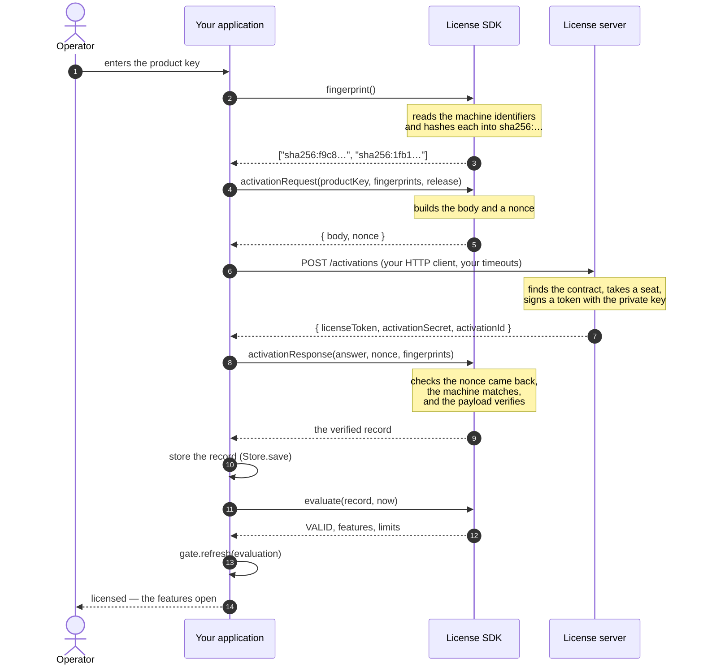
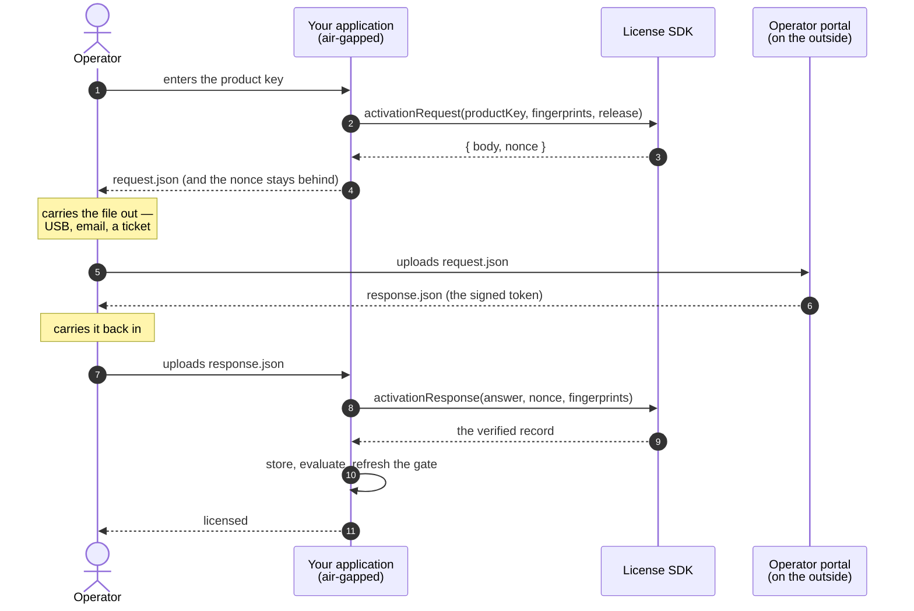
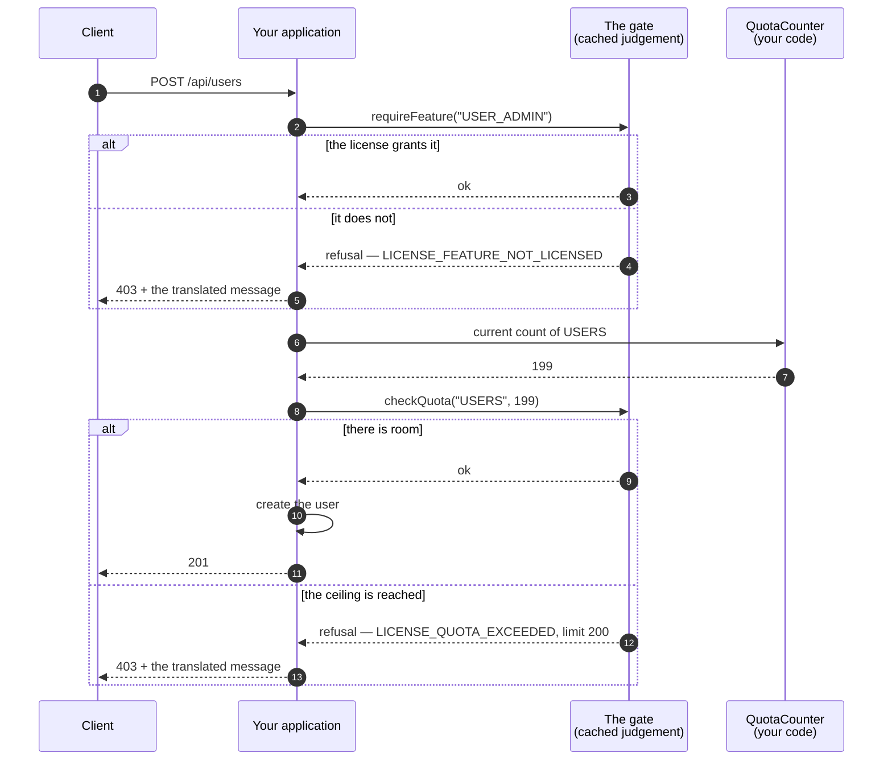
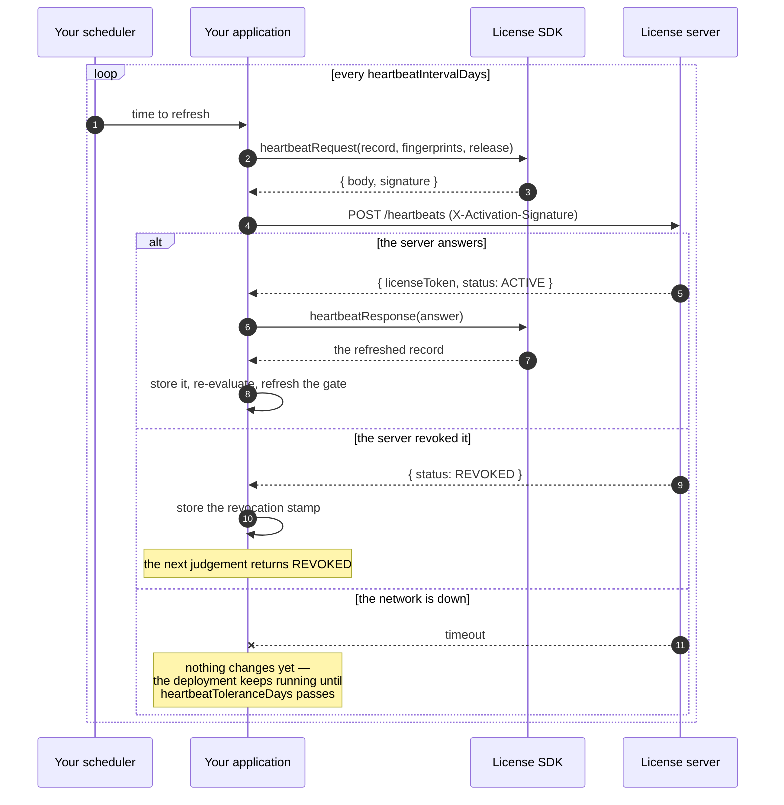
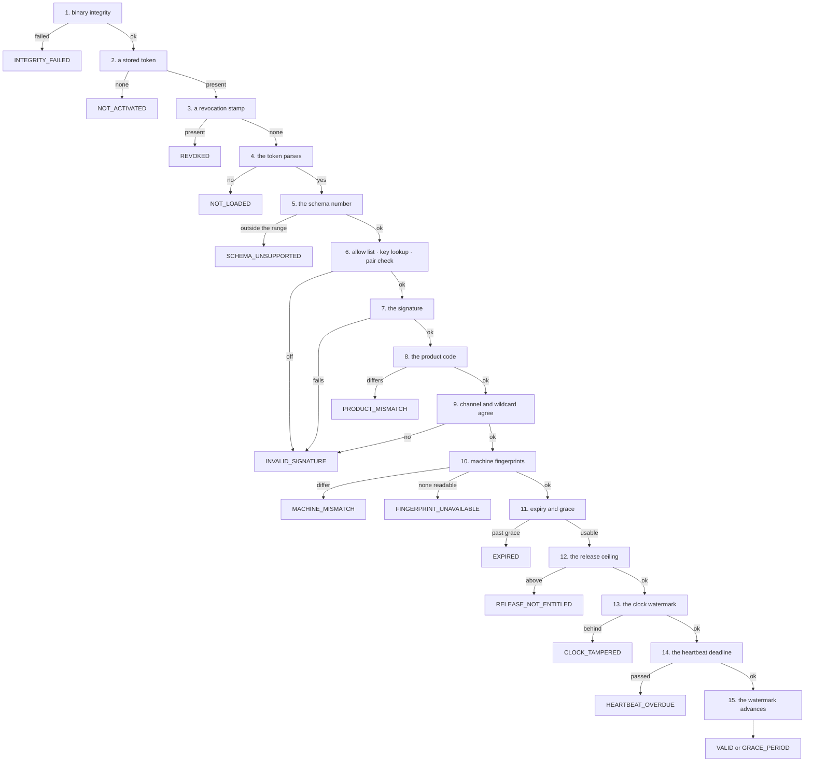
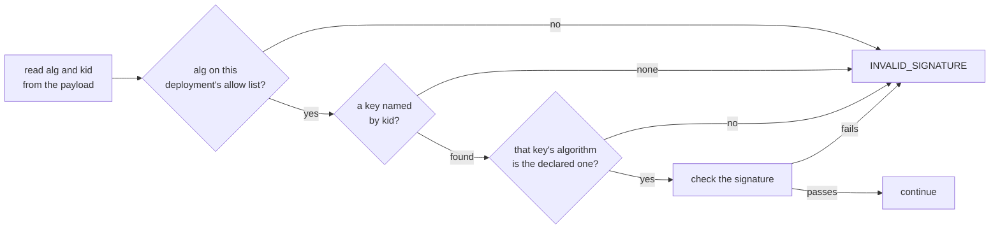

# Concepts

One core owns the license format and the judgement. Every binding hands it what your application
knows and reads back what your application may do. Nothing about a license is decided twice.


## What the core owns, and what your application owns

| The core | Your application |
| --- | --- |
| The payload format and the schema number | Storing and loading the record (JPA, a file, a registry) |
| Signing and verifying | The current instant |
| Collecting machine identifiers, and matching them | HTTP transport, retries, timeouts |
| Expiry, the grace period, per-channel relaxations | Running the heartbeat on a schedule |
| The heartbeat deadline | Where the gate is attached |
| Deciding a clock was rolled back | Hashing its own binary |
| Product code and release-ceiling checks | Recording audit rows |
| Refusal statuses, and their message keys and arguments | Translating the messages |
| Writing activation and heartbeat bodies, and reading the answers | |

Binary integrity is yours alone because what to hash differs per language: a jar hash, an
executable hash, and a wheel hash are not obtained the same way. You measure and pass the result
in, and the core places it in the same order as every other check.

## The token

```
base64url(payload).base64url(signature)
```

The signature covers the payload bytes as transmitted, and those exact bytes travel in the
token. A verifier never re-serializes anything, so the format needs no canonical JSON form and a
language whose JSON writer orders keys differently cannot break a signature.

Decoded, a payload looks like this:

```json
{
  "schemaVersion": 2,
  "alg": "Ed25519",
  "kid": "acps-2026-01",
  "licenseId": "lic_7f3a",
  "activationId": "act_91c2",
  "customerId": "cus_0042",
  "customer": "Riverside Hospital",
  "channel": "PRODUCTION",
  "productCode": "ACCESSCORE_PACS",
  "maxRelease": "3.2",
  "tierLabel": "Enterprise",
  "issuedAt": "2026-07-25T00:00:00Z",
  "activatedAt": "2026-07-25T00:00:00Z",
  "expiresAt": "2027-07-25T00:00:00Z",
  "gracePeriodDays": 30,
  "machineFingerprints": ["sha256:f9c8…", "sha256:1fb1…"],
  "features": ["ATTENDANCE", "VISITOR"],
  "limits": { "USERS": 200, "READER_PORTS": 0 },
  "heartbeatRequired": true,
  "heartbeatIntervalDays": 7,
  "heartbeatToleranceDays": 21
}
```

Everything your application gates on is in there: `features` is the list, `limits` is the
ceilings, and `expiresAt` plus `gracePeriodDays` is how long it lasts.

A perpetual sale carries no `expiresAt` at all, and a license without one never expires — the
expiry and grace checks are skipped and nothing else about the judgement changes. What such a
license stops receiving is new releases, and that ceiling is `maxRelease`.

## Activation, step by step

A deployment starts unlicensed. An operator types a product key, and this happens:



Two things are worth reading twice. **The SDK never opens a socket** — step 6 is your HTTP
client, with your timeouts, your proxy, and your retry policy. And **the nonce** in step 3 comes
back in step 8: a reply captured from an earlier activation cannot be replayed at this one.

After the first activation, every later request is signed with the activation secret, carried in
`X-Activation-Signature` as base64 HMAC-SHA256 over the body bytes as sent.

## Activation without a network

A deployment behind an air gap runs the same functions with a file where the socket was:



The nonce never leaves the deployment, so the answer is bound to the request that asked for it.
Nothing in this path is a different code path — the same two functions run, and only the
transport changed.

## What happens on every request

The gate is what your application calls, and it does not call the core:



The gate reads a cached judgement, so a request costs a map lookup rather than a signature
verification. You decide when the cache is replaced — at start, after an activation, after a
heartbeat, and on whatever schedule you keep.

A quota with no entry in the payload is unlimited; an entry of zero is zero. A license issued
before a quota code existed must not read as forbidding everything under it.

## The heartbeat

When `heartbeatRequired` is set, a deployment has to check in. What it buys is revocation: a
license the server withdrew stops working within the tolerance rather than at expiry.



Tolerance is deliberately larger than the interval. A site whose uplink is down for a weekend
keeps working; one that has not checked in for three weeks does not.

## The judgement

Fifteen checks in one order. The first that fails decides the status:



The order is the design. The schema number is read before the signature: a format this
deployment cannot read is not worth computing a signature over. The product code sits right
after the signature and before the machine binding — if the token belongs to another product,
whether the machine matches is not a question worth asking.

### One schema written, a range read

This build issues under `SCHEMA_VERSION` alone and reads every schema from
`MIN_READABLE_SCHEMA_VERSION` up to it. Accepting only its own number would mean that the moment
a product upgrades the SDK, every license it has already sold is refused — and on a closed
network there is no reissuing them.

A schema bump may therefore only **add optional fields or relax a constraint**. Removing a field,
making an optional one required, or reinterpreting an existing value is not a bump: it is raising
the floor, which is the same act as invalidating every license below it, and it belongs to a
major release that says so.

When the schema rises, a verifier carrying an older SDK cannot read the new tokens. **The
verifying side upgrades first, and only then does the issuing side start writing the new
schema.**

## Statuses

| Status | Meaning | Usable | What an operator should do |
| --- | --- | --- | --- |
| `VALID` | every check passed | ● | nothing |
| `GRACE_PERIOD` | expired, inside the grace period | ● | renew before the grace period ends |
| `RELEASE_NOT_ENTITLED` | above the contract ceiling | ● | extend the contract, or roll back the release |
| `EXPIRED` | past the grace period | ○ | renew and re-activate |
| `INVALID_SIGNATURE` | signature, algorithm, or a production wildcard | ○ | the license is not for this build — reissue |
| `MACHINE_MISMATCH` | stamped for other machines | ○ | move the seat on the license server |
| `FINGERPRINT_UNAVAILABLE` | not one identifier could be read | ○ | mount the host identifiers into the container |
| `NOT_ACTIVATED` | nothing registered | ○ | activate with a product key |
| `NOT_LOADED` | a token that cannot be read | ○ | the stored record is damaged — re-activate |
| `SCHEMA_UNSUPPORTED` | a schema this build does not read | ○ | upgrade the deployment, or have it reissued |
| `REVOKED` | the server revoked it | ○ | ask the vendor why |
| `CLOCK_TAMPERED` | the clock moved back past the watermark | ○ | fix the clock |
| `INTEGRITY_FAILED` | the binary is not what it should be | ○ | reinstall from a trusted build |
| `HEARTBEAT_OVERDUE` | a required refresh did not arrive | ○ | restore the connection, or refresh by hand |
| `PRODUCT_MISMATCH` | another product's license | ○ | register the right license |
| `SIGNING_KEY_COMPROMISED` | signed by a key that is in someone else's hands, and asking for more than was already held | ○ | take a release carrying the issuer's current signing key |

`RELEASE_NOT_ENTITLED` stays usable on purpose. A ceiling that closed the state gate would stop
access control at the door; what it costs instead is the feature list, which comes back empty.

`SIGNING_KEY_COMPROMISED` is the one status the judgement above never reaches on its own. A
deployment carrying a key whose signing half is known to be in someone else's hands measures what
a token signed under it grants against what that deployment already held, and refuses one that
asks for more. The record it measures against is the host's; the judgement is not given it.

## Machine binding

Each hardware identifier is hashed on its own into `sha256:<hex>`, and the list travels in the
payload.

| Platform | What is read |
| --- | --- |
| Linux | `/sys/class/dmi/id/product_uuid`, `product_serial`, `/etc/machine-id` |
| macOS | `IOPlatformUUID` |
| Windows | `MachineGuid` under `HKLM\SOFTWARE\Microsoft\Cryptography` |

Matching is by intersection, and the threshold is measured against what was **collected**:

```
matched = |collected ∩ stamped|
passes when  matched ≥ 1  and  matched ≥ ceil(|collected| / 2)
```

| Situation | Collected | Matched | Verdict |
| --- | --- | --- | --- |
| Redeployed without the DMI mount | 1 | 1 | pass |
| Mainboard replaced | 3 | 2 | pass |
| Only the machine-id copied elsewhere | 3 | 1 | refuse |
| Nothing readable | 0 | 0 | `FINGERPRINT_UNAVAILABLE` |

Measuring against the stamped count instead would leave an environment that reads fewer
identifiers no way to pass at all. MAC addresses are not used: `--mac-address` sets one to
whatever a caller likes.

In a container the Linux identifiers have to be mounted read-only from the host:

```
-v /sys/class/dmi/id:/sys/class/dmi/id:ro -v /etc/machine-id:/etc/machine-id:ro
```

Without those mounts a container reads nothing, and the status is `FINGERPRINT_UNAVAILABLE`
rather than a mismatch — the deployment is told the identifiers are missing, not that the
license is wrong.

## Signatures and keys

Issuance uses Ed25519 — a 64-byte signature and a 32-byte public key keep a hand-carried token
short and make embedding the verification key cost nothing. Verification also reads RSA-4096
PSS, so a customer who must keep the private key in a hardware module is served without touching
a deployed verifier.

`alg` names the algorithm and `kid` names the key. Both sit under the signature, so changing
either breaks it — but only if the checks run in this order:



The allow-list check and the pairing check are what close algorithm confusion. Without them, a
token could declare a weak algorithm and be verified under it.

A `kid` is `<family>-<year>-<serial>`, for example `acps-2026-01` — an ordered name an operator
reads against the ledger, not a random one. A deployment may carry several keys at once, which
is what makes a rotation possible:

```mermaid
sequenceDiagram
    autonumber
    participant Old as Deployment on the old build
    participant New as Deployment on the new build
    participant Srv as License server

    Note over Old,New: both builds ship acps-2026-01;<br/>the new build also ships acps-2027-01
    Srv->>Old: tokens signed with acps-2026-01
    Note over Old: verifies — the only key it has
    Srv->>New: tokens signed with acps-2026-01
    Note over New: verifies — kid picks the old key

    Note over Srv: once every deployment is on the new build
    Srv->>New: tokens signed with acps-2027-01
    Note over New: verifies — kid picks the new key
    Srv--xOld: an old build cannot read these
```

The verification key is fixed in the deployment's binary. A path a deployment could redirect
would let a customer verify a license they minted themselves, and at that moment the signature
check defends nothing. Rotation is a rebuild.

## The gate

```
gate.state()                     the cached judgement
gate.requireFeature(key)         refuse when the license does not grant it
gate.checkQuota(code, current)   refuse when the ceiling is passed
gate.refresh(evaluation)         replace the cache with a fresh judgement
```

Where each one belongs:

| Call | Where it goes | What it costs |
| --- | --- | --- |
| `state()` | a status screen, a health endpoint | a read |
| `requireFeature` | the entry of a feature's controller or service | a list lookup |
| `checkQuota` | just before creating the thing being counted | a map lookup |
| `refresh` | after activation, after a heartbeat, on a schedule | one full judgement |

## What the SDK does not decide

- **The ledger, the catalogue, the back office** — the issuing server owns them. The SDK knows
  only the shape of what was issued.
- **Product vocabulary** — feature keys and quota codes are your product's constants. The SDK
  carries them as free strings.
- **Wording** — the SDK returns message keys and arguments; you translate them. Every key is in
  [messages.md](messages.md).
- **Binary integrity** — you measure, the SDK places the answer in order.
