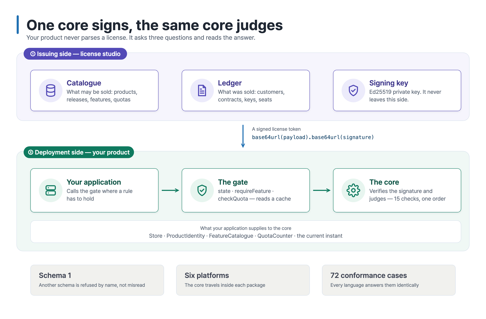
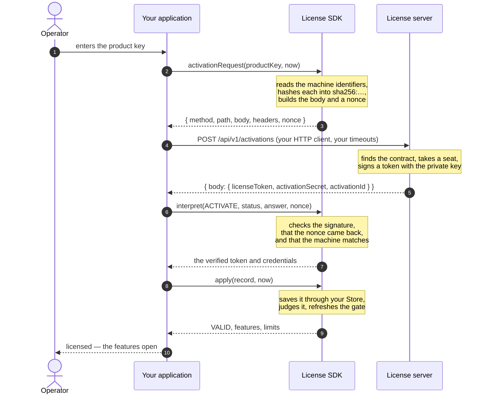
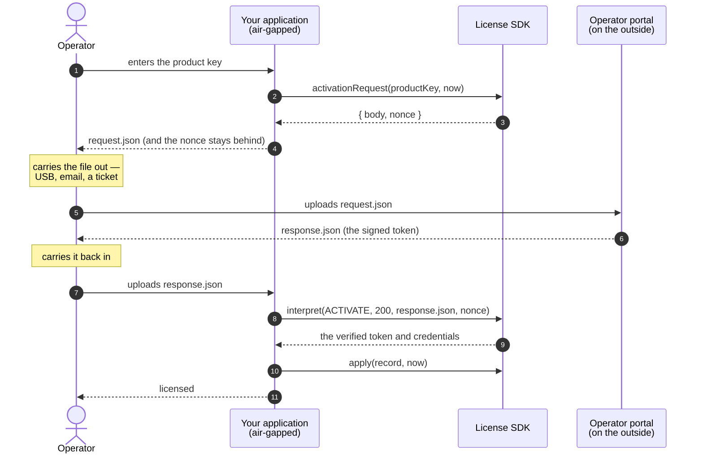
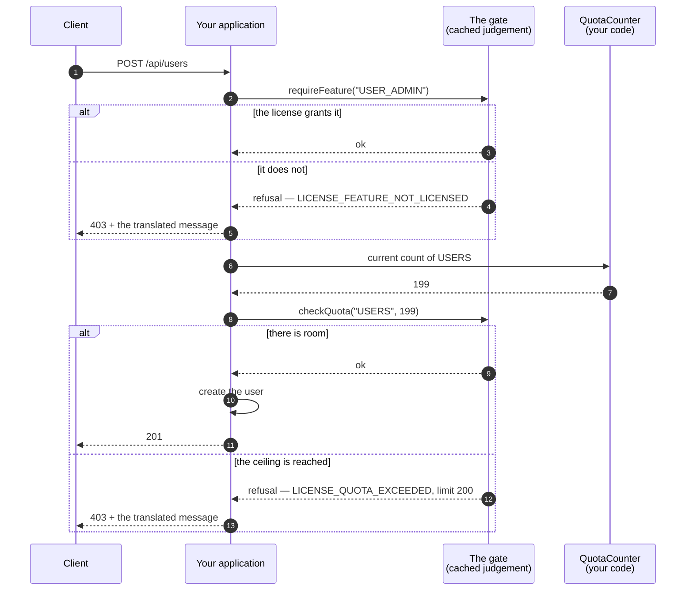
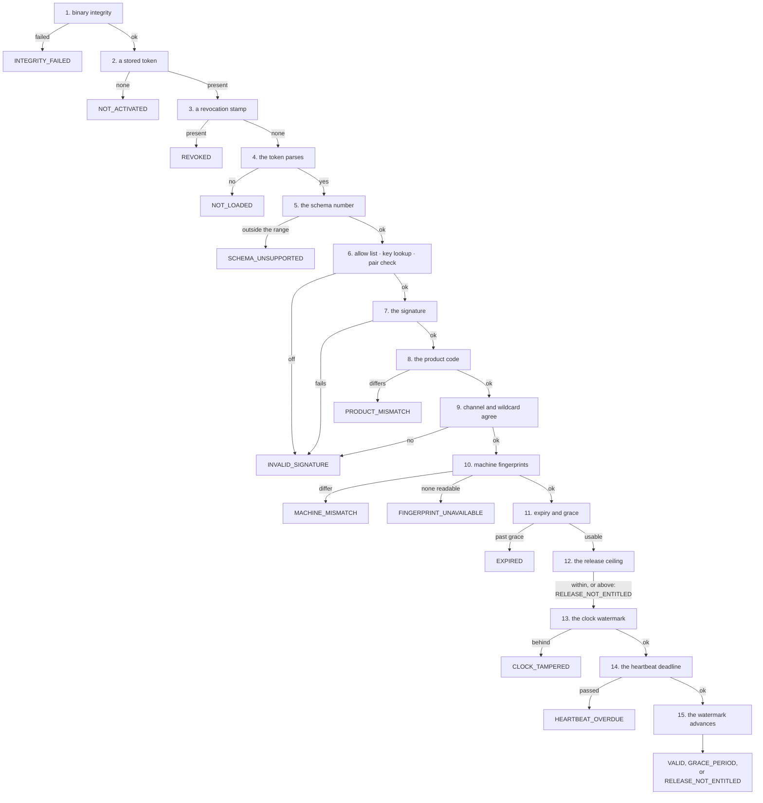
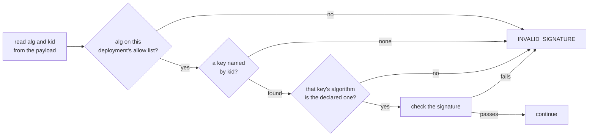

# Concepts

One core owns the license format and the judgement. Every binding hands it what your application
knows and reads back what your application may do. Nothing about a license is decided twice.



## What the core owns, and what your application owns

| The core | Your application |
| --- | --- |
| The payload format and the schema number | Storing and loading the record (JPA, a file, a registry) |
| Signing and verifying | The current instant |
| Collecting machine identifiers, and matching them | HTTP transport, retries, timeouts |
| Expiry, the grace period, per-channel relaxations | Running re-verification and the heartbeat on a schedule |
| The heartbeat deadline | Where the gate is attached |
| Deciding a clock was rolled back | Hashing its own binary |
| Product code and release-ceiling checks | Recording audit rows |
| Refusal statuses, and their message keys and arguments | Translating the messages |
| Writing activation and heartbeat bodies, and reading the answers | |

Binary integrity is yours alone because what to hash differs per language: a jar hash, an
executable hash, and a wheel hash are not obtained the same way. You measure and pass the result
in, and the core places it in the same order as every other check.

## The token

```
base64url(payload).base64url(signature)
```

The signature covers the payload bytes as transmitted, and those exact bytes travel in the
token. A verifier never re-serializes anything, so the format needs no canonical JSON form and a
language whose JSON writer orders keys differently cannot break a signature.

Decoded, a payload looks like this:

```json
{
  "schemaVersion": 2,
  "alg": "Ed25519",
  "kid": "acps-2026-01",
  "licenseId": "lic_7f3a",
  "activationId": "act_91c2",
  "customerId": "cus_0042",
  "customer": "Riverside Hospital",
  "channel": "PRODUCTION",
  "productCode": "ACCESSCORE_PACS",
  "maxRelease": "3.2",
  "tierLabel": "Enterprise",
  "issuedAt": "2026-07-25T00:00:00Z",
  "activatedAt": "2026-07-25T00:00:00Z",
  "expiresAt": "2027-07-25T00:00:00Z",
  "gracePeriodDays": 30,
  "machineFingerprints": ["sha256:f9c8…", "sha256:1fb1…"],
  "features": ["ATTENDANCE", "VISITOR"],
  "limits": { "USERS": 200, "READER_PORTS": 0 },
  "heartbeatRequired": true,
  "heartbeatIntervalHours": 1,
  "heartbeatToleranceHours": 3,
  "metadata": {}
}
```

Everything your application gates on is in there: `features` is the list, `limits` is the
ceilings, and `expiresAt` plus `gracePeriodDays` is how long it lasts.

A perpetual sale carries no `expiresAt` at all, and a license without one never expires — the
expiry and grace checks are skipped and nothing else about the judgement changes. What such a
license stops receiving is new releases, and that ceiling is `maxRelease`.

A token without `channel` is read as `PRODUCTION`. The channel changes two checks. The grace
period applies only to `PRODUCTION`: a `DEV` license stops at `expiresAt`. The wildcard
fingerprint `"*"`, which matches any machine, is accepted only on `DEV`; a `PRODUCTION` token
carrying it is refused as `INVALID_SIGNATURE`.

## Activation, step by step

A deployment starts unlicensed. An operator types a product key, and this happens:



Two things are worth reading twice. **The SDK never opens a socket** — step 4 is your HTTP
client, with your timeouts, your proxy, and your retry policy. And **the nonce** from step 3 has
to come back inside the signed token, which step 6 checks: a reply captured from an earlier
activation cannot be replayed at this one.

`interpret` does not throw on a refusal; it returns an outcome that names the reason. An HTTP
202 means the server is holding the activation for an operator (`PENDING_APPROVAL`). A refusal
names its reason in `errorDetail.reason` (`APPROVAL_DENIED` when an operator refused the
activation), or is read from the status: 404 is
`UNKNOWN_PRODUCT_KEY`, 409 `SEAT_EXHAUSTED`, 403 `SUSPENDED`, 410 `REVOKED`. An answer whose
signature, nonce, or machine does not check out is `INVALID_SIGNATURE`, `NONCE_MISMATCH`, or
`FINGERPRINT_MISMATCH`.

After the first activation, every later request is signed with the activation secret, carried in
`X-Activation-Signature` as base64 HMAC-SHA256 over the body bytes as sent.

## Activation without a network

A deployment behind an air gap runs the same functions with a file where the socket was:



The nonce never leaves the deployment, so the answer is bound to the request that asked for it.
Nothing in this path is a different code path — the same two functions run, and only the
transport changed.

## What happens on every request

The gate is what your application calls, and it does not call the core:



The gate reads a cached judgement, so a request costs a map lookup rather than a signature
verification. You decide when the cache is replaced — at start, after an activation, after a
heartbeat, and on whatever schedule you keep. A scheduled re-verification is required, for a
license that needs no heartbeat too: a judgement is made at the instant the caller gives it, so
when the end date, the grace period, or the heartbeat deadline passes, the gate keeps answering
with the earlier judgement until the next one.

A quota with no entry in the payload is unlimited; an entry of zero is zero. A license issued
before a quota code existed must not read as forbidding everything under it.

## The heartbeat

When `heartbeatRequired` is set, a deployment has to check in. What it buys is revocation: a
license the server withdrew stops working within the tolerance rather than at expiry.

```mermaid
sequenceDiagram
    autonumber
    participant Sch as Your scheduler
    participant App as Your application
    participant SDK as License SDK
    participant Srv as License server

    loop every heartbeatIntervalHours
        Sch->>App: time to refresh
        App->>SDK: heartbeatRequest(now)
        SDK-->>App: { method, path, body, headers, nonce }
        App->>Srv: POST /api/v1/activations/{activationId}/heartbeat<br/>(X-Activation-Signature in the headers)

        alt the server answers 2xx
            Srv-->>App: { body: { licenseToken } }
            App->>SDK: interpret(HEARTBEAT, status, answer, nonce)
            SDK-->>App: the verified token
            App->>SDK: apply(record with the new token and lastHeartbeatAt, now)
            Note over SDK: saves it, judges it, refreshes the gate
        else the server revoked it
            Srv-->>App: 410, or errorDetail.reason REVOKED
            App->>SDK: interpret(…) returns REVOKED
            App->>SDK: markRevoked(now)
            Note over SDK: stores the revocation stamp;<br/>the judgement returns REVOKED
        else the network is down
            Srv--xApp: timeout
            Note over App: nothing changes yet —<br/>the deployment keeps running until<br/>the heartbeat window passes
        end
    end
```

Both windows are counted in hours. The deadline is the last successful heartbeat plus the wider
of the tolerance and the interval; before the first heartbeat it is counted from `activatedAt`.
The SDK does not record a heartbeat by itself: the record you pass to `apply` carries
`lastHeartbeatAt`. A judgement exactly at the deadline still passes. Tolerance is deliberately larger than the interval: a license with a
one-hour interval and a three-hour tolerance keeps working through two failed refreshes, and only
a deployment that has not checked in for three hours stops.

A token carrying zero is read with defaults: one hour for the interval, 24 hours for the
tolerance. That covers an issuer that set no window, and a token issued by 1.0.x, whose fields
were days and are no longer read. A deployment holding a 1.0.x token keeps working if a heartbeat succeeds within 24
hours of its last one, because that heartbeat returns a new token.

## The judgement

Fifteen checks in one order. Up to step 11, the first that fails decides the status. Step 12
does not stop the judgement: a release above the ceiling turns the status into
`RELEASE_NOT_ENTITLED`, and steps 13 and 14 still run and can replace it.



The order is the design. The schema number is read before the signature: a format this
deployment cannot read is not worth computing a signature over. The product code sits right
after the signature and before the machine binding — if the token belongs to another product,
whether the machine matches is not a question worth asking.

Steps 13 and 14 run only when step 11 left a usable status, so an expired license is settled
without consulting a clock or a heartbeat. Step 13 refuses only a clock more than one hour
behind the watermark; ordinary drift passes. Step 15 is reached only by a usable judgement, and
it moves the watermark forward, never back.

### One range written and read

This build reads every schema from `MIN_READABLE_SCHEMA_VERSION` (1) up to `SCHEMA_VERSION` (2),
and issues across the same range. Accepting only its own number would mean that the moment a
product upgrades the SDK, every license it has already sold is refused — and on a closed network
there is no reissuing them. Issuing across the range lets one issuer serve products that embed
different SDKs. Schema 1 has no way to say a license never expires, so a schema-1 payload needs
`expiresAt`.

A schema bump may therefore only **add optional fields or relax a constraint**. Removing a field,
making an optional one required, or reinterpreting an existing value is not a bump: it is raising
the floor, which is the same act as invalidating every license below it, and it belongs to a
major release that says so.

When the schema rises, a verifier carrying an older SDK cannot read the new tokens. **The
verifying side upgrades first, and only then does the issuing side start writing the new
schema.**

1.1.0 is an exception to this rule. It replaced `heartbeatIntervalDays` and
`heartbeatToleranceDays` with `heartbeatIntervalHours` and `heartbeatToleranceHours` and gave
zero a meaning, while staying on schema 2 in a minor release. The day fields are no longer read,
so a 1.0.x token is judged with the defaults in [The heartbeat](#the-heartbeat). The order runs
the same way as a schema bump: a 1.0.x verifier reading a 1.1.0 token finds no day fields, puts
the deadline at the last heartbeat itself, and refuses with `HEARTBEAT_OVERDUE`. **Upgrade every
deployment that verifies to 1.1.0 before the issuing server.** Until the issuing server moves,
the tokens it returns still carry day fields, so an upgraded deployment reads them with the
defaults: a heartbeat has to succeed at least every 24 hours, whatever tolerance the license
was sold with.

## Statuses

| Status | Meaning | Usable | What an operator should do |
| --- | --- | --- | --- |
| `VALID` | every check passed | ● | nothing |
| `GRACE_PERIOD` | expired, inside the grace period | ● | renew before the grace period ends |
| `RELEASE_NOT_ENTITLED` | above the contract ceiling | ● | extend the contract, or roll back the release |
| `EXPIRED` | past the grace period | ○ | renew and re-activate |
| `INVALID_SIGNATURE` | signature, algorithm, key, or a production wildcard | ○ | the license is not for this build — reissue |
| `MACHINE_MISMATCH` | stamped for other machines | ○ | move the seat on the license server |
| `FINGERPRINT_UNAVAILABLE` | not one identifier could be read | ○ | mount the host identifiers into the container |
| `NOT_ACTIVATED` | nothing registered | ○ | activate with a product key |
| `NOT_LOADED` | a token that cannot be read | ○ | the stored record is damaged — re-activate |
| `SCHEMA_UNSUPPORTED` | a schema this build does not read | ○ | upgrade the deployment, or have it reissued |
| `REVOKED` | the server revoked it | ○ | ask the vendor why |
| `CLOCK_TAMPERED` | the clock is more than an hour behind the watermark | ○ | fix the clock |
| `INTEGRITY_FAILED` | the binary is not what it should be | ○ | reinstall from a trusted build |
| `HEARTBEAT_OVERDUE` | a required refresh did not arrive | ○ | restore the connection, or refresh by hand |
| `PRODUCT_MISMATCH` | another product's license | ○ | register the right license |
| `SIGNING_KEY_COMPROMISED` | signed by a key that is in someone else's hands, and asking for more than was already held | ○ | take a release carrying the issuer's current signing key |

`RELEASE_NOT_ENTITLED` stays usable on purpose. A ceiling that closed the state gate would stop
access control at the door; what it costs instead is the feature list, which comes back empty.
The limits stay as the license sold them: a quota with no entry is unlimited, so emptying them
would lift every ceiling. In this status the gate's `requireFeature` refuses with
`LICENSE_RELEASE_NOT_ENTITLED`, carrying the running release and the contract ceiling rather than
the feature. A refusal naming the feature sends the operator to the license's feature list, where
the feature is present and the cause is not.

`SIGNING_KEY_COMPROMISED` is the one status the judgement above never reaches on its own. A
deployment carrying a key whose signing half is known to be in someone else's hands measures what
a token signed under it grants against what that deployment already held, and refuses one that
asks for more. The record it measures against is the host's; the judgement is not given it. The steps are in
each language's manual, under "A compromised signing key".

## Machine binding

Each hardware identifier is hashed on its own into `sha256:<hex>`, and the list travels in the
payload.

| Platform | What is read |
| --- | --- |
| Linux | `/sys/class/dmi/id/product_uuid`, `product_serial`, `/etc/machine-id` |
| macOS | `IOPlatformUUID` |
| Windows | `MachineGuid` under `HKLM\SOFTWARE\Microsoft\Cryptography` |

Matching is by intersection, and the threshold is measured against what was **collected**:

```
matched = |collected ∩ stamped|
passes when  matched ≥ 1  and  matched ≥ ceil(|collected| / 2)
```

| Situation | Collected | Matched | Verdict |
| --- | --- | --- | --- |
| Redeployed without the DMI mount | 1 | 1 | pass |
| Mainboard replaced | 3 | 2 | pass |
| Only the machine-id copied elsewhere | 3 | 1 | refuse |
| Nothing readable | 0 | 0 | `FINGERPRINT_UNAVAILABLE` |

Each identifier is trimmed and lowercased before it is hashed. Firmware placeholders such as
`To be filled by O.E.M.` and the all-zero UUID are dropped, and duplicates count once.

Measuring against the stamped count instead would leave an environment that reads fewer
identifiers no way to pass at all. MAC addresses are not used: `--mac-address` sets one to
whatever a caller likes.

In a container the Linux identifiers have to be mounted read-only from the host:

```
-v /sys/class/dmi/id:/sys/class/dmi/id:ro -v /etc/machine-id:/etc/machine-id:ro
```

Without those mounts a container reads nothing, and the status is `FINGERPRINT_UNAVAILABLE`
rather than a mismatch — the deployment is told the identifiers are missing, not that the
license is wrong.

## Signatures and keys

Issuance uses Ed25519 by default — a 64-byte signature and a 32-byte public key keep a
hand-carried token short and make embedding the verification key cost nothing. RSA-PSS with
SHA-256 (`RSA-PSS-SHA256`) is the other algorithm, so a customer who must keep the private key
in a hardware module is served without touching a deployed verifier. An RSA key must be 3072
bits or more; the SDK generates 4096-bit keys.

`alg` names the algorithm and `kid` names the key. Both sit under the signature, so changing
either breaks it — but only if the checks run in this order:



The allow-list check and the pairing check are what close algorithm confusion. Without them, a
token could declare a weak algorithm and be verified under it.

A `kid` is `<family>-<year>-<serial>`, for example `acps-2026-01` — an ordered name an operator
reads against the ledger, not a random one. The family is lowercase letters and digits, the year
four digits, and the serial digits that keep their written width: `-01` and `-1` are different
keys. A deployment may carry several keys at once, which
is what makes a rotation possible:

```mermaid
sequenceDiagram
    autonumber
    participant Old as Deployment on the old build
    participant New as Deployment on the new build
    participant Srv as License server

    Note over Old,New: both builds ship acps-2026-01;<br/>the new build also ships acps-2027-01
    Srv->>Old: tokens signed with acps-2026-01
    Note over Old: verifies — the only key it has
    Srv->>New: tokens signed with acps-2026-01
    Note over New: verifies — kid picks the old key

    Note over Srv: once every deployment is on the new build
    Srv->>New: tokens signed with acps-2027-01
    Note over New: verifies — kid picks the new key
    Srv--xOld: an old build cannot read these
```

The verification key is fixed in the deployment's binary. A path a deployment could redirect
would let a customer verify a license they minted themselves, and at that moment the signature
check defends nothing. Rotation is a rebuild.

## Product keys and release ceilings

A product key is `<PREFIX>-XXXXX-XXXXX-XXXXX-XXXXX-XXXXX`. The prefix names a product family:
two to eight capital letters or digits. The groups use an alphabet without `I`, `L`, `O`, and
`U`, and the last group is a checksum over the rest, so a typo is caught where it is typed.

A release ceiling is compared segment by segment. A missing segment counts as zero, so `3.2`
and `3.2.0` are the same release, and `3.2.1` is above a ceiling of `3.2`. Numeric segments
compare as numbers, so `3.10` is above `3.2`; anything else compares as text, which puts
`3.2.0-rc1` above `3.2.0`. An absent or blank ceiling is no ceiling.

## The gate

```
gate.state()                     the cached judgement
gate.requireFeature(key)         refuse when the license does not grant it
gate.checkQuota(code, current)   refuse when the ceiling is passed
gate.refresh(evaluation)         replace the cache with a fresh judgement
```

Where each one belongs:

| Call | Where it goes | What it costs |
| --- | --- | --- |
| `state()` | a status screen, a health endpoint | a read |
| `requireFeature` | the entry of a feature's controller or service | a list lookup |
| `checkQuota` | just before creating the thing being counted | a map lookup |
| `refresh` | after activation, after a heartbeat, on a re-verification schedule (required, heartbeat or not) | one full judgement |

## What the SDK does not decide

- **The ledger, the catalogue, the back office** — the issuing server owns them. The SDK knows
  only the shape of what was issued.
- **Product vocabulary** — feature keys and quota codes are your product's constants. The SDK
  carries them as free strings.
- **Wording** — the SDK returns message keys and arguments; you translate them. Every key is in
  [messages.md](messages.md).
- **Binary integrity** — you measure, the SDK places the answer in order.
