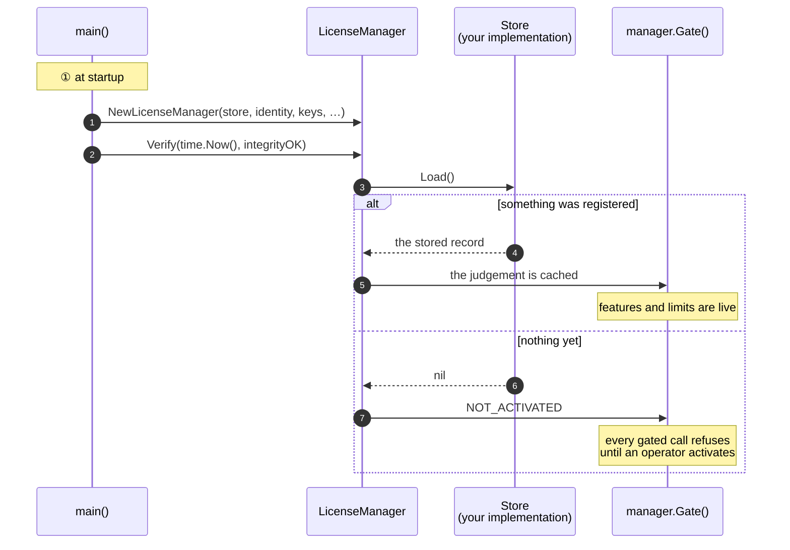
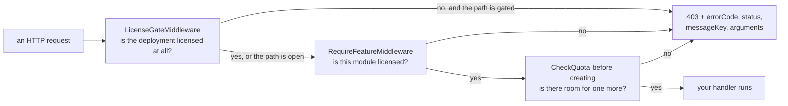

# Go

## What you are going to build

Three things, in this order: wire the SDK at startup, give an operator a way to activate, and
put the gate where a rule has to hold.



## Taking it

The module needs Go 1.22 or later.

```
go get github.com/accesscore-dev/accesscore-license-sdk-dist/packages/go@v1.2.0
```

```go
import aclic "github.com/accesscore-dev/accesscore-license-sdk-dist/packages/go"
```

The core is linked statically, so a Go binary carries it rather than needing a shared library
installed beside it. cgo is required; `CGO_ENABLED=0` will not build. The module carries cores
for linux amd64 and arm64, darwin amd64 and arm64, and windows amd64. It carries no musl core, so
Alpine and other musl systems are not supported.

## What a product has to supply

Interfaces in the package. Only the first two are required, along with the verification keys.

| Interface | What it answers |
| --- | --- |
| `Store` | reading and writing the registration |
| `ProductIdentity` | which product this is, and which release |
| `FeatureCatalogue` | the feature keys this deployment gates on |
| `QuotaCounter` | the current count per quota code |
| `FeatureActivationChecker` | whether an administrator switched a feature on |
| `AuditRecorder` | where license events are recorded |
| `ActivationServerDirectory` | where the activation server is |

`FeatureActivationChecker` is given to the gate, not to the manager:
`aclic.WithGate(aclic.NewGateWithActivation(checker.IsEffectivelyActive))`.
`ActivationServerDirectory` is given with `aclic.WithDirectory(directory)`; `ServerURL()` then
prefers the address it returns over the configured one.

## Assembling it

```go
manager := aclic.NewLicenseManager(
    store,
    identity,
    []aclic.KeyMaterial{{Kid: "acps-2026-01", PublicKey: publicKeyPEM}},
    aclic.WithCatalogue(catalogue),
    aclic.WithCounter(userCounter),
    aclic.WithAudit(auditRecorder),
    aclic.WithConfiguredServerURL(config.LicenseServerURL),
    aclic.WithInstanceID(config.InstanceID),
)

if _, err := manager.Verify(time.Now(), integrityOK); err != nil {
    return err
}
```

`Verify` takes the instant and the integrity result from the caller. The core reads no clock,
and what to hash for an integrity check differs per language. Its error means the core could
not be called; a refusal is the `Status` of the evaluation it returns.

## Activating from your own endpoint

The SDK builds the request and reads the answer; the HTTP call is yours, with your timeouts and
your transport.

```go
var httpClient = &http.Client{Timeout: 20 * time.Second}

func activate(writer http.ResponseWriter, request *http.Request) {
    var form struct{ ProductKey string `json:"productKey"` }
    if err := json.NewDecoder(request.Body).Decode(&form); err != nil {
        http.Error(writer, "bad request", http.StatusBadRequest)
        return
    }

    now := time.Now()
    activation, err := manager.ActivationRequest(form.ProductKey, now)
    if err != nil {
        http.Error(writer, err.Error(), http.StatusInternalServerError)
        return
    }

    status, body, reachable := send(request.Context(), manager.ServerURL(), activation)
    outcome, err := manager.Interpret("ACTIVATE", status, body, activation.Nonce, reachable) // nonce checked here
    if err != nil {
        http.Error(writer, err.Error(), http.StatusInternalServerError)
        return
    }
    if !outcome.Success {
        writer.Header().Set("Content-Type", "application/json")
        writer.WriteHeader(http.StatusBadRequest)
        json.NewEncoder(writer).Encode(map[string]string{
            "error": outcome.Error, "messageKey": outcome.MessageKey,
        })
        return
    }

    evaluation, err := manager.Apply(&aclic.RegistrationRecord{
        ProductKey:       form.ProductKey,
        LicenseToken:     outcome.Result.LicenseToken,
        ActivationID:     outcome.Result.ActivationID,
        ActivationSecret: outcome.Result.ActivationSecret,
        InstanceID:       config.InstanceID,
    }, now, integrityOK)
    if err != nil {
        http.Error(writer, err.Error(), http.StatusInternalServerError)
        return
    }

    json.NewEncoder(writer).Encode(evaluation)
}

// send posts a prepared request exactly as written. reachable is false when no answer arrived.
func send(ctx context.Context, server string, prepared *aclic.PreparedRequest) (int, string, bool) {
    request, err := http.NewRequestWithContext(ctx, prepared.Method, server+prepared.Path,
        strings.NewReader(prepared.Body))
    if err != nil {
        return 0, "", false
    }
    for name, value := range prepared.Headers {
        request.Header.Set(name, value)
    }
    response, err := httpClient.Do(request)
    if err != nil {
        return 0, "", false
    }
    defer response.Body.Close()
    body, err := io.ReadAll(response.Body)
    if err != nil {
        return 0, "", false
    }
    return response.StatusCode, string(body), true
}
```

`ActivationRequest` returns a `*PreparedRequest` with `Method`, `Path`, `Body`, `Headers`, and
`Nonce`. Send `Body` as it is: it is already JSON, and the signature covers those bytes.

`Interpret` returns an error only when the core cannot be called. A refusal is an outcome with
`Success: false`, `Error`, and `MessageKey`: `NONCE_MISMATCH`, `FINGERPRINT_MISMATCH`, or
`INVALID_SIGNATURE` for an answer whose nonce, machine, or signature does not check out, so a
captured reply from another deployment cannot be replayed here. The server's own refusals and
`PENDING_APPROVAL` are listed in [concepts.md](concepts.md#activation-step-by-step). `Apply`
saves the record through your `Store` and judges it.

## Enforcing it

```go
// Every request, while the deployment is unlicensed.
handler := aclic.LicenseGateMiddleware(manager.Gate(), []string{"/license", "/activations"})(mux)

// One feature.
protected := aclic.RequireFeatureMiddleware(manager.Gate(), "ATTENDANCE")(attendanceHandler)

// One ceiling, before adding.
if err := manager.CheckQuota("USERS"); err != nil {
    aclic.WriteDenial(writer, err)
    return
}
```

gin, echo, and fiber are reached through `GinLicenseGate`, `EchoLicenseGate`, and
`FiberLicenseGate`, so this module depends on none of them. Each takes a small interface
(`GinContext`, `EchoContext`, `FiberContext`) rather than the framework's own context, and the
framework contexts do not satisfy those interfaces as they are: `*gin.Context` holds `Writer`
and `Request` as fields, echo's `Response()` returns `*echo.Response`, and fiber's `Path` and
`Status` have other signatures. A product writes a wrapper that adapts its context:

```go
type ginContext struct{ c *gin.Context }

func (g ginContext) Writer() http.ResponseWriter { return g.c.Writer }
func (g ginContext) Request() *http.Request      { return g.c.Request }
func (g ginContext) Abort()                      { g.c.Abort() }
func (g ginContext) Next()                       { g.c.Next() }

licenseGate := aclic.GinLicenseGate(manager.Gate(), []string{"/license"})
router.Use(func(c *gin.Context) { licenseGate(ginContext{c}) })
```

`EchoLicenseGate` writes nothing. It returns the `*LicenseDenied`, and the product's echo error
handler writes it with `WriteDenial`; echo's default handler would answer 500.

Which paths stay open while unlicensed is the product's decision: a deployment has to reach its
own license screen in order to stop being unlicensed.

Where each call sits:



## Turning a refusal into a response

A refusal is a `*LicenseDenied` carrying `Status`, `ErrorCode`, `Denial`, and `HTTPStatus`.
`WriteDenial` writes the document every adapter writes: `errorCode`, `status`, `messageKey`,
and `arguments`, untranslated. It writes nothing and returns `false` for any other error. A
product with its own response shape reads the fields and renders its own:

```go
var denied *aclic.LicenseDenied
if errors.As(err, &denied) {
    message := translate(request.Context(), denied.Denial.MessageKey, denied.Denial.Arguments)
    respond(writer, denied.HTTPStatus, denied.ErrorCode, message)
    return
}
```

A request that `LicenseGateMiddleware`, `GinLicenseGate`, or `FiberLicenseGate` refuses never
reaches this code: it gets the body `WriteDenial` wrote, which carries the message key and its
arguments only. For a refused request to carry the sentence too, put your own middleware that
calls `gate.RequireUsable()` in place of the adapter and build the response with the code above.

Message keys and their argument order: [messages.md](messages.md).

## Keeping it fresh

A judgement is made at the instant `verify` is given, and the gate answers with the last one it
was handed. When the end date, the grace period, or the heartbeat deadline passes, the gate keeps
letting requests through on the earlier judgement until the next one. So the scheduled work is two
jobs.

Re-verification runs for every license. It calls `verify(now)` on a schedule so the time that has
passed reaches the gate, for a license that needs no heartbeat too, and while heartbeats keep
failing.

The heartbeat runs only for a license with `heartbeatRequired` set. The SDK writes the request and
reads the answer; the schedule and the transport are yours.

```go
// Re-verification: every license. Brings the time that has passed to the gate.
func reverifyLicense() error {
    _, err := manager.Verify(time.Now(), integrityOK)
    return err
}

// Heartbeat: only a license that requires one.
func sendHeartbeat(ctx context.Context) error {
    state := manager.Gate().State()
    if state.Payload == nil || !state.Payload.HeartbeatRequired {
        return nil
    }

    now := time.Now()
    beat, err := manager.HeartbeatRequest(now)
    if err != nil {
        return err
    }

    // X-Activation-Signature is in beat.Headers.
    status, body, reachable := send(ctx, manager.ServerURL(), beat)
    if !reachable {
        return nil // the license stays usable until the heartbeat window passes
    }

    outcome, err := manager.Interpret("HEARTBEAT", status, body, beat.Nonce, true)
    if err != nil {
        return err
    }
    switch {
    case outcome.Success:
        record := store.Load()
        record.LicenseToken = outcome.Result.LicenseToken
        record.LastHeartbeatAt = now.UTC().Format(time.RFC3339)
        _, err = manager.Apply(record, now, integrityOK)
    case outcome.Error == "REVOKED":
        _, err = manager.MarkRevoked(now, integrityOK)
    }
    return err
}
```

A heartbeat answer carries a new token but not the activation secret, so keep the stored record
and replace only `LicenseToken`. The SDK does not record when a heartbeat succeeded: the record
you store sets `LastHeartbeatAt`, and the deadline is measured from it, or from `activatedAt`
before the first heartbeat.

A failed heartbeat is not an error the deployment has to act on immediately. The license stays
usable until the heartbeat window passes, which is the larger of `heartbeatToleranceHours` and
`heartbeatIntervalHours`, read as 24 and 1 when the token carries zero. Log it and let the next
run try again. Once the window passes, re-verification turns the judgement into `HEARTBEAT_OVERDUE`.

The re-verification interval is the longest a passed deadline may go unenforced: on a 30-minute
interval, a license whose end date or heartbeat deadline has passed keeps its earlier judgement for
up to 30 minutes.

## A compromised signing key

When an issuer marks a signing key as compromised, the verification key list built into a
customer's product carries that key with `compromised: true`. Taking the key out of the list
would refuse every license signed under it as `INVALID_SIGNATURE`, including the ones issued
properly before the compromise. Keep the key registered, and refuse with `SIGNING_KEY_COMPROMISED`
only a token signed under it that asks for more than the deployment already held.

The judgement does not make this comparison, because what it compares against is a record the
application keeps. `KeyMaterial` carries no compromise mark; the application keeps the `kid` of
each compromised key itself. The steps:

1. On the first judgement after a compromised key is registered, store what the deployment holds
   at that moment. When the judgement is usable, store its features, limits, expiry, and release
   ceiling; when it is not, store that nothing was held. Store this once and never change it.
2. Each time `Verify`, `Apply`, or `MarkRevoked` returns a judgement, check whether the payload's `kid` is a compromised key.
3. When a token signed under a compromised key asks for more than what was stored, build a
   `SIGNING_KEY_COMPROMISED` judgement and hand it to the gate.

A token asks for more in four ways: a feature that was not stored; a limit that was capped when
stored and is now higher or missing (a missing limit is unlimited); an expiry later than the
stored one, or none; a release ceiling higher than the stored one, or none. When nothing was held,
every token signed under that key is refused. Compare release ceilings with the `WITHIN_CEILING` operation of `aclic.Shared.Release`: compared
as text, `3.10` ranks below `3.9`.

```go
judged, err := manager.Verify(now, integrityOK)
if err != nil {
    return err
}
if judged.Payload != nil && compromisedKeyIDs[judged.Payload.Kid] &&
    !ceiling.Covers(judged.Payload) { // against what step 1 stored
    manager.Gate().Refresh(&aclic.Evaluation{
        Status:            "SIGNING_KEY_COMPROMISED",
        ErrorCode:         "LICENSE_SIGNING_KEY_COMPROMISED",
        Denial:            &aclic.Denial{MessageKey: "error.license.signingKeyCompromised", Arguments: []any{}},
        NextWatermark:     judged.NextWatermark,
        AvailableFeatures: []string{},
        Limits:            map[string]int64{},
        GraceExpiresAt:    judged.GraceExpiresAt,
        HeartbeatDeadline: judged.HeartbeatDeadline,
        Payload:           judged.Payload,
    })
}
```

An application that uses this status has to translate `error.license.signingKeyCompromised`. The
keys are listed in [messages.md](messages.md).

## The record and the other calls

The `Store` keeps one `RegistrationRecord` per deployment:

| Field | What it holds | Written by |
| --- | --- | --- |
| `ProductKey` | the key the operator typed | your activation code |
| `LicenseToken` | the signed token | your activation and heartbeat code, through `Apply` |
| `ActivationID`, `ActivationSecret` | the credentials a heartbeat and a release are signed with | your activation code |
| `InstanceID` | this installation's identifier | your activation code |
| `LastHeartbeatAt` | the last successful heartbeat | your heartbeat code |
| `VerificationWatermark` | the latest instant a judgement accepted | the manager, after each judgement |
| `RevokedAt` | the revocation stamp | `MarkRevoked` |

Three more calls complete the lifecycle. `DeactivationRequest(now)` writes the request that
hands the seat back; read its answer with `Interpret("DEACTIVATE", …)`. `MarkRevoked(now, …)`
stores a revocation stamp and judges again. `ClearRegistration(now, …)` discards the record and
returns the deployment to `NOT_ACTIVATED`.

## The core directly

Anything the manager does not wrap is one call away:

```go
var answer map[string]any
if err := aclic.Shared.Release(map[string]any{
    "operation": "WITHIN_CEILING", "version": "3.2.0", "other": "3.2",
}, &answer); err != nil {
    return err
}
```

## Before you ship

- [ ] `CGO_ENABLED=1` in every build that produces a release binary.
- [ ] The verification key is compiled in, not read from a configurable path.
- [ ] The prefixes that stay open while unlicensed reach your license screen and nothing else.
- [ ] Every message key in [messages.md](messages.md) has a translation in every locale you ship.
- [ ] A container mounts the host machine identifiers read-only. Without them activation fails
      with `FINGERPRINT_MISMATCH`, and a stored license is judged `FINGERPRINT_UNAVAILABLE`.
