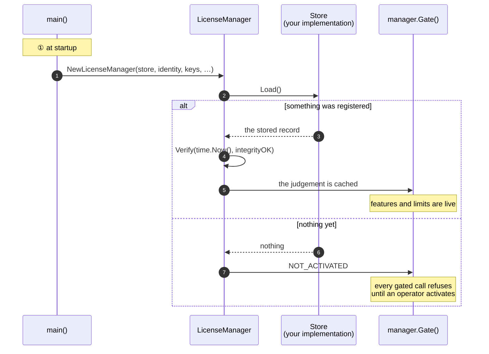
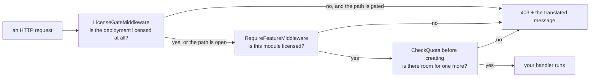

# Go

## What you are going to build

Three things, in this order: wire the SDK at startup, give an operator a way to activate, and
put the gate where a rule has to hold.



## Taking it

```
go get github.com/accesscore-dev/accesscore-license-sdk-dist/packages/go@v1.0.6
```

The core is linked statically, so a Go binary carries it rather than needing a shared library
installed beside it. cgo is required; `CGO_ENABLED=0` will not build.

## What a product has to supply

Interfaces in the package. Only the first two are required, along with the verification keys.

| Interface | What it answers |
| --- | --- |
| `Store` | reading and writing the registration |
| `ProductIdentity` | which product this is, and which release |
| `FeatureCatalogue` | the feature keys this deployment gates on |
| `QuotaCounter` | the current count per quota code |
| `FeatureActivationChecker` | whether an administrator switched a feature on |
| `AuditRecorder` | where license events are recorded |
| `ActivationServerDirectory` | where the activation server is |

## Assembling it

```go
manager := aclic.NewLicenseManager(
    store,
    identity,
    []aclic.KeyMaterial{{Kid: "acps-2026-01", PublicKey: publicKeyPEM}},
    aclic.WithCatalogue(catalogue),
    aclic.WithCounter(userCounter),
    aclic.WithAudit(auditRecorder),
    aclic.WithConfiguredServerURL(config.LicenseServerURL),
    aclic.WithInstanceID(config.InstanceID),
)

if _, err := manager.Verify(time.Now(), integrityOK); err != nil {
    return err
}
```

`Verify` takes the instant and the integrity result from the caller. The core reads no clock,
and what to hash for an integrity check differs per language.

## Activating from your own endpoint

The SDK builds the body and reads the answer; the HTTP call is yours, with your timeouts and
your transport.

```go
func activate(writer http.ResponseWriter, request *http.Request) {
    var form struct{ ProductKey string `json:"productKey"` }
    if err := json.NewDecoder(request.Body).Decode(&form); err != nil {
        http.Error(writer, "bad request", http.StatusBadRequest)
        return
    }

    activation, err := manager.ActivationRequest(form.ProductKey)
    if err != nil {
        aclic.WriteDenial(writer, err)
        return
    }

    answer, err := postJSON(request.Context(),
        manager.ActivationServerURL()+"/api/activations", activation.Body)
    if err != nil {
        http.Error(writer, "the license server did not answer", http.StatusBadGateway)
        return
    }

    record, err := manager.ActivationResponse(answer, activation)   // nonce checked here
    if err != nil {
        aclic.WriteDenial(writer, err)
        return
    }
    if err := manager.Store(record); err != nil {
        http.Error(writer, "could not store the license", http.StatusInternalServerError)
        return
    }
    if _, err := manager.Verify(time.Now(), integrityOK); err != nil {
        aclic.WriteDenial(writer, err)
        return
    }

    json.NewEncoder(writer).Encode(manager.Gate().State())
}
```

`ActivationResponse` refuses an answer whose nonce does not match the request, whose machine
fingerprints do not match this host, or whose payload does not verify — so a captured reply from
another deployment cannot be replayed here.

## Enforcing it

```go
// Every request, while the deployment is unlicensed.
handler := aclic.LicenseGateMiddleware(manager.Gate(), []string{"/license", "/activations"})(mux)

// One feature.
protected := aclic.RequireFeatureMiddleware(manager.Gate(), "ATTENDANCE")(attendanceHandler)

// One ceiling, before adding.
if err := manager.CheckQuota("USERS"); err != nil {
    aclic.WriteDenial(writer, err)
    return
}
```

gin, echo, and fiber are reached through `GinLicenseGate`, `EchoLicenseGate`, and
`FiberLicenseGate`. Each takes a small interface their context already satisfies, so this module
depends on none of them and a product wires the one it uses in three lines.

Which paths stay open while unlicensed is the product's decision: a deployment has to reach its
own license screen in order to stop being unlicensed.



## Turning a refusal into a response

A refusal is a `*LicenseDenied` carrying `Status`, `ErrorCode`, `Denial`, and `HTTPStatus`.
`WriteDenial` writes the document every adapter writes; a product with its own response shape
reads the fields and renders its own:

```go
var denied *aclic.LicenseDenied
if errors.As(err, &denied) {
    message := translate(request.Context(), denied.Denial.MessageKey, denied.Denial.Arguments)
    respond(writer, denied.HTTPStatus, denied.ErrorCode, message)
    return
}
```

Message keys and their argument order: [messages.md](messages.md).

## Keeping it fresh

A license that requires a heartbeat needs a scheduled refresh. The SDK writes the body and reads
the answer; the schedule and the transport are yours.

```go
func refreshLicense(ctx context.Context) error {
    if !manager.Gate().State().HeartbeatRequired {
        return nil
    }

    beat, err := manager.HeartbeatRequest()
    if err != nil {
        return err
    }

    answer, err := postSigned(ctx,
        manager.ActivationServerURL()+"/api/heartbeats", beat.Body, beat.Signature)
    if err != nil {
        return err   // the license stays usable until the tolerance passes
    }

    record, err := manager.HeartbeatResponse(answer)
    if err != nil {
        return err
    }
    if err := manager.Store(record); err != nil {
        return err
    }
    _, err = manager.Verify(time.Now(), integrityOK)
    return err
}
```

A failed heartbeat is not an error the deployment has to act on immediately — the license stays
usable until `heartbeatToleranceDays` passes. Log it and let the next run try again.

## The core directly

Anything the manager does not wrap is one call away:

```go
var answer map[string]any
if err := aclic.Shared.Release(map[string]any{
    "operation": "WITHIN_CEILING", "version": "3.2.0", "other": "3.2",
}, &answer); err != nil {
    return err
}
```

## Before you ship

- [ ] `CGO_ENABLED=1` in every build that produces a release binary.
- [ ] The verification key is compiled in, not read from a configurable path.
- [ ] The prefixes that stay open while unlicensed reach your license screen and nothing else.
- [ ] Every message key in [messages.md](messages.md) has a translation in every locale you ship.
- [ ] A container mounts the host machine identifiers read-only, or activation fails with
      `FINGERPRINT_UNAVAILABLE`.
