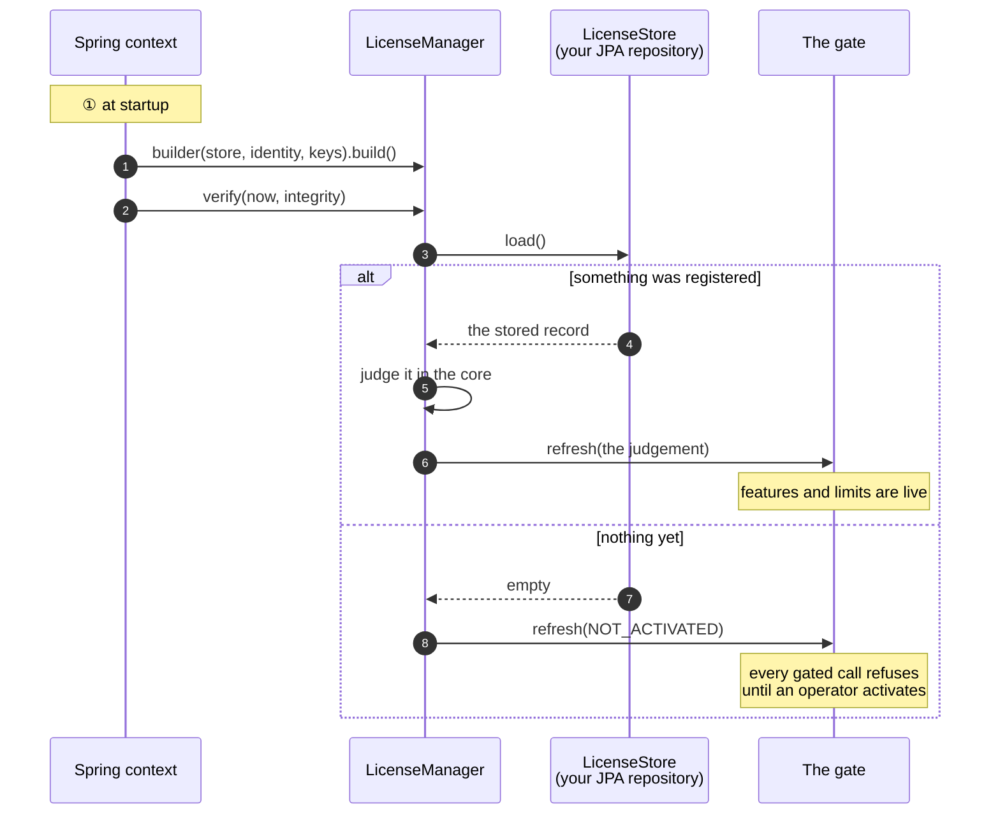
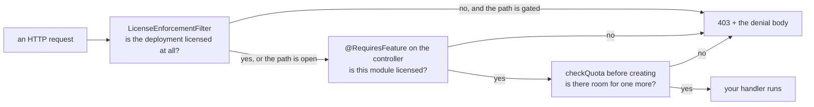

# Java

## What you are going to build

Three things, in this order: wire the SDK at startup, give an operator a way to activate, and
put the gate where a rule has to hold.



## Taking it

```groovy
repositories {
    maven {
        url = uri('https://maven.pkg.github.com/accesscore-dev/accesscore-license-sdk-dist')
        credentials {
            username = providers.gradleProperty('gpr.user').orElse(providers.environmentVariable('GITHUB_USERNAME')).get()
            password = providers.gradleProperty('gpr.token').orElse(providers.environmentVariable('GITHUB_TOKEN')).get()
        }
        content { includeGroup 'dev.accesscore' }
    }
}

dependencies {
    implementation 'dev.accesscore:license-sdk:1.2.0'
}
```

### The token

The GitHub Packages registry asks every consumer to authenticate, public package or not. Create
a classic token with the `read:packages` scope — and nothing else — at
<https://github.com/settings/tokens/new?scopes=read:packages&description=accesscore-license-sdk>.

Keep it out of the build file. Either `~/.gradle/gradle.properties`:

```properties
gpr.user=your-github-username
gpr.token=ghp_xxxxxxxxxxxxxxxxxxxx
```

or the environment:

```
export GITHUB_USERNAME=your-github-username
export GITHUB_TOKEN=ghp_xxxxxxxxxxxxxxxxxxxx
```

In CI, the workflow's own `GITHUB_TOKEN` already carries `read:packages`.

### Maven

```xml
<repositories>
  <repository>
    <id>accesscore</id>
    <url>https://maven.pkg.github.com/accesscore-dev/accesscore-license-sdk-dist</url>
  </repository>
</repositories>

<dependency>
  <groupId>dev.accesscore</groupId>
  <artifactId>license-sdk</artifactId>
  <version>1.2.0</version>
</dependency>
```

with the credentials in `~/.m2/settings.xml`:

```xml
<servers>
  <server>
    <id>accesscore</id>
    <username>your-github-username</username>
    <password>ghp_xxxxxxxxxxxxxxxxxxxx</password>
  </server>
</servers>
```

The native core travels inside the jar, one directory per platform, and is extracted to a
temporary file the first time it is needed. A deployment whose policy fixes where a shared
library may come from names one with `-Daclic.native.library=<path>`; it names a file to load,
never a key to trust, so it cannot weaken any check.

The jar needs Java 17 or later. JNA and Jackson come with it. Spring, Jakarta Servlet, JAX-RS,
Reactor, and AspectJ are compile-only: the adapters for them work when your application already
has them on the classpath, and the SDK does not bring them in.

## What a product has to supply

Seven interfaces, all on `LicenseSpi`, plus the verification keys. The builder requires
`LicenseStore`, `ProductIdentity`, and the keys; the other five are optional.

| Interface | What it answers | Typical implementation |
| --- | --- | --- |
| `LicenseStore` | reading and writing the registration | a one-row JPA entity, or a file under the data directory |
| `ProductIdentity` | which product this is, and which release | constants plus the build's version |
| — the verification keys | passed to the builder | a PEM on the classpath, read at start |
| `FeatureCatalogue` | the feature keys this deployment gates on | an enum of your product's features |
| `QuotaCounter` | the current count per quota code | `repository.count()` per code |
| `FeatureActivationChecker` | whether an administrator switched a feature on | your settings table |
| `AuditRecorder` | where license events are recorded | an audit table |
| `ActivationServerDirectory` | where the activation server is | a settings row an operator fills in |

Those three are required because without them the core cannot answer at all: it has nowhere
to read the license from, no product to compare against, and no key to verify with.

## Assembling it

```java
@Configuration
@EnableAspectJAutoProxy
class LicenseConfig {

    @Bean
    LicenseManager licenseManager(LicenseStore store,
                                  ProductIdentity identity,
                                  FeatureCatalogue catalogue,
                                  List<QuotaCounter> counters,
                                  AuditRecorder audit,
                                  LicenseProperties properties) throws IOException {

        String publicKeyPem = new String(
                new ClassPathResource("license-public-key.pem").getInputStream().readAllBytes(),
                StandardCharsets.UTF_8);

        LicenseManager.Builder builder = LicenseManager
                .builder(store, identity, List.of(KeyMaterial.of("acps-2026-01", publicKeyPem)))
                .catalogue(catalogue)
                .audit(audit)
                .configuredServerUrl(properties.getServerUrl())
                .instanceId(properties.getInstanceId());

        counters.forEach(builder::counter);
        return builder.build();
    }

    @Bean
    FeatureGateAspect featureGateAspect(LicenseManager manager) {
        return new FeatureGateAspect(manager.gate());
    }

    @Bean
    ApplicationRunner licenseAtStartup(LicenseManager manager, IntegrityChecker integrity) {
        return args -> manager.verify(Instant.now(), integrity.verify());
    }
}
```

`verify` takes the instant and the integrity result from the caller. The core reads no clock,
and what to hash for an integrity check differs per language. `LicenseProperties` and
`IntegrityChecker` are your own classes; the SDK reads no configuration properties.

`@RequiresFeature` does nothing until `FeatureGateAspect` is a bean and AspectJ proxying is on,
through `@EnableAspectJAutoProxy` or Spring Boot's AOP starter.

The two optional interfaces the sample leaves out are wired like this. A
`FeatureActivationChecker` goes into the gate, not the builder:

```java
LicenseManager.builder(store, identity, keys)
        .gate(new LicenseGate(activationChecker))   // FeatureActivationChecker
        .directory(serverDirectory)                 // ActivationServerDirectory
        .build();
```

Register more than one key when a rotation is in flight — the token's `kid` picks which applies:

```java
List.of(KeyMaterial.of("acps-2026-01", currentKeyPem),
        KeyMaterial.of("acps-2027-01", incomingKeyPem))
```

## Activating from your own endpoint

The SDK builds the body and reads the answer; the HTTP call is yours, with your timeouts and
your proxy.

```java
@PostMapping("/license/activate")
public ActivationView activate(@RequestBody @Validated ActivationForm form) {
    Instant now = Instant.now();
    PreparedRequest request = manager.activationRequest(form.productKey(), now);

    ActivationOutcome outcome = send(ActivationOperation.ACTIVATE, request);   // nonce checked here
    if (!outcome.isSuccess()) {
        return ActivationView.refused(outcome.error(), outcome.messageKey());
    }

    ActivationSuccess issued = outcome.result();
    manager.apply(new RegistrationRecord(form.productKey(), issued.licenseToken(),
                    issued.activationId(), issued.activationSecret(), null, null, null, null),
            now, integrity.verify());                                         // the gate refreshes
    return ActivationView.of(manager.gate().state());
}

ActivationOutcome send(ActivationOperation operation, PreparedRequest request) {
    try {
        return restClient.method(HttpMethod.valueOf(request.method()))
                .uri(manager.serverUrl() + request.path())
                .headers(headers -> request.headers().forEach(headers::set))
                .body(request.body())
                .exchange((req, res) -> manager.interpret(operation,
                        res.getStatusCode().value(), res.bodyTo(String.class),
                        request.nonce(), true));
    } catch (ResourceAccessException unreachable) {
        return manager.interpret(operation, 0, "", request.nonce(), false);
    }
}
```

`PreparedRequest` carries the method, the path under the server address, the body as a string,
the headers, and the nonce. Send the body and the headers exactly as they are: a heartbeat is
signed over those bytes.

`interpret` checks the token's signature, the nonce, and this host's machine fingerprints before
anything is stored, so a captured reply from another deployment cannot be replayed here. It does
not throw on a refusal: it returns a failed `ActivationOutcome` whose `error()` names the reason,
such as `INVALID_SIGNATURE`, `NONCE_MISMATCH`, `FINGERPRINT_MISMATCH`, or `SEAT_EXHAUSTED`.
`PENDING_APPROVAL` means the server is holding the activation until an operator approves it:
show it as a state and ask again later. `APPROVAL_DENIED` means an operator refused it, and
asking again changes nothing. The other reasons the server can name are listed in
[concepts.md](concepts.md#activation-step-by-step).

Some reasons only the host can see, and the core never returns them. Check them at the top of
`activate`, before `activationRequest`, and refuse with the reason's own message key:

```java
if (manager.serverUrl().isEmpty()) {
    return ActivationView.refused(ActivationError.NOT_CONFIGURED,
            ActivationError.NOT_CONFIGURED.messageKey());
}
if (!manager.fingerprint().isAvailable()) {
    return ActivationView.refused(ActivationError.FINGERPRINT_UNAVAILABLE,
            ActivationError.FINGERPRINT_UNAVAILABLE.messageKey());
}
```

`NOT_ACTIVATED` (no `hasActivationCredentials()` to refresh or release with) and
`ALREADY_REGISTERED` are the same kind of check.

## Enforcing it

```java
// Every request, while the deployment is unlicensed.
new LicenseEnforcementFilter(manager.gate(), List.of("/license/**", "/activations/**"), mapper)

// One feature.
@RequiresFeature(PacsFeatures.ATTENDANCE)
public class AttendanceRestController { }

// One ceiling, before adding.
manager.checkQuota(PacsQuotas.USERS);
```

Which paths stay open while unlicensed is the product's decision: a deployment has to reach its
own license screen in order to stop being unlicensed, and only the product knows where it is.

Where each call belongs:



## Turning a refusal into a response

`LicenseDeniedException` carries a status, an error code, a message key, and its arguments.
A refusal thrown inside a controller or a service (`@RequiresFeature`, `checkQuota`) is shaped by
one handler:

```java
@ExceptionHandler(LicenseDeniedException.class)
public ResponseEntity<ApiResponse<Void>> handle(LicenseDeniedException denied, Locale locale) {
    String message = messageSource.getMessage(
            denied.denial().messageKey(), denied.denial().argumentArray(), locale);
    return ResponseEntity.status(denied.httpStatus())
            .body(ApiResponse.error(denied.errorCode(), message));
}
```

`LicenseEnforcementFilter` never reaches this handler. It runs before Spring MVC's exception
handling and writes the refusal itself, and by default that body carries the message key and its
arguments only. Hand the filter a `DenialMessages` for the body to carry the sentence as well: the
filter calls it with the request's locale and writes what it returns as `message`.

```java
DenialMessages messages = (denied, locale) -> messageSource.getMessage(
        denied.denial().messageKey(), denied.denial().argumentArray(),
        denied.denial().messageKey(), locale);

new LicenseEnforcementFilter(manager.gate(), List.of("/license/**", "/activations/**"),
        mapper, messages)
```

`LicenseEnforcementWebFilter` (WebFlux) and `LicenseEnforcementRequestFilter` (Jakarta REST) take
the same argument. The filter's refusal does not pass through the response shape this handler
sets, so the two refusals differ in shape: branch on `errorCode`, which both carry.

Message keys and their argument order: [messages.md](messages.md).

## Keeping it fresh

A judgement is made at the instant `verify` is given, and the gate answers with the last one it
was handed. When the end date, the grace period, or the heartbeat deadline passes, the gate keeps
letting requests through on the earlier judgement until the next one. So the scheduled work is two
jobs.

Re-verification runs for every license. It calls `verify(now)` on a schedule so the time that has
passed reaches the gate, for a license that needs no heartbeat too, and while heartbeats keep
failing.

The heartbeat runs only for a license with `heartbeatRequired` set. The SDK writes the body and
reads the answer; the schedule and the transport are yours.

```java
// Re-verification: every license. Brings the time that has passed to the gate.
@Scheduled(fixedDelayString = "PT30M", initialDelayString = "PT30M")
void reverifyLicense() {
    manager.verify(Instant.now(), integrity.verify());
}

// Heartbeat: only a license that requires one.
@Scheduled(cron = "0 */30 * * * *")
void sendHeartbeat() {
    LicensePayload payload = manager.gate().state().payload();
    if (payload == null || !Boolean.TRUE.equals(payload.heartbeatRequired())) {
        return;
    }
    Instant now = Instant.now();
    ActivationOutcome outcome = send(ActivationOperation.HEARTBEAT, manager.heartbeatRequest(now));

    if (outcome.isSuccess()) {
        RegistrationRecord record = manager.currentRecord().orElseThrow();
        manager.apply(record.withHeartbeat(outcome.result().licenseToken(), now),
                now, integrity.verify());
    } else if (outcome.error() == ActivationError.REVOKED) {
        manager.markRevoked(now, integrity.verify());
    } else {
        log.warn("License heartbeat failed: {}", outcome.detail());
    }
}
```

`withHeartbeat` replaces the token and records `lastHeartbeatAt`, and the deadline is measured
from that instant (from `activatedAt` before the first heartbeat). A heartbeat answer carries no
activation secret, so keep the stored record and change only those two fields. `markRevoked`
stores the revocation stamp, so the denial outlives a restart.

A failed heartbeat is not an error the deployment has to act on immediately. The license stays
usable until the heartbeat window passes: the larger of `heartbeatToleranceHours` and
`heartbeatIntervalHours`, read as 24 and 1 hours when the license carries zero. Log it and let
the next run try again. Once the window passes, re-verification turns the judgement into `HEARTBEAT_OVERDUE`.

The re-verification interval is the longest a passed deadline may go unenforced: on a 30-minute
interval, a license whose end date or heartbeat deadline has passed keeps its earlier judgement for
up to 30 minutes.

## A compromised signing key

When an issuer marks a signing key as compromised, the verification key list built into a
customer's product carries that key with `compromised: true`. Taking the key out of the list
would refuse every license signed under it as `INVALID_SIGNATURE`, including the ones issued
properly before the compromise. Keep the key registered, and refuse with `SIGNING_KEY_COMPROMISED`
only a token signed under it that asks for more than the deployment already held.

The judgement does not make this comparison, because what it compares against is a record the
application keeps. `KeyMaterial` carries no compromise mark; the application keeps the `kid` of
each compromised key itself. The steps:

1. On the first judgement after a compromised key is registered, store what the deployment holds
   at that moment. When the judgement is usable, store its features, limits, expiry, and release
   ceiling; when it is not, store that nothing was held. Store this once and never change it.
2. Each time `verify`, `apply`, or `markRevoked` returns a judgement, check whether the payload's `kid` is a compromised key.
3. When a token signed under a compromised key asks for more than what was stored, build a
   `SIGNING_KEY_COMPROMISED` judgement and hand it to the gate.

A token asks for more in four ways: a feature that was not stored; a limit that was capped when
stored and is now higher or missing (a missing limit is unlimited); an expiry later than the
stored one, or none; a release ceiling higher than the stored one, or none. When nothing was held,
every token signed under that key is refused. Compare release ceilings with `ReleaseVersions.isWithinCeiling`: compared
as text, `3.10` ranks below `3.9`.

```java
EvaluationResponse judged = manager.verify(now, integrity.verify());
LicensePayload payload = judged.payload();
if (payload != null && compromisedKeyIds.contains(payload.kid())
        && !ceiling.covers(payload)) {          // against what step 1 stored
    manager.gate().refresh(new EvaluationResponse(
            LicenseStatus.SIGNING_KEY_COMPROMISED, false,
            LicenseStatus.SIGNING_KEY_COMPROMISED.errorCode(),
            new Denial("error.license.signingKeyCompromised", List.of()),
            judged.nextWatermark(), List.of(), Map.of(),
            judged.graceExpiresAt(), judged.heartbeatDeadline(), payload));
}
```

An application that uses this status has to translate `error.license.signingKeyCompromised`. The
keys are listed in [messages.md](messages.md).

## Issuing

Only an issuer holds a private key. A deployment has `LicenseIssuer` on its classpath and
nothing to do with it — signing needs a key a customer never holds.

```java
LicenseIssuer issuer = new LicenseIssuer();
byte[] privateKeyPem = Files.readAllBytes(signingKeyPath);

// At start: announce which key pair this server signs with, so a mismatch with what
// deployments carry is a line in a log rather than a customer's first activation failing.
log.info("License signing key fingerprint: {}", issuer.fingerprintOf(privateKeyPem));

// Per activation: the contract, bound to the machines and nonce the request carried.
ActivationBinding binding = objectMapper.readValue(requestBody, ActivationBinding.class);
LicensePayload payload = issuance.boundTo(binding).toPayload(
        Instant.now(), "acps-2026-01", SignatureAlgorithm.ED25519,
        AclicCore.shared().schemaVersion());
SignedToken signed = issuer.sign(payload, privateKeyPem);
```

`issuance` is a `LicenseIssuance`: what the contract decides, from the license id to the
heartbeat. Its last two `int` arguments are `heartbeatIntervalHours` and
`heartbeatToleranceHours`, in hours, and zero leaves the verifier's defaults of one hour and 24
hours. Before 1.1.0 they were days. A caller still passing days compiles unchanged and asks for
hours, so check every call when upgrading.

The key is handed over as PKCS#8 bytes, never a `String`, and wiped from the core's memory as
soon as the signature exists. Whatever copy the caller holds is the caller's to clear.

## Product keys and release versions

Both halves of licensing need these and they have to agree, so every operation crosses to the
core rather than being written a second time in Java.

```java
ProductKeys keys = new ProductKeys();
String key = keys.generate("ACPS");
String shown = keys.masked("ACPS", key);

ReleaseVersions releases = new ReleaseVersions();
boolean entitled = releases.isWithinCeiling("3.2.0", "3.2");
String sortKey = releases.sortKey("3.2");   // for ordering a list in SQL
```

## Before you ship

- [ ] The verification key is a classpath resource, not a configurable path.
- [ ] The paths that stay open while unlicensed reach your license screen and nothing else.
- [ ] Every message key in [messages.md](messages.md) has a translation in every locale you ship.
- [ ] A container mounts the host machine identifiers read-only. Otherwise activation fails
      (`FINGERPRINT_UNAVAILABLE` from your own check, or `FINGERPRINT_MISMATCH`), and a stored
      license is judged `FINGERPRINT_UNAVAILABLE`.
- [ ] The heartbeat runs at least as often as `heartbeatIntervalHours` (one hour when the license
      carries zero), so several runs can fail before the window runs out.
