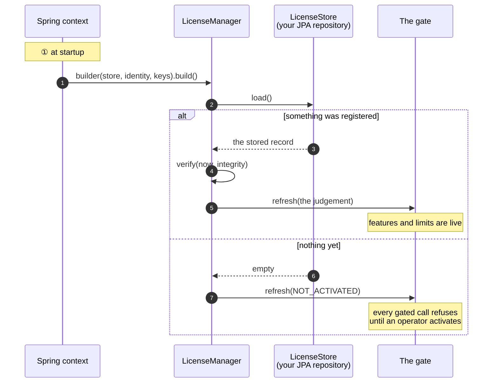
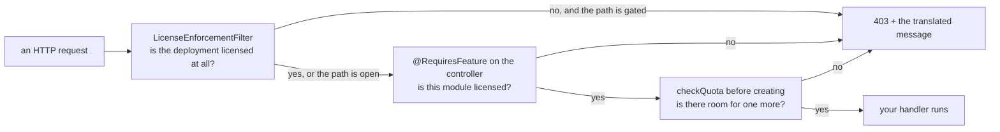

# Java

## What you are going to build

Three things, in this order: wire the SDK at startup, give an operator a way to activate, and
put the gate where a rule has to hold.



## Taking it

```groovy
repositories {
    maven {
        url = uri('https://maven.pkg.github.com/accesscore-dev/accesscore-license-sdk-dist')
        credentials {
            username = providers.gradleProperty('gpr.user').orElse(providers.environmentVariable('GITHUB_USERNAME')).get()
            password = providers.gradleProperty('gpr.token').orElse(providers.environmentVariable('GITHUB_TOKEN')).get()
        }
        content { includeGroup 'dev.accesscore' }
    }
}

dependencies {
    implementation 'dev.accesscore:license-sdk:1.0.3'
}
```

### The token

The GitHub Packages registry asks every consumer to authenticate, public package or not. Create
a classic token with the `read:packages` scope — and nothing else — at
<https://github.com/settings/tokens/new?scopes=read:packages&description=accesscore-license-sdk>.

Keep it out of the build file. Either `~/.gradle/gradle.properties`:

```properties
gpr.user=your-github-username
gpr.token=ghp_xxxxxxxxxxxxxxxxxxxx
```

or the environment:

```
export GITHUB_USERNAME=your-github-username
export GITHUB_TOKEN=ghp_xxxxxxxxxxxxxxxxxxxx
```

In CI, the workflow's own `GITHUB_TOKEN` already carries `read:packages`.

### Maven

```xml
<repositories>
  <repository>
    <id>accesscore</id>
    <url>https://maven.pkg.github.com/accesscore-dev/accesscore-license-sdk-dist</url>
  </repository>
</repositories>

<dependency>
  <groupId>dev.accesscore</groupId>
  <artifactId>license-sdk</artifactId>
  <version>1.0.3</version>
</dependency>
```

with the credentials in `~/.m2/settings.xml`:

```xml
<servers>
  <server>
    <id>accesscore</id>
    <username>your-github-username</username>
    <password>ghp_xxxxxxxxxxxxxxxxxxxx</password>
  </server>
</servers>
```

The native core travels inside the jar, one directory per platform, and is extracted to a
temporary file the first time it is needed. A deployment whose policy fixes where a shared
library may come from names one with `-Daclic.native.library=<path>`; it names a file to load,
never a key to trust, so it cannot weaken any check.

## What a product has to supply

Seven interfaces, all on `LicenseSpi`. Only the first three are required.

| Interface | What it answers | Typical implementation |
| --- | --- | --- |
| `LicenseStore` | reading and writing the registration | a one-row JPA entity, or a file under the data directory |
| `ProductIdentity` | which product this is, and which release | constants plus the build's version |
| — the verification keys | passed to the builder | a PEM on the classpath, read at start |
| `FeatureCatalogue` | the feature keys this deployment gates on | an enum of your product's features |
| `QuotaCounter` | the current count per quota code | `repository.count()` per code |
| `FeatureActivationChecker` | whether an administrator switched a feature on | your settings table |
| `AuditRecorder` | where license events are recorded | an audit table |
| `ActivationServerDirectory` | where the activation server is | a settings row an operator fills in |

The first three are required because without them the core cannot answer at all: it has nowhere
to read the license from, no product to compare against, and no key to verify with.

## Assembling it

```java
@Configuration
class LicenseConfig {

    @Bean
    LicenseManager licenseManager(LicenseStore store,
                                  ProductIdentity identity,
                                  FeatureCatalogue catalogue,
                                  List<QuotaCounter> counters,
                                  AuditRecorder audit,
                                  LicenseProperties properties) throws IOException {

        String publicKeyPem = new String(
                new ClassPathResource("license-public-key.pem").getInputStream().readAllBytes(),
                StandardCharsets.UTF_8);

        LicenseManager.Builder builder = LicenseManager
                .builder(store, identity, List.of(KeyMaterial.of("acps-2026-01", publicKeyPem)))
                .catalogue(catalogue)
                .audit(audit)
                .configuredServerUrl(properties.getServerUrl())
                .instanceId(properties.getInstanceId());

        counters.forEach(builder::counter);
        return builder.build();
    }

    @Bean
    ApplicationRunner licenseAtStartup(LicenseManager manager, IntegrityChecker integrity) {
        return args -> manager.verify(Instant.now(), integrity.verify());
    }
}
```

`verify` takes the instant and the integrity result from the caller. The core reads no clock,
and what to hash for an integrity check differs per language.

Register more than one key when a rotation is in flight — the token's `kid` picks which applies:

```java
List.of(KeyMaterial.of("acps-2026-01", currentKeyPem),
        KeyMaterial.of("acps-2027-01", incomingKeyPem))
```

## Activating from your own endpoint

The SDK builds the body and reads the answer; the HTTP call is yours, with your timeouts and
your proxy.

```java
@PostMapping("/license/activate")
public ActivationView activate(@RequestBody @Validated ActivationForm form) {

    ActivationRequest request = manager.activationRequest(form.productKey());

    ActivationAnswer answer = restClient.post()
            .uri(manager.activationServerUrl() + "/api/activations")
            .contentType(MediaType.APPLICATION_JSON)
            .body(request.body())
            .retrieve()
            .body(ActivationAnswer.class);

    LicenseRecord record = manager.activationResponse(answer, request);   // nonce checked here
    manager.store(record);
    manager.verify(Instant.now(), integrity.verify());                    // the gate refreshes

    return ActivationView.of(manager.gate().state());
}
```

`activationResponse` refuses an answer whose nonce does not match the request, whose machine
fingerprints do not match this host, or whose payload does not verify — so a captured reply
from another deployment cannot be replayed here.

## Enforcing it

```java
// Every request, while the deployment is unlicensed.
new LicenseEnforcementFilter(manager.gate(), List.of("/license/**", "/activations/**"), mapper)

// One feature.
@RequiresFeature(PacsFeatures.ATTENDANCE)
public class AttendanceRestController { }

// One ceiling, before adding.
manager.checkQuota(PacsQuotas.USERS);
```

Which paths stay open while unlicensed is the product's decision: a deployment has to reach its
own license screen in order to stop being unlicensed, and only the product knows where it is.

Where each call belongs:



## Turning a refusal into a response

`LicenseDeniedException` carries a status, an error code, a message key, and its arguments.
Every adapter writes the same document from it. A product with its own response envelope maps
it in one handler:

```java
@ExceptionHandler(LicenseDeniedException.class)
public ResponseEntity<ApiResponse<Void>> handle(LicenseDeniedException denied, Locale locale) {
    String message = messageSource.getMessage(
            denied.denial().messageKey(), denied.denial().argumentArray(), locale);
    return ResponseEntity.status(denied.httpStatus())
            .body(ApiResponse.error(denied.errorCode(), message));
}
```

Message keys and their argument order: [messages.md](messages.md).

## Keeping it fresh

A license that requires a heartbeat needs a scheduled refresh. The SDK writes the body and reads
the answer; the schedule and the transport are yours.

```java
@Scheduled(cron = "0 17 3 * * *")
void refreshLicense() {
    if (!manager.gate().state().heartbeatRequired()) {
        return;
    }
    HeartbeatRequest request = manager.heartbeatRequest();
    HeartbeatAnswer answer = restClient.post()
            .uri(manager.activationServerUrl() + "/api/heartbeats")
            .header("X-Activation-Signature", request.signature())
            .body(request.body())
            .retrieve()
            .body(HeartbeatAnswer.class);

    manager.store(manager.heartbeatResponse(answer));
    manager.verify(Instant.now(), integrity.verify());
}
```

A failed heartbeat is not an error the deployment has to act on immediately — the license stays
usable until `heartbeatToleranceDays` passes. Log it and let the next run try again.

## Issuing

Only an issuer holds a private key. A deployment has `LicenseIssuer` on its classpath and
nothing to do with it — signing needs a key a customer never holds.

```java
LicenseIssuer issuer = new LicenseIssuer();

// At start: announce which key pair this server signs with, so a mismatch with what
// deployments carry is a line in a log rather than a customer's first activation failing.
log.info("License signing key fingerprint: {}", issuer.fingerprintOf(privateKeyPem));

SignedToken signed = issuer.sign(payload, privateKeyPem);
```

The key is handed over as PKCS#8 and wiped from the core's memory as soon as the signature
exists. Whatever copy the caller holds is the caller's to clear.

## Product keys and release versions

Both halves of licensing need these and they have to agree, so every operation crosses to the
core rather than being written a second time in Java.

```java
ProductKeys keys = new ProductKeys();
String key = keys.generate("ACPS");
String shown = keys.masked("ACPS", key);

ReleaseVersions releases = new ReleaseVersions();
boolean entitled = releases.isWithinCeiling("3.2.0", "3.2");
String sortKey = releases.sortKey("3.2");   // for ordering a list in SQL
```

## Before you ship

- [ ] The verification key is a classpath resource, not a configurable path.
- [ ] The paths that stay open while unlicensed reach your license screen and nothing else.
- [ ] Every message key in [messages.md](messages.md) has a translation in every locale you ship.
- [ ] A container mounts the host machine identifiers read-only, or activation fails with
      `FINGERPRINT_UNAVAILABLE`.
- [ ] The heartbeat schedule is shorter than `heartbeatIntervalDays`, so one missed run is not
      immediately a lapse.
