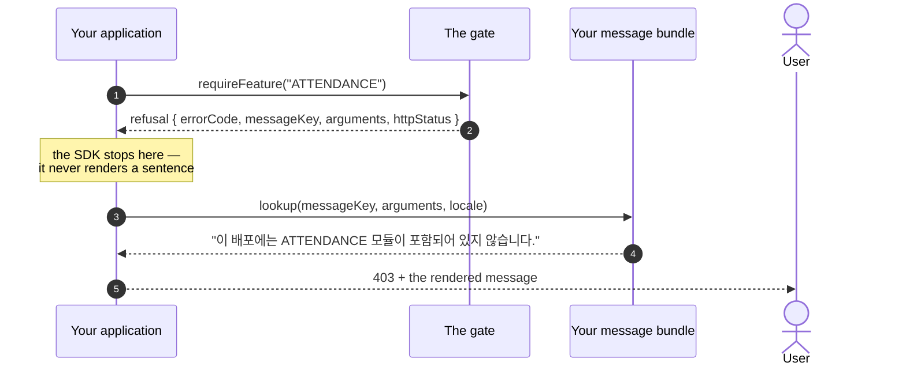

# Message keys

The core returns a key and its arguments; the host translates. Every language the SDK binds has
its own internationalization, and a core holding wording would grow a phrase book each time a
language is added.

A host must define every key below in each locale it serves. A missing key surfaces as an
untranslated placeholder at the worst moment — the operator is already locked out. The one
exception is `error.license.signingKeyCompromised`: only an application that handles a
compromised signing key has to define it.

## Where a message comes from



The `errorCode` is for your client code to branch on; the `messageKey` and its arguments are for
a human. Branching on the rendered sentence breaks the moment someone changes a translation.

## Argument order is part of the key

The order is fixed here and nowhere else. A host that swaps two arguments renders a number in the
wrong place and tells an operator something untrue.

## Denials a judgement produces

| Key | Arguments | When |
| --- | --- | --- |
| `error.license.notValid` | — | the general line, used when a specific one cannot be filled in |
| `error.license.gracePeriodReadOnly` | — | `GRACE_PERIOD` — expired, still serving |
| `error.license.releaseNotEntitled` | 1. running release<br>2. entitled ceiling | `RELEASE_NOT_ENTITLED` |
| `error.license.expired` | 1. expiry instant, RFC 3339 | `EXPIRED` |
| `error.license.schemaUnsupported` | 1. the license's schema<br>2. this build's schema | `SCHEMA_UNSUPPORTED` |
| `error.license.heartbeatOverdue` | 1. the window in hours: the larger of tolerance and interval, with 24 and 1 read for zero | `HEARTBEAT_OVERDUE` |
| `error.license.productMismatch` | 1. the license's product<br>2. this deployment's product | `PRODUCT_MISMATCH` |
| `error.license.invalidSignature` | — | `INVALID_SIGNATURE` |
| `error.license.fingerprintMismatch` | — | `MACHINE_MISMATCH` |
| `error.license.fingerprintUnavailable` | — | `FINGERPRINT_UNAVAILABLE` |
| `error.license.notActivated` | — | `NOT_ACTIVATED` |
| `error.license.unreadable` | — | `NOT_LOADED` |
| `error.license.revoked` | — | `REVOKED` |
| `error.license.clockTampered` | — | `CLOCK_TAMPERED` |
| `error.license.integrityFailed` | — | `INTEGRITY_FAILED` |
| `error.license.signingKeyCompromised` | — | `SIGNING_KEY_COMPROMISED`, which the host assigns |

The judgement never reaches `SIGNING_KEY_COMPROMISED` on its own. The host assigns it, because
what the token is measured against is a record the host keeps; the key is listed here so the
message is translated when the host uses it. An application that does not handle a key
marked compromised never reaches this status and need not define the key. The steps are in each
language's manual, under "A compromised signing key".

A denial that a number makes actionable carries it. When the payload could not be read far
enough to fill one in, the denial falls back to `error.license.notValid` rather than rendering an
empty placeholder.

## Denials a gate produces

| Key | Arguments | When |
| --- | --- | --- |
| `error.license.featureNotLicensed` | 1. feature key | the license does not grant the feature |
| `error.license.featureNotActivated` | 1. feature key | licensed, but an administrator has not switched it on |
| `error.license.quotaExceeded` | 1. quota code<br>2. the ceiling | one more would pass the ceiling |

## Reasons an activation attempt returns

These carry no arguments. `interpret` returns them as an outcome rather than throwing. Four of
them the core never produces: the host raises `activationServerNotConfigured`,
`fingerprintUnavailable`, `notActivated`, and `alreadyRegistered` itself before it sends a
request, from the checks only the host can make.

| Key | When |
| --- | --- |
| `error.license.activationServerNotConfigured` | no server address to reach |
| `error.license.fingerprintUnavailable` | no machine identifier could be read |
| `error.license.unknownProductKey` | the server does not know the key |
| `error.license.seatExhausted` | every seat is held by another machine |
| `error.license.contractSuspended` | the contract behind the license is suspended |
| `error.license.productMismatch` | the key sells another product |
| `error.license.releaseNotEntitled` | the running release is above the ceiling |
| `error.license.revoked` | the activation was revoked |
| `error.license.serverUnreachable` | the server could not be reached |
| `error.license.serverError` | the server answered with an error |
| `error.license.invalidResponse` | the answer was not an activation response |
| `error.license.nonceMismatch` | the returned token echoes another nonce |
| `error.license.fingerprintMismatch` | the returned token is bound elsewhere |
| `error.license.invalidSignature` | the returned token is signed by another key |
| `error.license.notActivated` | nothing to refresh or release |
| `error.license.alreadyRegistered` | a working license under another key is registered here |
| `error.license.pendingApproval` | the server answered 202: an operator has to approve the activation |
| `error.license.approvalDenied` | an operator refused the activation |

The four ways a token is refused after it arrives — a wrong signing key, a license bound to
another machine, a replayed answer, an unreadable one — are named apart on purpose. They need
four different actions from an operator, and one shared "could not be verified" line leaves every
one of them undiagnosable.

## Error codes

Every refusal a judgement or a gate produces also carries a code a client branches on, and every
one begins with `LICENSE_`. That prefix is how a client tells a license denial from a permission
denial without parsing a message. An activation outcome carries no such code: it names its
reason without the prefix, such as `SEAT_EXHAUSTED`, beside the message key.

- A judgement's code is `LICENSE_` plus the status name: `LICENSE_HEARTBEAT_OVERDUE`.
- A gate's codes are `LICENSE_FEATURE_NOT_LICENSED`, `LICENSE_FEATURE_NOT_ACTIVATED`, and
  `LICENSE_QUOTA_EXCEEDED`.
- In `RELEASE_NOT_ENTITLED`, a gate's feature check refuses with the judgement's own code,
  `LICENSE_RELEASE_NOT_ENTITLED`, and `error.license.releaseNotEntitled` rather than a feature
  code: the feature is in the license, and what stopped it is the running release.

## The body every adapter writes

```json
{
  "errorCode": "LICENSE_NOT_ACTIVATED",
  "status": "NOT_ACTIVATED",
  "messageKey": "error.license.notActivated",
  "arguments": []
}
```

A Java adapter filter (`LicenseEnforcementFilter`, `LicenseEnforcementWebFilter`,
`LicenseEnforcementRequestFilter`) handed a `DenialMessages` adds the sentence, resolved in the
request's locale, as `message`. Without one there is no `message`. The Go and Python adapters do
not write it.

One shape, whichever framework produced it. The adapter contract tests assert exactly this, which
is what makes a new adapter cheap: it moves the gate's answer into a response and decides nothing.
