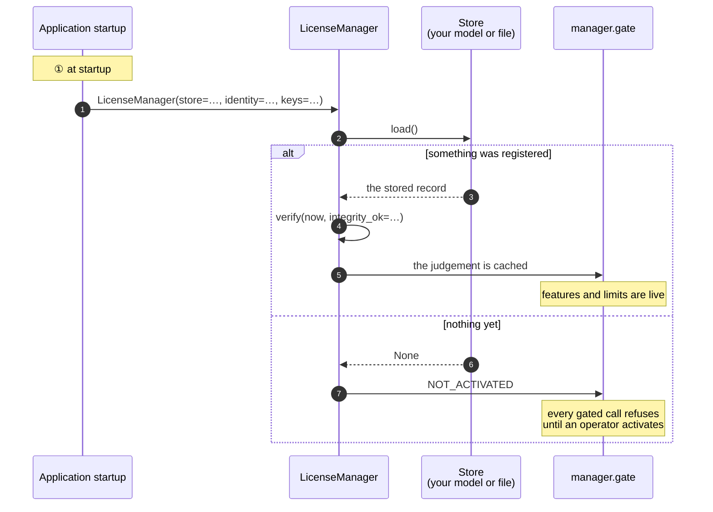
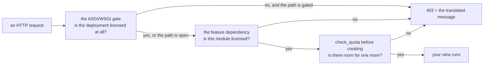

# Python

## What you are going to build

Three things, in this order: wire the SDK at startup, give an operator a way to activate, and
put the gate where a rule has to hold.



## Taking it

```
pip install https://github.com/accesscore-dev/accesscore-license-sdk-dist/releases/download/v1.0.2/accesscore_license-1.0.2-py3-none-any.whl
```

The native core travels inside the wheel, one directory per platform. A deployment whose policy
fixes where a shared library may come from names one with `ACLIC_NATIVE_LIBRARY`; it names a
file to load, never a key to trust.

Framework extras install only what a product uses: `accesscore-license[fastapi]`,
`[django]`, `[flask]`.

## What a product has to supply

Subclasses of the abstract bases in `accesscore_license.host`. Only the first two are required,
along with the verification keys.

| Base | What it answers |
| --- | --- |
| `Store` | reading and writing the registration |
| `ProductIdentity` | which product this is, and which release |
| `FeatureCatalogue` | the feature keys this deployment gates on |
| `QuotaCounter` | the current count per quota code |
| `FeatureActivationChecker` | whether an administrator switched a feature on |
| `AuditRecorder` | where license events are recorded |
| `ActivationServerDirectory` | where the activation server is |

## Assembling it

```python
from datetime import datetime, timezone
from accesscore_license import LicenseManager

manager = LicenseManager(
    store=store,
    identity=identity,
    keys=[{"kid": "acps-2026-01", "publicKey": PUBLIC_KEY_PEM}],
    catalogue=catalogue,
    counters=[user_counter, hardware_counter],
    audit=audit_recorder,
    configured_server_url=settings.LICENSE_SERVER_URL,
    instance_id=settings.INSTANCE_ID,
)

manager.verify(datetime.now(timezone.utc), integrity_ok=check_integrity())
```

`verify` takes the instant and the integrity result from the caller. The core reads no clock,
and what to hash for an integrity check differs per language.

## Activating from your own endpoint

The SDK builds the body and reads the answer; the HTTP call is yours, with your timeouts and
your proxy.

```python
@app.post("/license/activate")
async def activate(form: ActivationForm):
    request = manager.activation_request(form.product_key)

    async with httpx.AsyncClient(timeout=20.0) as client:
        response = await client.post(
            f"{manager.activation_server_url()}/api/activations", json=request.body
        )
        response.raise_for_status()
        answer = response.json()

    record = manager.activation_response(answer, request)   # nonce checked here
    manager.store_record(record)
    manager.verify(datetime.now(timezone.utc), integrity_ok=check_integrity())

    return manager.gate.state()
```

`activation_response` refuses an answer whose nonce does not match the request, whose machine
fingerprints do not match this host, or whose payload does not verify — so a captured reply from
another deployment cannot be replayed here.

## Enforcing it

```python
from accesscore_license.adapters import (
    asgi_license_gate, fastapi_license_dependency, fastapi_register_exception_handler,
)

# Every request, while the deployment is unlicensed.
app = asgi_license_gate(app, manager.gate, open_prefixes=["/license", "/activations"])

# One feature.
@router.get("/attendance", dependencies=[Depends(
    fastapi_license_dependency(manager.gate, "ATTENDANCE"))])
async def list_attendance(): ...

# One ceiling, before adding.
manager.check_quota("USERS")

# So a refusal anywhere becomes the shared document.
fastapi_register_exception_handler(app)
```

Django takes `django_license_middleware(gate, open_prefixes)`; Flask takes
`flask_register(app, gate, open_prefixes)`; anything WSGI takes `wsgi_license_gate`.

Which paths stay open while unlicensed is the product's decision: a deployment has to reach its
own license screen in order to stop being unlicensed.



## Turning a refusal into a response

`LicenseDenied` carries `status`, `error_code`, `message_key`, `arguments`, and `http_status`,
and `body()` renders the document every adapter writes. A product with its own response shape
translates the key itself:

```python
from django.utils.translation import gettext

@app.exception_handler(LicenseDenied)
async def handle(request, denied):
    message = gettext(denied.message_key) % tuple(denied.arguments)
    return JSONResponse(
        status_code=denied.http_status,
        content={"code": denied.error_code, "message": message},
    )
```

Message keys and their argument order: [messages.md](messages.md).

## Keeping it fresh

A license that requires a heartbeat needs a scheduled refresh. The SDK writes the body and reads
the answer; the schedule and the transport are yours.

```python
def refresh_license() -> None:
    if not manager.gate.state().heartbeat_required:
        return

    request = manager.heartbeat_request()
    response = httpx.post(
        f"{manager.activation_server_url()}/api/heartbeats",
        json=request.body,
        headers={"X-Activation-Signature": request.signature},
        timeout=20.0,
    )
    response.raise_for_status()

    manager.store_record(manager.heartbeat_response(response.json()))
    manager.verify(datetime.now(timezone.utc), integrity_ok=check_integrity())
```

A failed heartbeat is not an error the deployment has to act on immediately — the license stays
usable until `heartbeatToleranceDays` passes. Log it and let the next run try again.

## Issuing

```python
from accesscore_license import LicenseIssuer

issuer = LicenseIssuer()
print("License signing key fingerprint:", issuer.fingerprint_of(private_key_pem))
signed = issuer.sign(payload, private_key_pem)
```

Only an issuer holds a private key. The key is wiped from the core's memory as soon as the
signature exists.

## Product keys and release versions

```python
from accesscore_license import ProductKeys, ReleaseVersions

keys = ProductKeys()
key = keys.generate("ACPS")
shown = keys.masked("ACPS", key)

releases = ReleaseVersions()
entitled = releases.is_within_ceiling("3.2.0", "3.2")
```

## Before you ship

- [ ] The verification key is packaged with the application, not read from a configurable path.
- [ ] The prefixes that stay open while unlicensed reach your license screen and nothing else.
- [ ] Every message key in [messages.md](messages.md) has a translation in every locale you ship.
- [ ] A container mounts the host machine identifiers read-only, or activation fails with
      `FINGERPRINT_UNAVAILABLE`.
- [ ] The heartbeat schedule is shorter than `heartbeatIntervalDays`, so one missed run is not
      immediately a lapse.
