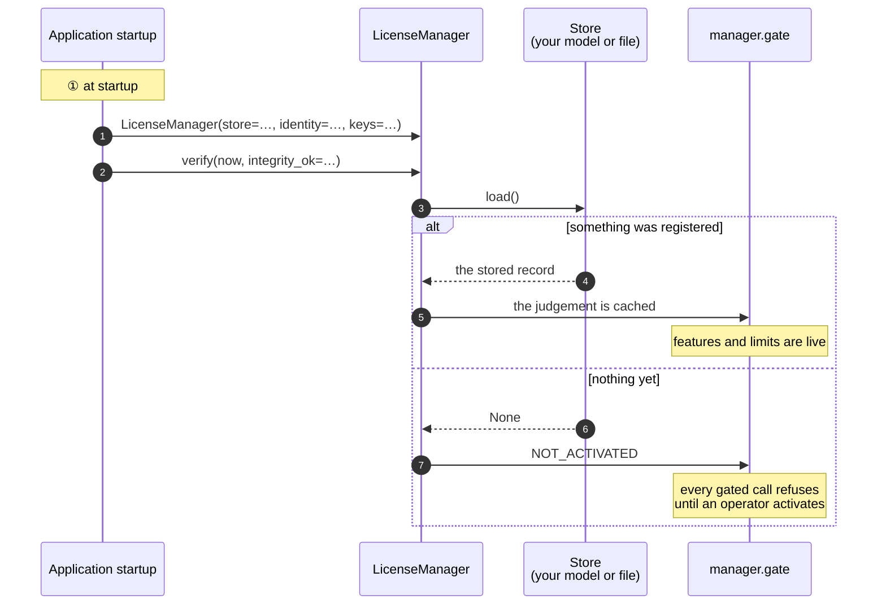
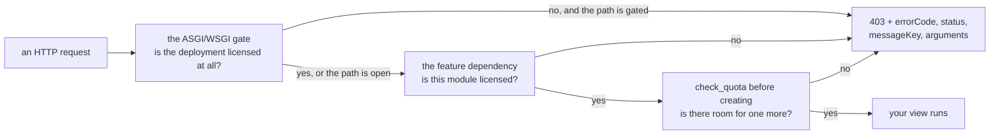

# Python

## What you are going to build

Three things, in this order: wire the SDK at startup, give an operator a way to activate, and
put the gate where a rule has to hold.



## Taking it

The SDK needs Python 3.9 or later.

```
pip install https://github.com/accesscore-dev/accesscore-license-sdk-dist/releases/download/v1.2.0/accesscore_license-1.2.0-py3-none-any.whl
```

The native core travels inside the wheel, one directory per platform: `linux-x86_64`,
`linux-x86_64-musl`, `linux-aarch64`, `darwin-x86_64`, `darwin-aarch64`, and `windows-x86_64`.
On Linux the wheel picks the musl core when it finds musl's loader; `ACLIC_NATIVE_LIBC=musl` or
`glibc` says which outright. A deployment whose policy fixes where a shared library may come
from names one with `ACLIC_NATIVE_LIBRARY`; it names a file to load, never a key to trust.

Framework extras install only what a product uses: `fastapi`, `django`, `flask`. The wheel is
not on PyPI, so name the extra together with the wheel's address:

```
pip install "accesscore-license[fastapi] @ https://github.com/accesscore-dev/accesscore-license-sdk-dist/releases/download/v1.2.0/accesscore_license-1.2.0-py3-none-any.whl"
```

## What a product has to supply

Subclasses of the abstract bases in `accesscore_license.host`. Only the first two are required,
along with the verification keys.

| Base | What it answers |
| --- | --- |
| `Store` | reading and writing the registration |
| `ProductIdentity` | which product this is, and which release |
| `FeatureCatalogue` | the feature keys this deployment gates on |
| `QuotaCounter` | the current count per quota code |
| `FeatureActivationChecker` | whether an administrator switched a feature on |
| `AuditRecorder` | where license events are recorded |
| `ActivationServerDirectory` | where the activation server is |

`FeatureActivationChecker` is given to the gate, not to the manager:
`LicenseManager(..., gate=Gate(activation_checker=checker.is_effectively_active))`.
`ActivationServerDirectory` is given as `directory=`; `server_url()` then prefers the address it
returns over `configured_server_url`.

## Assembling it

```python
from datetime import datetime, timezone
from accesscore_license import LicenseManager

manager = LicenseManager(
    store=store,
    identity=identity,
    keys=[{"kid": "acps-2026-01", "publicKey": PUBLIC_KEY_PEM}],
    catalogue=catalogue,
    counters=[user_counter, hardware_counter],
    audit=audit_recorder,
    configured_server_url=settings.LICENSE_SERVER_URL,
    instance_id=settings.INSTANCE_ID,
)

manager.verify(datetime.now(timezone.utc), integrity_ok=check_integrity())
```

`verify` takes the instant and the integrity result from the caller. The core reads no clock,
and what to hash for an integrity check differs per language.

## Activating from your own endpoint

The SDK builds the request and reads the answer; the HTTP call is yours, with your timeouts and
your proxy.

```python
from datetime import datetime, timezone

import httpx
from fastapi.responses import JSONResponse

@api.post("/license/activate")
async def activate(form: ActivationForm):
    now = datetime.now(timezone.utc)
    prepared = manager.activation_request(form.product_key, now)

    try:
        async with httpx.AsyncClient(timeout=20.0) as client:
            response = await client.post(
                manager.server_url() + prepared["path"],
                content=prepared["body"],
                headers=prepared["headers"],
            )
        outcome = manager.interpret(   # nonce checked here
            "ACTIVATE", response.status_code, response.text, prepared["nonce"]
        )
    except httpx.TransportError:
        outcome = manager.interpret("ACTIVATE", 0, "", prepared["nonce"], reachable=False)

    if not outcome["success"]:
        return JSONResponse(
            status_code=400,
            content={"error": outcome["error"], "messageKey": outcome["messageKey"]},
        )

    result = outcome["result"]
    manager.apply(
        {
            "licenseToken": result["licenseToken"],
            "activationId": result["activationId"],
            "activationSecret": result["activationSecret"],
            "instanceId": settings.INSTANCE_ID,
        },
        now,
        integrity_ok=check_integrity(),
    )
    return manager.gate.state()
```

`activation_request` returns `method`, `path`, `body`, `headers`, and `nonce`. Send `body` as it
is: it is already JSON, and the signature covers those bytes.

`interpret` does not raise on a refusal. It returns `success: False` with `error` and
`messageKey`: `NONCE_MISMATCH`, `FINGERPRINT_MISMATCH`, or `INVALID_SIGNATURE` for an answer
whose nonce, machine, or signature does not check out, so a captured reply from another
deployment cannot be replayed here. The server's own refusals and `PENDING_APPROVAL` are listed
in [concepts.md](concepts.md#activation-step-by-step). `apply` saves the record through your
`Store` and judges it.

## Enforcing it

```python
from fastapi import Depends, FastAPI
from accesscore_license.adapters import (
    asgi_license_gate, fastapi_license_dependency, fastapi_register_exception_handler,
)

api = FastAPI()

# So a refusal anywhere becomes the shared document.
fastapi_register_exception_handler(api)

# One feature.
@api.get("/attendance", dependencies=[Depends(
    fastapi_license_dependency(manager.gate, "ATTENDANCE"))])
async def list_attendance(): ...

# One ceiling, before adding.
@api.post("/users")
async def create_user(form: UserForm):
    manager.check_quota("USERS")
    ...

# Every request, while the deployment is unlicensed. Wrap last: the result is a plain ASGI app.
app = asgi_license_gate(api, manager.gate, open_prefixes=["/license", "/activations"])
```

Django takes `django_license_middleware(gate, open_prefixes)`. It returns a middleware factory,
so bind it to a module-level name and list that name in `MIDDLEWARE`:

```python
# myproduct/license.py
license_middleware = django_license_middleware(manager.gate, ["/license"])

# settings.py
MIDDLEWARE = [..., "myproduct.license.license_middleware"]
```

Flask takes `flask_register(app, gate, open_prefixes)`, which also turns a `LicenseDenied` raised
in a view into the shared document. Anything WSGI takes `wsgi_license_gate`.

Which paths stay open while unlicensed is the product's decision: a deployment has to reach its
own license screen in order to stop being unlicensed.

Where each call sits:



## Turning a refusal into a response

`LicenseDenied` carries `status`, `error_code`, `message_key`, `arguments`, and `http_status`,
and `body()` renders the document every adapter writes: `errorCode`, `status`, `messageKey`,
and `arguments`, untranslated. A product with its own response shape registers its own handler
in place of `fastapi_register_exception_handler` and translates the key itself:

```python
from fastapi.responses import JSONResponse
from accesscore_license import LicenseDenied

@api.exception_handler(LicenseDenied)
async def handle(request, denied: LicenseDenied):
    message = translate(request, denied.message_key, denied.arguments)   # your translator
    return JSONResponse(
        status_code=denied.http_status,
        content={"code": denied.error_code, "message": message},
    )
```

A request that `asgi_license_gate`, `wsgi_license_gate`, `django_license_middleware`, or
`flask_register` refuses never reaches this handler: it gets the body `body()` built, which carries
the message key and its arguments only. For a refused request to carry the sentence too, use
`fastapi_license_dependency` on FastAPI; it raises `LicenseDenied`, so the handler above builds the
response. On another framework, put your own middleware that calls `gate.require_usable()` in place
of the adapter and build the response the same way.

Message keys and their argument order: [messages.md](messages.md).

## Keeping it fresh

A judgement is made at the instant `verify` is given, and the gate answers with the last one it
was handed. When the end date, the grace period, or the heartbeat deadline passes, the gate keeps
letting requests through on the earlier judgement until the next one. So the scheduled work is two
jobs.

Re-verification runs for every license. It calls `verify(now)` on a schedule so the time that has
passed reaches the gate, for a license that needs no heartbeat too, and while heartbeats keep
failing.

The heartbeat runs only for a license with `heartbeatRequired` set. The SDK writes the request and
reads the answer; the schedule and the transport are yours.

```python
# Re-verification: every license. Brings the time that has passed to the gate.
def reverify_license() -> None:
    manager.verify(datetime.now(timezone.utc), integrity_ok=check_integrity())


# Heartbeat: only a license that requires one.
def send_heartbeat() -> None:
    payload = manager.gate.state().get("payload") or {}
    if not payload.get("heartbeatRequired"):
        return

    now = datetime.now(timezone.utc)
    prepared = manager.heartbeat_request(now)
    try:
        response = httpx.post(
            manager.server_url() + prepared["path"],
            content=prepared["body"],
            headers=prepared["headers"],   # X-Activation-Signature is among them
            timeout=20.0,
        )
    except httpx.TransportError:
        return   # the license stays usable until the heartbeat window passes

    outcome = manager.interpret(
        "HEARTBEAT", response.status_code, response.text, prepared["nonce"]
    )
    if outcome["success"]:
        record = dict(store.load() or {})
        record["licenseToken"] = outcome["result"]["licenseToken"]
        record["lastHeartbeatAt"] = now.isoformat().replace("+00:00", "Z")
        manager.apply(record, now, integrity_ok=check_integrity())
    elif outcome["error"] == "REVOKED":
        manager.mark_revoked(now, integrity_ok=check_integrity())
```

A heartbeat answer carries a new token but not the activation secret, so keep the stored record
and replace only `licenseToken`. The SDK does not record when a heartbeat succeeded: the record
you store sets `lastHeartbeatAt`, and the deadline is measured from it, or from `activatedAt`
before the first heartbeat.

A failed heartbeat is not an error the deployment has to act on immediately. The license stays
usable until the heartbeat window passes, which is the larger of `heartbeatToleranceHours` and
`heartbeatIntervalHours`, read as 24 and 1 when the token carries zero. Log it and let the next
run try again. Once the window passes, re-verification turns the judgement into `HEARTBEAT_OVERDUE`.

The re-verification interval is the longest a passed deadline may go unenforced: on a 30-minute
interval, a license whose end date or heartbeat deadline has passed keeps its earlier judgement for
up to 30 minutes.

## A compromised signing key

When an issuer marks a signing key as compromised, the verification key list built into a
customer's product carries that key with `compromised: true`. Taking the key out of the list
would refuse every license signed under it as `INVALID_SIGNATURE`, including the ones issued
properly before the compromise. Keep the key registered, and refuse with `SIGNING_KEY_COMPROMISED`
only a token signed under it that asks for more than the deployment already held.

The judgement does not make this comparison, because what it compares against is a record the
application keeps. `KeyMaterial` carries no compromise mark; the application keeps the `kid` of
each compromised key itself. The steps:

1. On the first judgement after a compromised key is registered, store what the deployment holds
   at that moment. When the judgement is usable, store its features, limits, expiry, and release
   ceiling; when it is not, store that nothing was held. Store this once and never change it.
2. Each time `verify`, `apply`, or `mark_revoked` returns a judgement, check whether the payload's `kid` is a compromised key.
3. When a token signed under a compromised key asks for more than what was stored, build a
   `SIGNING_KEY_COMPROMISED` judgement and hand it to the gate.

A token asks for more in four ways: a feature that was not stored; a limit that was capped when
stored and is now higher or missing (a missing limit is unlimited); an expiry later than the
stored one, or none; a release ceiling higher than the stored one, or none. When nothing was held,
every token signed under that key is refused. Compare release ceilings with `ReleaseVersions().is_within_ceiling`: compared
as text, `3.10` ranks below `3.9`.

```python
judged = manager.verify(now, integrity_ok=check_integrity())
payload = judged.get("payload")
if payload and payload["kid"] in compromised_key_ids and not ceiling.covers(payload):
    # asks for more than step 1 stored
    manager.gate.refresh({
        "status": "SIGNING_KEY_COMPROMISED",
        "usable": False,
        "errorCode": "LICENSE_SIGNING_KEY_COMPROMISED",
        "denial": {"messageKey": "error.license.signingKeyCompromised", "arguments": []},
        "nextWatermark": judged.get("nextWatermark"),
        "availableFeatures": [],
        "limits": {},
        "graceExpiresAt": judged.get("graceExpiresAt"),
        "heartbeatDeadline": judged.get("heartbeatDeadline"),
        "payload": payload,
    })
```

An application that uses this status has to translate `error.license.signingKeyCompromised`. The
keys are listed in [messages.md](messages.md).

## The record and the other calls

The `Store` keeps one dict per deployment. The manager reads and writes these keys:

| Key | What it holds | Written by |
| --- | --- | --- |
| `licenseToken` | the signed token | your activation and heartbeat code, through `apply` |
| `activationId`, `activationSecret` | the credentials a heartbeat and a release are signed with | your activation code |
| `instanceId` | this installation's identifier | your activation code |
| `lastHeartbeatAt` | the last successful heartbeat | your heartbeat code |
| `verificationWatermark` | the latest instant a judgement accepted | the manager, after each judgement |
| `revokedAt` | the revocation stamp | `mark_revoked` |

Three more calls complete the lifecycle. `deactivation_request(now)` writes the request that
hands the seat back; read its answer with `interpret("DEACTIVATE", …)`.
`mark_revoked(now)` stores a revocation stamp and judges again. `clear_registration(now)`
discards the record and returns the deployment to `NOT_ACTIVATED`.

## Issuing

```python
from pathlib import Path
from accesscore_license import LicenseIssuer

private_key_pem = Path("signing-key.pem").read_bytes()

issuer = LicenseIssuer()
print("License signing key fingerprint:", issuer.fingerprint_of(private_key_pem))
signed = issuer.sign(payload, private_key_pem)
```

The private key is PKCS#8, PEM or DER, passed as `bytes`; a `str` is refused. Only an issuer
holds a private key. The key is wiped from the core's memory as soon as the signature exists.

## Product keys and release versions

```python
from accesscore_license import ProductKeys, ReleaseVersions

keys = ProductKeys()
key = keys.generate("ACPS")
shown = keys.masked("ACPS", key)

releases = ReleaseVersions()
entitled = releases.is_within_ceiling("3.2.0", "3.2")
```

## Before you ship

- [ ] The verification key is packaged with the application, not read from a configurable path.
- [ ] The prefixes that stay open while unlicensed reach your license screen and nothing else.
- [ ] Every message key in [messages.md](messages.md) has a translation in every locale you ship.
- [ ] A container mounts the host machine identifiers read-only. Without them activation fails
      with `FINGERPRINT_MISMATCH`, and a stored license is judged `FINGERPRINT_UNAVAILABLE`.
- [ ] The heartbeat schedule is no longer than `heartbeatIntervalHours` (1 when the token
      carries zero), so several runs can fail before the heartbeat window runs out.
