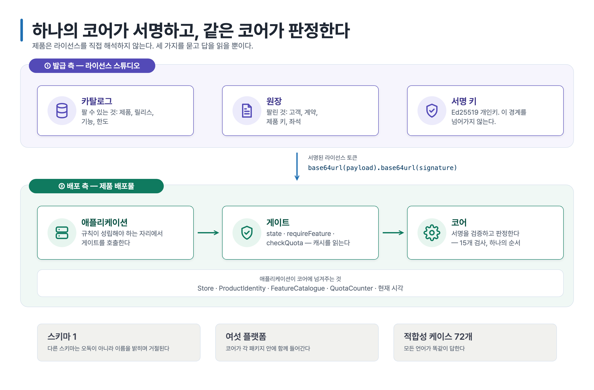

# AccessCore License SDK — 매뉴얼

SDK를 제품에 넣는 쪽을 위한 문서입니다.

Rust 코어가 라이선스를 서명하고 검증하며 배포물이 무엇을 해도 되는지 판정합니다. Java·Python·Go로 만든 제품은 얇은 바인딩으로 그 판정을 받아 씁니다. 코어는 파일도 시계도 네트워크도 만지지 않습니다. 애플리케이션이 값을 넣으면 코어가 결론을 돌려줄 뿐입니다. 모든 언어가 같은 코어를 부르므로 같은 라이선스를 읽는 두 배포물은 같은 결론에 이르고, 거절할 때 쓰는 메시지 키까지 같습니다.



## 세 번의 호출로 끝나는 이야기

제품은 라이선스를 직접 해석하지 않습니다. 세 가지를 물을 뿐입니다.

```
gate.state()                      지금 이 배포물에 라이선스가 있는가, 언제까지인가
gate.requireFeature("ATTENDANCE") 이 모듈을 써도 되는가 — 안 되면 띄울 메시지까지
gate.checkQuota("USERS", 199)     하나 더 만들 여유가 있는가, 상한에 닿았는가
```

서명, 머신 대조, 만료, 유예 기간, 릴리스 상한, 하트비트는 모두 이 세 호출 뒤에서 처리됩니다. 한곳에서, 모든 언어가 같은 방식으로 처리합니다.

이름은 언어의 관습을 따릅니다. Java와 Go는 `requireFeature`, Python은 `require_feature`입니다.

## 어디부터 볼 것인가

| | |
| --- | --- |
| [개념](concepts.md) | 코어가 판정하는 것, 애플리케이션이 판단할 것, 검사가 도는 순서 |
| [Java](java.md) | 가져다 쓰기, 구현할 인터페이스, 게이트, 프레임워크 어댑터 |
| [Python](python.md) | Python에서 같은 것 |
| [Go](go.md) | Go에서 같은 것 |
| [메시지 키](messages.md) | SDK가 돌려줄 수 있는 모든 거절 사유와 인자 순서 |

[개념](concepts.md)부터 읽습니다. 길지 않고, 언어별 가이드가 그 내용을 전제로 합니다. 그다음 쓰는 언어의 가이드를 봅니다.

## 처음 한 시간

1. **패키지를 가져옵니다.** 좌표는 언어별 가이드에 있습니다. Java 가이드에는 레지스트리가 요구하는 `read:packages` 토큰을 어떻게 두는지도 함께 적혀 있습니다.
2. **인터페이스 두 개를 구현합니다.** 등록 기록을 어디에 둘지 정하는 `Store`와, 어떤 제품의 어떤 릴리스인지 답하는 `ProductIdentity`입니다. 나머지는 선택입니다.
3. **검증 키를 빌드와 함께 배포합니다.** 클래스패스 리소스든 패키징된 파일이든 컴파일된 상수든 상관없습니다. 그리고 기동할 때 매니저를 만듭니다. 라이선스가 없는 배포물은 `NOT_ACTIVATED` 상태로 올라와 게이트를 지나는 호출을 모두 거절합니다. 정상 동작이지 실패가 아닙니다.
4. **운영자에게 라이선스 화면을 줍니다.** 그 경로는 게이트에서 열어둡니다. 배포물이 라이선스 없는 상태를 벗어나려면 자기 라이선스 화면에 닿을 수 있어야 합니다.
5. **라이선스 서버로 한 번 활성화하고** `state()`가 `VALID`로 바뀌는 것을 확인합니다.
6. **규칙이 실제로 있는 자리에** `requireFeature`와 `checkQuota`를 넣습니다.

## 가져다 쓰기

코어가 각 패키지 안에 함께 들어가므로 애플리케이션 옆에 따로 설치할 것이 없습니다.

| 언어 | 받는 곳 | 토큰 |
| --- | --- | --- |
| Java | GitHub Packages 레지스트리의 `dev.accesscore:license-sdk` | `read:packages` — [Java 가이드](java.md) 참고 |
| Python | [릴리스](https://github.com/accesscore-dev/accesscore-license-sdk-dist/releases/tag/v1.0.9)에 붙은 wheel | 없음 |
| Go | `github.com/accesscore-dev/accesscore-license-sdk-dist/packages/go` | 없음 |

릴리스에는 모든 언어의 산출물이 파일로도 붙습니다. jar, wheel, Go 모듈, 그리고 SDK가 지원하지 않는 언어를 C ABI로 직접 얹을 때 쓸 미리 빌드한 코어입니다. 레지스트리에 닿을 수 없거나 닿고 싶지 않은 빌드는 이 파일을 가져가면 됩니다.

## 거절이 떴을 때

| 보이는 상태 | 대개의 원인 |
| --- | --- |
| `NOT_ACTIVATED` | 아직 등록된 것이 없음 — 제품 키로 활성화 |
| `FINGERPRINT_UNAVAILABLE` | 호스트 머신 식별자를 마운트하지 않은 컨테이너 |
| `MACHINE_MISMATCH` | 다른 호스트의 라이선스 — 서버에서 좌석 이동 |
| `SCHEMA_UNSUPPORTED` | 이 빌드보다 새 라이선스 — 배포물 업그레이드, 또는 재발급 |
| `HEARTBEAT_OVERDUE` | 허용 기간 안에 서버와 연락이 닿지 않음 |
| `RELEASE_NOT_ENTITLED` | 계약이 보장하는 범위를 넘겨 배포물을 업그레이드함 |

모든 상태와 그 뜻, 운영자가 할 일은 [개념](concepts.md) → 상태에 있습니다.
