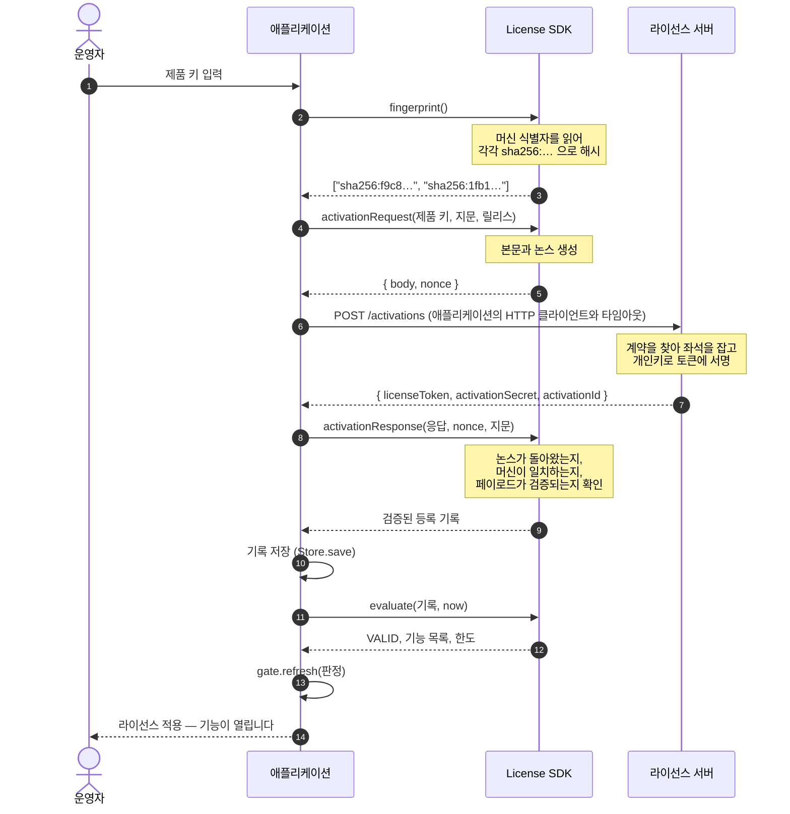
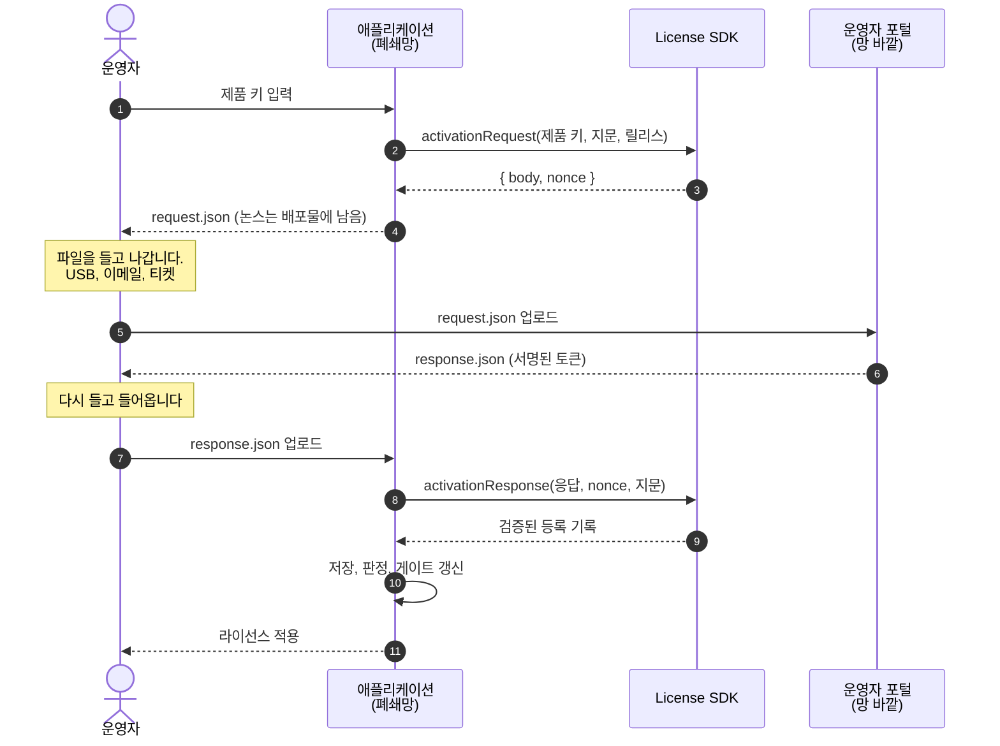
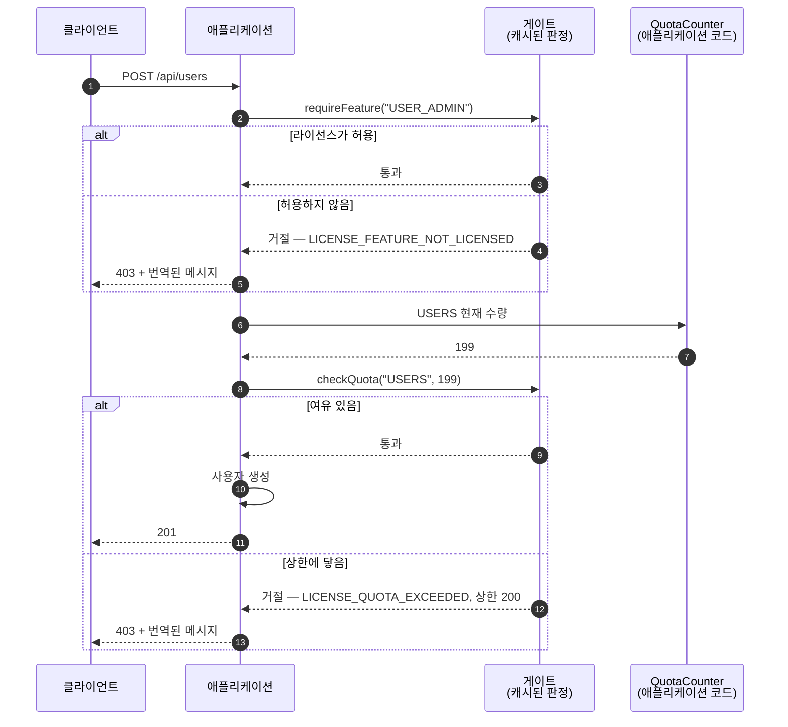
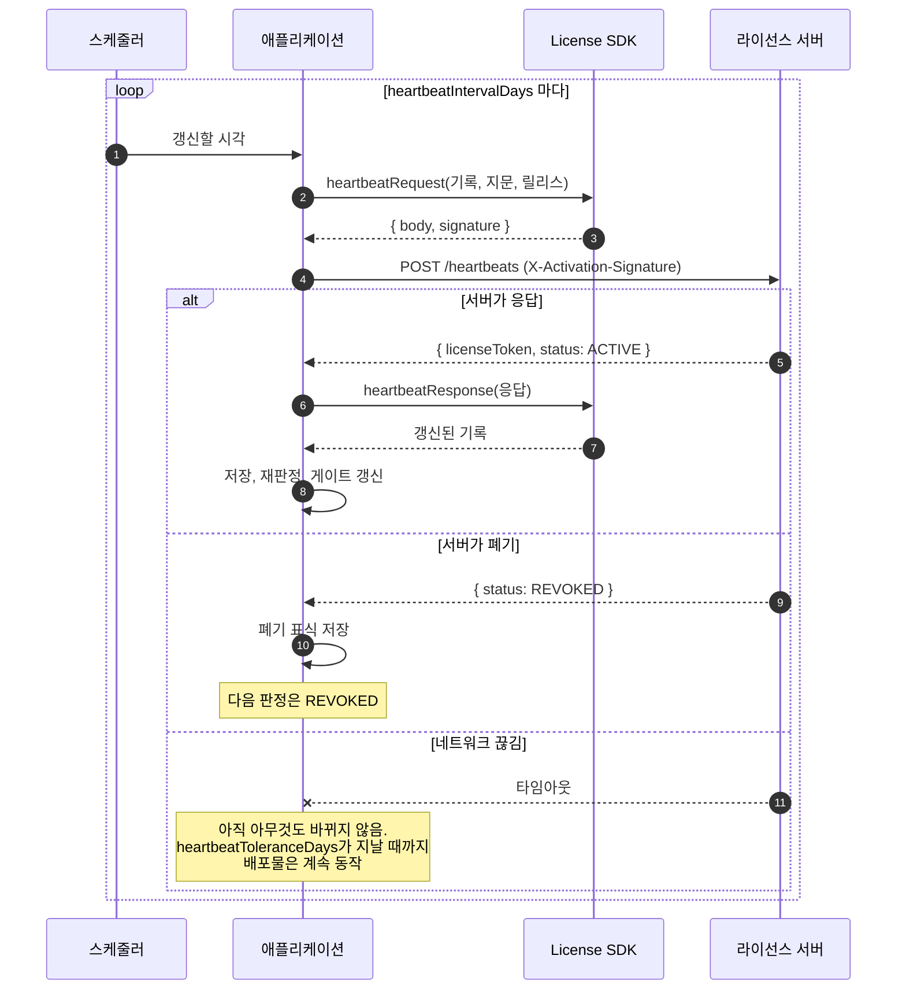
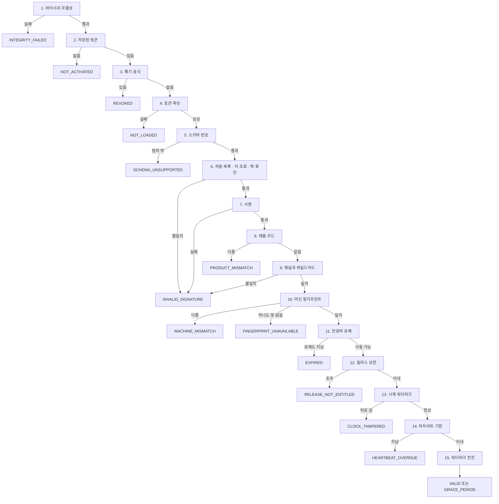
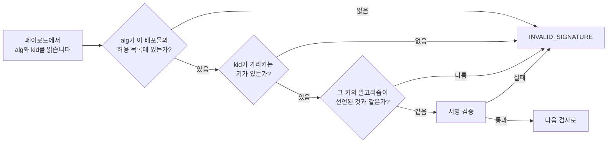
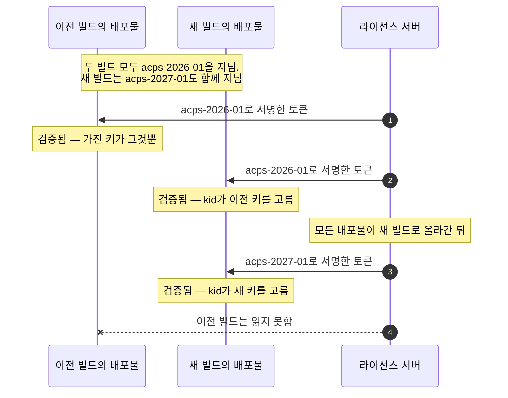

# 개념

라이선스의 형식과 판정은 코어 하나가 맡습니다. 바인딩은 애플리케이션이 아는 값을 코어에 넘기고, 무엇을 해도 되는지 답을 받아옵니다. 같은 판단을 두 곳에서 내리지 않습니다.


## 코어의 몫과 애플리케이션의 몫

| 코어가 맡는 것 | 애플리케이션이 맡는 것 |
| --- | --- |
| 페이로드 형식과 스키마 번호 | 등록 기록을 저장하고 불러오기 (JPA, 파일, 레지스트리) |
| 서명과 검증 | 현재 시각 |
| 머신 식별자 수집과 대조 | HTTP 전송, 재시도, 타임아웃 |
| 만료, 유예 기간, 채널별 완화 | 하트비트를 주기적으로 돌리기 |
| 하트비트 기한 | 게이트를 붙일 위치 |
| 시계가 되돌아갔는지 판단 | 자기 바이너리 해시 |
| 제품 코드와 릴리스 상한 검사 | 감사 기록 남기기 |
| 거절 상태와 그 메시지 키·인자 | 메시지 번역 |
| 활성화·하트비트 본문 작성과 응답 해석 | |

바이너리 무결성만 애플리케이션이 직접 확인합니다. 무엇을 해시할지가 언어마다 다르기 때문입니다. jar 해시와 실행 파일 해시와 wheel 해시는 얻는 방법이 서로 다릅니다. 애플리케이션이 확인한 결과를 넘겨주면 코어가 그 값을 나머지 검사와 같은 순서에 놓습니다.

## 토큰

```
base64url(payload).base64url(signature)
```

서명은 전송되는 페이로드 바이트를 그대로 덮습니다. 토큰에 실려 가는 바이트도 같은 바이트입니다. 검증하는 쪽이 무엇도 다시 직렬화하지 않으므로 정규 JSON 형식이 필요 없고, JSON 작성기가 키를 다른 순서로 내보내는 언어라도 서명을 깨뜨리지 못합니다.

디코드하면 페이로드는 이런 모습입니다.

```json
{
  "schemaVersion": 2,
  "alg": "Ed25519",
  "kid": "acps-2026-01",
  "licenseId": "lic_7f3a",
  "activationId": "act_91c2",
  "customerId": "cus_0042",
  "customer": "Riverside Hospital",
  "channel": "PRODUCTION",
  "productCode": "ACCESSCORE_PACS",
  "maxRelease": "3.2",
  "tierLabel": "Enterprise",
  "issuedAt": "2026-07-25T00:00:00Z",
  "activatedAt": "2026-07-25T00:00:00Z",
  "expiresAt": "2027-07-25T00:00:00Z",
  "gracePeriodDays": 30,
  "machineFingerprints": ["sha256:f9c8…", "sha256:1fb1…"],
  "features": ["ATTENDANCE", "VISITOR"],
  "limits": { "USERS": 200, "READER_PORTS": 0 },
  "heartbeatRequired": true,
  "heartbeatIntervalDays": 7,
  "heartbeatToleranceDays": 21
}
```

애플리케이션이 게이트할 값은 모두 여기 있습니다. `features`가 기능 목록이고, `limits`가 상한이며, `expiresAt`과 `gracePeriodDays`가 유효 기간을 정합니다.

영구 판매는 `expiresAt`을 아예 싣지 않으며, 이 필드가 없는 라이선스는 만료하지 않습니다. 만료와 유예 검사만 건너뛰고 나머지 판정은 그대로입니다. 그런 라이선스가 더 받지 못하는 것은 새 릴리스이고, 그 상한은 `maxRelease`입니다.

## 활성화, 한 단계씩

배포물은 라이선스 없이 시작합니다. 운영자가 제품 키를 입력하면 이런 순서로 진행됩니다.



여기서 짚어둘 곳이 두 군데입니다.

**SDK는 소켓을 열지 않습니다.** 6번은 애플리케이션이 직접 보내는 요청이고, 타임아웃도 프록시도 재시도 정책도 애플리케이션이 정합니다.

**3번에서 만든 논스가 8번에서 돌아옵니다.** 그래서 예전 활성화에서 가로챈 응답을 이번 활성화에 다시 쓸 수 없습니다.

첫 활성화 이후로는 모든 요청에 활성화 비밀값으로 서명합니다. 보내는 본문 바이트를 base64 HMAC-SHA256으로 계산해 `X-Activation-Signature` 헤더에 실으면 됩니다.

## 네트워크 없이 활성화하기

망이 끊긴 배포물도 같은 함수를 그대로 씁니다. 소켓 자리에 파일이 들어갈 뿐입니다.



논스는 배포물 밖으로 나가지 않습니다. 그래서 받아 온 응답은 그 논스를 만든 요청에만 들어맞습니다. 폐쇄망을 위한 별도 코드 경로는 없습니다. 같은 함수 두 개가 그대로 돌고 전달 수단만 바뀝니다.

## 요청마다 일어나는 일

게이트는 애플리케이션이 호출하는 지점이며, 코어를 부르지 않습니다.



게이트는 캐시해 둔 판정을 읽습니다. 그래서 요청 하나에 드는 비용이 서명 검증이 아니라 맵 조회 한 번입니다. 캐시를 언제 갈아 끼울지는 애플리케이션이 정합니다. 보통 기동할 때, 활성화한 직후, 하트비트에 성공한 직후, 그리고 정해 둔 주기마다 갱신합니다.

페이로드에 없는 한도 코드는 무제한이고, 값이 0이면 0입니다. 어떤 한도 코드가 생기기 전에 발급된 라이선스를 두고 그 코드 아래 모든 것이 금지된 것으로 읽어서는 안 됩니다.

## 하트비트

`heartbeatRequired`가 켜져 있으면 배포물이 주기적으로 서버에 연락해야 합니다. 그렇게 해서 얻는 것이 폐기(revocation)입니다. 서버가 폐기한 라이선스가 만료를 기다리지 않고 허용 기간 안에 멈춥니다.



허용 기간을 주기보다 길게 잡은 것은 의도한 설정입니다. 주말 내내 회선이 끊긴 현장은 계속 돌아가고, 3주가 넘도록 연락이 없는 배포물만 멈춥니다.

## 판정

검사 열다섯 개가 정해진 순서로 돕니다. 가장 먼저 걸리는 검사가 상태를 결정합니다.



순서를 이렇게 잡은 데는 이유가 있습니다. 스키마 번호를 서명보다 먼저 읽는 까닭은, 이 배포물이 읽지 못하는 형식이라면 서명을 계산해 볼 필요가 없기 때문입니다. 제품 코드는 서명 바로 뒤, 머신 대조 앞에 둡니다. 다른 제품의 토큰이라면 머신이 맞는지는 물어볼 필요도 없습니다.

### 하나를 쓰고 범위를 읽습니다

이 빌드는 `SCHEMA_VERSION` 하나로만 발급하고, 검증은 `MIN_READABLE_SCHEMA_VERSION`부터 그 번호까지를 받습니다. 자기 번호만 받으면 제품이 SDK를 올리는 순간 이미 판 라이선스가 전부 거절되고, 폐쇄망에서는 다시 발급해 줄 수 없습니다.

그래서 스키마를 올리는 변경은 **선택 항목을 더하거나 제약을 푸는 것까지**입니다. 필드를 없애거나, 선택 항목을 필수로 바꾸거나, 기존 값의 뜻을 다시 정하는 것은 스키마를 올리는 일이 아니라 **하한을 올리는 일**이며, 그 아래 발급된 라이선스를 전부 무효로 만드는 것과 같습니다. 그렇게 선언하는 major 릴리스에서만 합니다.

스키마가 오르면 그보다 낮은 SDK를 품은 검증기는 새 토큰을 읽지 못합니다. **검증 측을 먼저 올리고, 그다음에 발급 측이 새 스키마를 쓰기 시작합니다.**

## 상태

| 상태 | 뜻 | 사용 가능 | 운영자가 할 일 |
| --- | --- | --- | --- |
| `VALID` | 모든 검사 통과 | ● | 없음 |
| `GRACE_PERIOD` | 만료됐지만 유예 기간 안 | ● | 유예가 끝나기 전에 갱신 |
| `RELEASE_NOT_ENTITLED` | 계약 상한 초과 | ● | 계약 확대, 또는 릴리스 되돌리기 |
| `EXPIRED` | 유예 기간도 지남 | ○ | 갱신 후 재활성화 |
| `INVALID_SIGNATURE` | 서명·알고리즘·운영 와일드카드 문제 | ○ | 이 빌드용 라이선스가 아님 — 재발급 |
| `MACHINE_MISMATCH` | 다른 머신에 찍힌 라이선스 | ○ | 라이선스 서버에서 좌석 이동 |
| `FINGERPRINT_UNAVAILABLE` | 식별자를 하나도 읽지 못함 | ○ | 호스트 식별자를 컨테이너에 마운트 |
| `NOT_ACTIVATED` | 등록된 것이 없음 | ○ | 제품 키로 활성화 |
| `NOT_LOADED` | 읽을 수 없는 토큰 | ○ | 저장된 기록 손상 — 재활성화 |
| `SCHEMA_UNSUPPORTED` | 이 빌드가 읽지 못하는 스키마 | ○ | 배포물 업그레이드, 또는 재발급 |
| `REVOKED` | 서버가 폐기함 | ○ | 공급자에게 사유 확인 |
| `CLOCK_TAMPERED` | 시계가 워터마크보다 뒤로 감 | ○ | 시계 바로잡기 |
| `INTEGRITY_FAILED` | 바이너리가 원래의 것이 아님 | ○ | 신뢰할 수 있는 빌드로 재설치 |
| `HEARTBEAT_OVERDUE` | 필수 갱신이 오지 않음 | ○ | 연결 복구, 또는 수동 갱신 |
| `PRODUCT_MISMATCH` | 다른 제품의 라이선스 | ○ | 올바른 라이선스 등록 |

`RELEASE_NOT_ENTITLED`는 일부러 사용 가능으로 두었습니다. 상한이 상태 게이트까지 닫아버리면 출입 통제가 문 앞에서 멈춥니다. 대신 기능 목록이 비어서 돌아옵니다.

## 머신 대조

하드웨어 식별자를 하나씩 따로 `sha256:<hex>`로 해시해 그 목록을 페이로드에 싣습니다.

| 플랫폼 | 읽는 값 |
| --- | --- |
| Linux | `/sys/class/dmi/id/product_uuid`, `product_serial`, `/etc/machine-id` |
| macOS | `IOPlatformUUID` |
| Windows | `HKLM\SOFTWARE\Microsoft\Cryptography`의 `MachineGuid` |

대조는 교집합으로 합니다. 기준이 되는 것은 찍힌 개수가 아니라 지금 수집한 개수입니다.

```
matched = |수집됨 ∩ 찍힘|
matched ≥ 1 이고 matched ≥ ceil(|수집됨| / 2) 이면 통과
```

| 상황 | 수집됨 | 일치 | 판정 |
| --- | --- | --- | --- |
| DMI 마운트 없이 재배포 | 1 | 1 | 통과 |
| 메인보드 교체 | 3 | 2 | 통과 |
| machine-id만 다른 곳에 복사 | 3 | 1 | 거절 |
| 아무것도 못 읽음 | 0 | 0 | `FINGERPRINT_UNAVAILABLE` |

찍힌 개수를 기준으로 삼으면 식별자를 더 적게 읽는 환경은 통과할 길이 아예 없어집니다. MAC 주소는 쓰지 않습니다. `--mac-address` 한 줄이면 원하는 값을 넣을 수 있기 때문입니다.

컨테이너에서는 Linux 식별자를 호스트에서 읽기 전용으로 마운트해야 합니다.

```
-v /sys/class/dmi/id:/sys/class/dmi/id:ro -v /etc/machine-id:/etc/machine-id:ro
```

마운트하지 않으면 컨테이너가 아무것도 읽지 못합니다. 이때 상태는 불일치가 아니라 `FINGERPRINT_UNAVAILABLE`입니다. 라이선스가 잘못됐다는 뜻이 아니라 식별자를 읽지 못했다는 뜻입니다.

## 서명과 키

발급에는 Ed25519를 씁니다. 서명이 64바이트, 공개키가 32바이트라 손으로 들고 다니는 토큰이 짧게 유지되고, 검증 키를 빌드에 심는 부담도 없습니다. 검증할 때는 RSA-4096 PSS도 읽습니다. 개인키를 하드웨어 모듈에 두어야 하는 고객도 배포된 검증기를 건드리지 않고 지원할 수 있습니다.

`alg`는 알고리즘을, `kid`는 키를 가리킵니다. 둘 다 서명이 덮는 범위 안에 있으므로 어느 쪽을 바꿔도 서명이 깨집니다. 단, 검사가 이 순서로 돌 때만 그렇습니다.



알고리즘 혼동 공격을 막는 것은 허용 목록 검사와 짝 확인입니다. 이 둘이 없으면 토큰이 약한 알고리즘을 선언하고 그 알고리즘으로 검증받을 수 있습니다.

`kid`는 `<계열>-<연도>-<일련번호>` 형식입니다. `acps-2026-01`처럼 운영자가 원장과 대조해 읽을 수 있는 이름이며, 난수가 아닙니다. 배포물이 여러 키를 동시에 지닐 수 있어서 키 교체도 가능합니다.



검증 키는 배포물의 바이너리에 박아 둡니다. 배포물이 키 경로를 바꿀 수 있으면 고객이 직접 만든 라이선스를 스스로 검증할 수 있게 되고, 그 순간 서명 검사는 아무것도 지키지 못합니다. 키를 바꾸려면 다시 빌드해야 합니다.

## 게이트

```
gate.state()                     캐시된 판정
gate.requireFeature(key)         라이선스가 허용하지 않으면 거절
gate.checkQuota(code, current)   상한을 넘으면 거절
gate.refresh(evaluation)         새 판정으로 캐시를 갈아 끼움
```

각각을 놓을 자리는 이렇습니다.

| 호출 | 놓는 곳 | 비용 |
| --- | --- | --- |
| `state()` | 상태 화면, 헬스 엔드포인트 | 읽기 한 번 |
| `requireFeature` | 기능의 컨트롤러나 서비스 진입부 | 목록 조회 |
| `checkQuota` | 세는 대상을 만들기 직전 | 맵 조회 |
| `refresh` | 활성화 후, 하트비트 후, 정해진 주기 | 전체 판정 한 번 |

## SDK가 판단하지 않는 것

- **원장, 카탈로그, 백오피스.** 발급 서버가 맡습니다. SDK는 발급된 것의 형태만 압니다.
- **제품 어휘.** 기능 키와 한도 코드는 제품이 정하는 상수입니다. SDK는 자유 문자열로 실어 나릅니다.
- **문구.** SDK는 메시지 키와 인자를 돌려주고, 번역은 애플리케이션이 합니다. 모든 키는 [messages.md](messages.md)에 있습니다.
- **바이너리 무결성.** 애플리케이션이 확인하고, SDK는 그 결과를 순서에 놓습니다.
