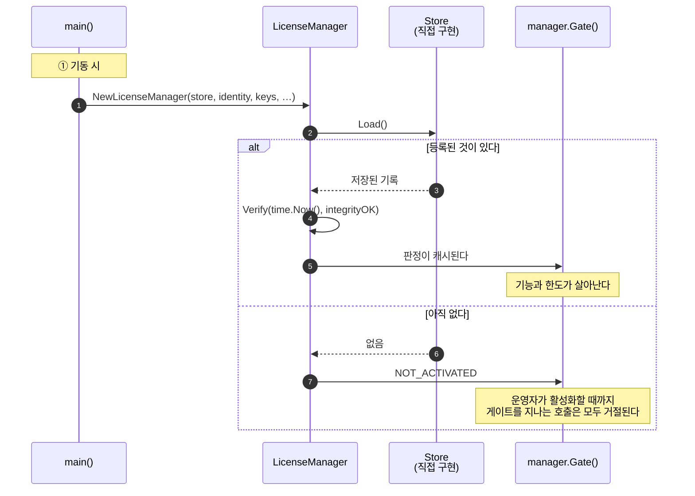
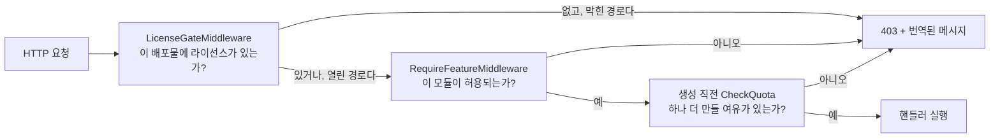

# Go

## 무엇을 만들게 되는가

순서대로 세 가지입니다. 기동 시 SDK를 조립하고, 운영자가 활성화할 자리를 만들고, 규칙이 성립해야 하는 지점에 게이트를 놓습니다.



## 가져다 쓰기

```
go get github.com/accesscore-dev/accesscore-license-sdk-dist/packages/go@v1.0.0
```

코어는 정적으로 링크되므로 Go 바이너리가 코어를 안고 다닙니다 — 옆에 공유 라이브러리를 깔 필요가 없습니다. cgo가 필요하며 `CGO_ENABLED=0`으로는 빌드되지 않습니다.

## 제품이 제공해야 하는 것

패키지의 인터페이스입니다. 검증 키와 함께 앞의 둘만 필수입니다.

| 인터페이스 | 답하는 것 |
| --- | --- |
| `Store` | 등록 기록 읽기와 쓰기 |
| `ProductIdentity` | 이 배포가 어떤 제품이고 어떤 릴리스인지 |
| `FeatureCatalogue` | 이 배포가 게이트하는 기능 키 |
| `QuotaCounter` | 한도 코드별 현재 수량 |
| `FeatureActivationChecker` | 운영자가 그 기능을 켰는지 |
| `AuditRecorder` | 라이선스 이벤트 기록 위치 |
| `ActivationServerDirectory` | 활성화 서버 주소 |

## 조립

```go
manager := aclic.NewLicenseManager(
    store,
    identity,
    []aclic.KeyMaterial{{Kid: "acps-2026-01", PublicKey: publicKeyPEM}},
    aclic.WithCatalogue(catalogue),
    aclic.WithCounter(userCounter),
    aclic.WithAudit(auditRecorder),
    aclic.WithConfiguredServerURL(config.LicenseServerURL),
    aclic.WithInstanceID(config.InstanceID),
)

if _, err := manager.Verify(time.Now(), integrityOK); err != nil {
    return err
}
```

`Verify`는 현재 시각과 무결성 검사 결과를 호출자에게서 받습니다. 코어는 시계를 읽지 않고, 무결성 검사 대상은 언어마다 다릅니다.

## 직접 만든 엔드포인트에서 활성화하기

SDK는 본문을 만들고 응답을 해석합니다. HTTP 호출은 애플리케이션의 몫이며, 타임아웃도 전송 계층도 애플리케이션이 정합니다.

```go
func activate(writer http.ResponseWriter, request *http.Request) {
    var form struct{ ProductKey string `json:"productKey"` }
    if err := json.NewDecoder(request.Body).Decode(&form); err != nil {
        http.Error(writer, "bad request", http.StatusBadRequest)
        return
    }

    activation, err := manager.ActivationRequest(form.ProductKey)
    if err != nil {
        aclic.WriteDenial(writer, err)
        return
    }

    answer, err := postJSON(request.Context(),
        manager.ActivationServerURL()+"/api/activations", activation.Body)
    if err != nil {
        http.Error(writer, "라이선스 서버가 응답하지 않았다", http.StatusBadGateway)
        return
    }

    record, err := manager.ActivationResponse(answer, activation)   // 여기서 논스를 확인한다
    if err != nil {
        aclic.WriteDenial(writer, err)
        return
    }
    if err := manager.Store(record); err != nil {
        http.Error(writer, "라이선스를 저장하지 못했다", http.StatusInternalServerError)
        return
    }
    if _, err := manager.Verify(time.Now(), integrityOK); err != nil {
        aclic.WriteDenial(writer, err)
        return
    }

    json.NewEncoder(writer).Encode(manager.Gate().State())
}
```

`ActivationResponse`는 논스가 요청과 다르거나, 머신 지문이 이 호스트와 맞지 않거나, 페이로드가 검증되지 않는 응답을 거절합니다. 다른 배포물에서 가로챈 응답을 여기에 쓸 수 없습니다.

## 게이트 적용하기

```go
// 라이선스가 없는 동안 모든 요청을 막는다.
handler := aclic.LicenseGateMiddleware(manager.Gate(), []string{"/license", "/activations"})(mux)

// 기능 하나.
protected := aclic.RequireFeatureMiddleware(manager.Gate(), "ATTENDANCE")(attendanceHandler)

// 한도 하나, 추가 직전에.
if err := manager.CheckQuota("USERS"); err != nil {
    aclic.WriteDenial(writer, err)
    return
}
```

gin·echo·fiber는 `GinLicenseGate`, `EchoLicenseGate`, `FiberLicenseGate`로 얹습니다. 각 프레임워크의 컨텍스트가 이미 만족하는 작은 인터페이스만 받으므로 이 모듈은 셋 중 무엇에도 의존하지 않고, 제품은 쓰는 것 하나를 세 줄로 연결합니다.

라이선스가 없는 동안 어느 경로를 열어 둘지는 제품이 정합니다. 배포물은 자기 라이선스 화면에 닿아야 비로소 라이선스를 등록할 수 있습니다.

각 호출이 놓이는 자리는 이렇습니다.



## 거절을 응답으로 바꾸기

거절은 `Status`, `ErrorCode`, `Denial`, `HTTPStatus`를 실은 `*LicenseDenied`다. `WriteDenial`이 모든 어댑터가 쓰는 문서를 쓰고, 자체 응답 형태를 쓰는 제품은 필드를 읽어 자기 형태로 만듭니다.

```go
var denied *aclic.LicenseDenied
if errors.As(err, &denied) {
    message := translate(request.Context(), denied.Denial.MessageKey, denied.Denial.Arguments)
    respond(writer, denied.HTTPStatus, denied.ErrorCode, message)
    return
}
```

메시지 키와 인자 순서는 [messages.ko.md](messages.md)에 있습니다.

## 최신 상태 유지하기

하트비트가 필요한 라이선스는 주기적인 갱신이 있어야 합니다. SDK가 본문을 쓰고 응답을 읽으며, 주기와 전송은 애플리케이션이 정합니다.

```go
func refreshLicense(ctx context.Context) error {
    if !manager.Gate().State().HeartbeatRequired {
        return nil
    }

    beat, err := manager.HeartbeatRequest()
    if err != nil {
        return err
    }

    answer, err := postSigned(ctx,
        manager.ActivationServerURL()+"/api/heartbeats", beat.Body, beat.Signature)
    if err != nil {
        return err   // 허용 기간이 지나기 전까지 라이선스는 계속 쓸 수 있다
    }

    record, err := manager.HeartbeatResponse(answer)
    if err != nil {
        return err
    }
    if err := manager.Store(record); err != nil {
        return err
    }
    _, err = manager.Verify(time.Now(), integrityOK)
    return err
}
```

하트비트 실패는 배포물이 즉시 대응해야 하는 오류가 아닙니다. `heartbeatToleranceDays`가 지날 때까지 라이선스는 계속 쓸 수 있습니다. 기록만 남기고 다음 실행에 맡깁니다.

## 코어 직접 호출

매니저가 감싸지 않은 연산은 호출 하나로 닿습니다.

```go
var answer map[string]any
if err := aclic.Shared.Release(map[string]any{
    "operation": "WITHIN_CEILING", "version": "3.2.0", "other": "3.2",
}, &answer); err != nil {
    return err
}
```

## 출시 전 점검

- [ ] 릴리스 바이너리를 만드는 모든 빌드에서 `CGO_ENABLED=1`입니다.
- [ ] 검증 키는 설정으로 바꿀 수 있는 경로가 아니라 빌드에 컴파일돼 들어갑니다.
- [ ] 라이선스가 없는 동안 열어두는 경로가 라이선스 화면까지만 닿습니다.
- [ ] [messages.md](messages.md)의 모든 메시지 키가 출시하는 모든 로케일에 번역돼 있습니다.
- [ ] 컨테이너가 호스트 머신 식별자를 읽기 전용으로 마운트합니다. 그렇지 않으면 활성화가 `FINGERPRINT_UNAVAILABLE`로 실패합니다.
