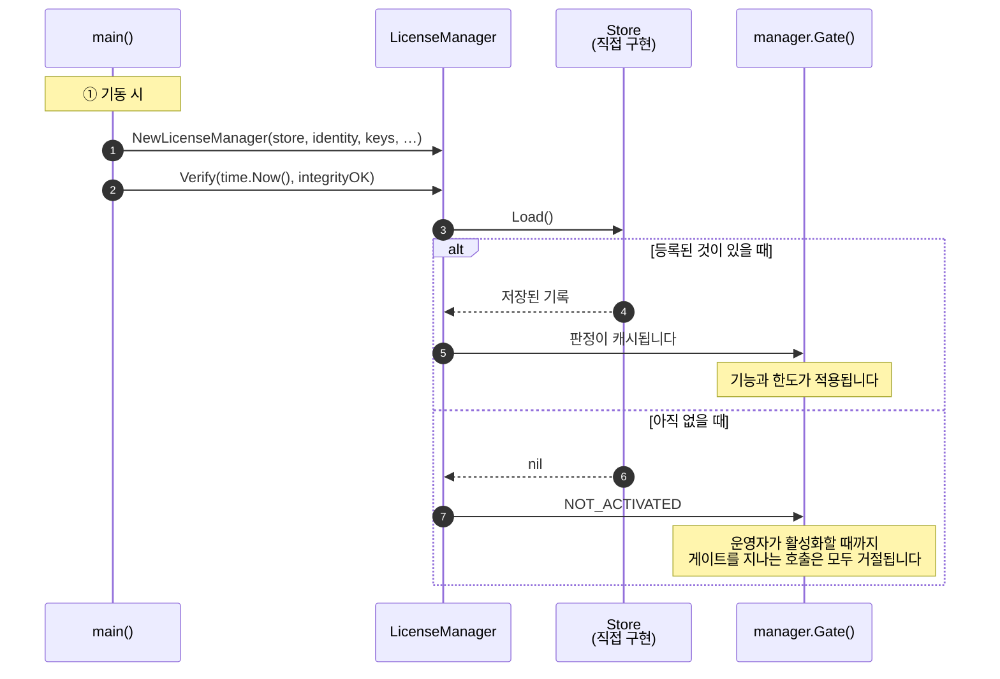
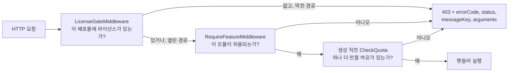

# Go

## 작업 개요

할 일은 세 가지입니다. 기동할 때 SDK를 조립하고, 운영자가 활성화할 화면을 만들고, 규칙을 적용해야 하는 코드 위치에 게이트를 둡니다.



## 가져다 쓰기

모듈은 Go 1.22 이상이 필요합니다.

```
go get github.com/accesscore-dev/accesscore-license-sdk-dist/packages/go@v1.1.0
```

```go
import aclic "github.com/accesscore-dev/accesscore-license-sdk-dist/packages/go"
```

코어를 정적으로 링크하므로 Go 바이너리에 코어가 함께 들어갑니다. 옆에 공유 라이브러리를 따로 설치할 필요가 없습니다. 대신 cgo가 필요하며 `CGO_ENABLED=0`으로는 빌드되지 않습니다. 모듈에는 linux amd64·arm64, darwin amd64·arm64, windows amd64용 코어가 들어 있습니다. musl 코어는 없으므로 Alpine을 비롯한 musl 시스템은 지원하지 않습니다.

## 제품이 구현할 인터페이스

패키지의 인터페이스입니다. 검증 키와 함께 앞의 둘만 필수입니다.

| 인터페이스 | 답하는 것 |
| --- | --- |
| `Store` | 등록 기록 읽기와 쓰기 |
| `ProductIdentity` | 이 배포가 어떤 제품이고 어떤 릴리스인지 |
| `FeatureCatalogue` | 이 배포가 게이트하는 기능 키 |
| `QuotaCounter` | 한도 코드별 현재 수량 |
| `FeatureActivationChecker` | 운영자가 그 기능을 켰는지 |
| `AuditRecorder` | 라이선스 이벤트 기록 위치 |
| `ActivationServerDirectory` | 활성화 서버 주소 |

`FeatureActivationChecker`는 매니저가 아니라 게이트에 넘깁니다. `aclic.WithGate(aclic.NewGateWithActivation(checker.IsEffectivelyActive))`처럼 씁니다. `ActivationServerDirectory`는 `aclic.WithDirectory(directory)`로 넘기며, 넘기면 `ServerURL()`이 설정된 주소보다 이 인터페이스가 돌려주는 주소를 먼저 씁니다.

## 조립

```go
manager := aclic.NewLicenseManager(
    store,
    identity,
    []aclic.KeyMaterial{{Kid: "acps-2026-01", PublicKey: publicKeyPEM}},
    aclic.WithCatalogue(catalogue),
    aclic.WithCounter(userCounter),
    aclic.WithAudit(auditRecorder),
    aclic.WithConfiguredServerURL(config.LicenseServerURL),
    aclic.WithInstanceID(config.InstanceID),
)

if _, err := manager.Verify(time.Now(), integrityOK); err != nil {
    return err
}
```

`Verify`는 현재 시각과 무결성 검사 결과를 호출한 쪽에서 받습니다. 코어는 시계를 읽지 않고, 무엇을 해시해 무결성을 볼지는 언어마다 다르기 때문입니다. `Verify`가 돌려주는 오류는 코어를 호출하지 못했다는 뜻입니다. 거절은 돌려받은 판정의 `Status`로 알 수 있습니다.

## 직접 만든 엔드포인트에서 활성화하기

요청을 만들고 응답을 해석하는 일은 SDK가 합니다. HTTP 호출은 애플리케이션이 직접 하고, 타임아웃도 전송 계층도 애플리케이션이 정합니다.

```go
var httpClient = &http.Client{Timeout: 20 * time.Second}

func activate(writer http.ResponseWriter, request *http.Request) {
    var form struct{ ProductKey string `json:"productKey"` }
    if err := json.NewDecoder(request.Body).Decode(&form); err != nil {
        http.Error(writer, "bad request", http.StatusBadRequest)
        return
    }

    now := time.Now()
    activation, err := manager.ActivationRequest(form.ProductKey, now)
    if err != nil {
        http.Error(writer, err.Error(), http.StatusInternalServerError)
        return
    }

    status, body, reachable := send(request.Context(), manager.ServerURL(), activation)
    outcome, err := manager.Interpret("ACTIVATE", status, body, activation.Nonce, reachable) // 여기서 논스를 확인한다
    if err != nil {
        http.Error(writer, err.Error(), http.StatusInternalServerError)
        return
    }
    if !outcome.Success {
        writer.Header().Set("Content-Type", "application/json")
        writer.WriteHeader(http.StatusBadRequest)
        json.NewEncoder(writer).Encode(map[string]string{
            "error": outcome.Error, "messageKey": outcome.MessageKey,
        })
        return
    }

    evaluation, err := manager.Apply(&aclic.RegistrationRecord{
        ProductKey:       form.ProductKey,
        LicenseToken:     outcome.Result.LicenseToken,
        ActivationID:     outcome.Result.ActivationID,
        ActivationSecret: outcome.Result.ActivationSecret,
        InstanceID:       config.InstanceID,
    }, now, integrityOK)
    if err != nil {
        http.Error(writer, err.Error(), http.StatusInternalServerError)
        return
    }

    json.NewEncoder(writer).Encode(evaluation)
}

// send는 만들어 둔 요청을 그대로 보낸다. 응답이 오지 않으면 reachable이 false다.
func send(ctx context.Context, server string, prepared *aclic.PreparedRequest) (int, string, bool) {
    request, err := http.NewRequestWithContext(ctx, prepared.Method, server+prepared.Path,
        strings.NewReader(prepared.Body))
    if err != nil {
        return 0, "", false
    }
    for name, value := range prepared.Headers {
        request.Header.Set(name, value)
    }
    response, err := httpClient.Do(request)
    if err != nil {
        return 0, "", false
    }
    defer response.Body.Close()
    body, err := io.ReadAll(response.Body)
    if err != nil {
        return 0, "", false
    }
    return response.StatusCode, string(body), true
}
```

`ActivationRequest`는 `Method`, `Path`, `Body`, `Headers`, `Nonce`를 담은 `*PreparedRequest`를 돌려줍니다. `Body`는 이미 JSON 문자열이고 서명이 그 바이트를 덮으므로 그대로 보내세요.

`Interpret`는 코어를 호출하지 못했을 때만 오류를 돌려줍니다. 거절이면 `Success: false`와 함께 `Error`, `MessageKey`를 담은 결과를 돌려줍니다. 논스가 요청과 다르면 `NONCE_MISMATCH`, 머신 핑거프린트가 이 호스트와 맞지 않으면 `FINGERPRINT_MISMATCH`, 서명이 검증되지 않으면 `INVALID_SIGNATURE`입니다. 그래서 다른 배포물에서 가로챈 응답을 여기에 쓸 수 없습니다. 서버가 보내는 거절과 `PENDING_APPROVAL`은 [concepts.md](concepts.md#활성화-한-단계씩)에 정리돼 있습니다. `Apply`는 기록을 `Store`로 저장하고 판정합니다.

## 게이트 적용하기

```go
// 라이선스가 없는 동안 모든 요청을 막는다.
handler := aclic.LicenseGateMiddleware(manager.Gate(), []string{"/license", "/activations"})(mux)

// 기능 하나.
protected := aclic.RequireFeatureMiddleware(manager.Gate(), "ATTENDANCE")(attendanceHandler)

// 한도 하나, 추가 직전에.
if err := manager.CheckQuota("USERS"); err != nil {
    aclic.WriteDenial(writer, err)
    return
}
```

gin·echo·fiber는 `GinLicenseGate`, `EchoLicenseGate`, `FiberLicenseGate`로 연결하므로 이 모듈은 셋 중 무엇에도 의존하지 않습니다. 각 함수는 프레임워크의 컨텍스트가 아니라 작은 인터페이스(`GinContext`, `EchoContext`, `FiberContext`)를 받습니다. 프레임워크의 컨텍스트는 이 인터페이스를 그대로 만족하지 않습니다. `*gin.Context`의 `Writer`와 `Request`는 메서드가 아니라 필드이고, echo의 `Response()`는 `*echo.Response`를 돌려주며, fiber의 `Path`와 `Status`는 시그니처가 다릅니다. 그래서 제품이 컨텍스트를 감싸는 래퍼를 작성합니다.

```go
type ginContext struct{ c *gin.Context }

func (g ginContext) Writer() http.ResponseWriter { return g.c.Writer }
func (g ginContext) Request() *http.Request      { return g.c.Request }
func (g ginContext) Abort()                      { g.c.Abort() }
func (g ginContext) Next()                       { g.c.Next() }

licenseGate := aclic.GinLicenseGate(manager.Gate(), []string{"/license"})
router.Use(func(c *gin.Context) { licenseGate(ginContext{c}) })
```

`EchoLicenseGate`는 응답을 쓰지 않고 `*LicenseDenied`를 돌려줍니다. 제품의 echo 오류 핸들러에서 `WriteDenial`로 쓰세요. echo의 기본 핸들러는 500으로 응답합니다.

라이선스가 없는 동안 어느 경로를 열어 둘지는 제품이 정합니다. 배포물이 자기 라이선스 화면에 접근할 수 있어야 라이선스를 등록할 수 있습니다.

각 호출의 위치는 다음과 같습니다.



## 거절을 응답으로 바꾸기

거절은 `*LicenseDenied`로 돌아오며 `Status`, `ErrorCode`, `Denial`, `HTTPStatus`를 담습니다. `WriteDenial`은 어느 어댑터에서나 같은 문서를 쓰며, 이 문서에는 번역하지 않은 `errorCode`, `status`, `messageKey`, `arguments`가 들어 있습니다. 다른 종류의 오류를 받으면 아무것도 쓰지 않고 `false`를 돌려줍니다. 자체 응답 형태를 쓰는 제품은 필드를 읽어 직접 만들면 됩니다.

```go
var denied *aclic.LicenseDenied
if errors.As(err, &denied) {
    message := translate(request.Context(), denied.Denial.MessageKey, denied.Denial.Arguments)
    respond(writer, denied.HTTPStatus, denied.ErrorCode, message)
    return
}
```

메시지 키와 인자 순서는 [messages.md](messages.md)에 있습니다.

## 최신 상태 유지하기

하트비트를 요구하는 라이선스는 주기적으로 갱신해야 합니다. 요청을 만들고 응답을 읽는 일은 SDK가 하고, 주기와 전송 방법은 애플리케이션이 정합니다.

```go
func refreshLicense(ctx context.Context) error {
    state := manager.Gate().State()
    if state.Payload == nil || !state.Payload.HeartbeatRequired {
        return nil
    }

    now := time.Now()
    beat, err := manager.HeartbeatRequest(now)
    if err != nil {
        return err
    }

    // X-Activation-Signature는 beat.Headers에 들어 있다.
    status, body, reachable := send(ctx, manager.ServerURL(), beat)
    if !reachable {
        return nil // 하트비트 허용 시간이 지나기 전까지 라이선스는 유효하다
    }

    outcome, err := manager.Interpret("HEARTBEAT", status, body, beat.Nonce, true)
    if err != nil {
        return err
    }
    switch {
    case outcome.Success:
        record := store.Load()
        record.LicenseToken = outcome.Result.LicenseToken
        record.LastHeartbeatAt = now.UTC().Format(time.RFC3339)
        _, err = manager.Apply(record, now, integrityOK)
    case outcome.Error == "REVOKED":
        _, err = manager.MarkRevoked(now, integrityOK)
    }
    return err
}
```

하트비트 응답에는 새 토큰만 있고 활성화 비밀값은 없습니다. 저장된 기록을 유지한 채 `LicenseToken`만 바꾸세요. SDK는 하트비트에 성공한 시각을 직접 기록하지 않습니다. 저장하는 기록에 `LastHeartbeatAt`을 넣어야 하며, 기한은 이 시각부터 계산합니다. 첫 하트비트 전에는 `activatedAt`부터 계산합니다.

하트비트가 한 번 실패했다고 곧바로 대응할 필요는 없습니다. 하트비트 허용 시간이 지나기 전까지 라이선스는 계속 유효합니다. 허용 시간은 `heartbeatToleranceHours`와 `heartbeatIntervalHours` 가운데 긴 쪽이며, 토큰의 값이 0이면 각각 24시간과 1시간으로 계산합니다. 기록만 남기고 다음 실행에 맡기면 됩니다.

## 등록 기록과 그 밖의 호출

`Store`는 배포물마다 `RegistrationRecord` 하나를 보관합니다.

| 필드 | 담는 값 | 쓰는 쪽 |
| --- | --- | --- |
| `ProductKey` | 운영자가 입력한 제품 키 | 활성화 코드 |
| `LicenseToken` | 서명된 토큰 | 활성화·하트비트 코드(`Apply`) |
| `ActivationID`, `ActivationSecret` | 하트비트와 해제 요청에 서명하는 자격 증명 | 활성화 코드 |
| `InstanceID` | 이 배포물의 인스턴스 식별자 | 활성화 코드 |
| `LastHeartbeatAt` | 마지막으로 성공한 하트비트 시각 | 하트비트 코드 |
| `VerificationWatermark` | 판정이 받아들인 가장 늦은 시각 | 매니저(판정할 때마다) |
| `RevokedAt` | 폐기 시각 | `MarkRevoked` |

수명 주기를 마무리하는 호출이 세 가지 더 있습니다. `DeactivationRequest(now)`는 좌석을 반납하는 요청을 만들고, 그 응답은 `Interpret("DEACTIVATE", …)`로 읽습니다. `MarkRevoked(now, …)`는 폐기 시각을 저장하고 다시 판정합니다. `ClearRegistration(now, …)`는 기록을 지우고 배포물을 `NOT_ACTIVATED` 상태로 되돌립니다.

## 코어 직접 호출

매니저가 감싸 두지 않은 연산도 호출 한 번으로 실행할 수 있습니다.

```go
var answer map[string]any
if err := aclic.Shared.Release(map[string]any{
    "operation": "WITHIN_CEILING", "version": "3.2.0", "other": "3.2",
}, &answer); err != nil {
    return err
}
```

## 출시 전 점검

- [ ] 릴리스 바이너리를 만드는 모든 빌드에서 `CGO_ENABLED=1`입니다.
- [ ] 검증 키는 설정으로 바꿀 수 있는 경로가 아니라 빌드에 컴파일돼 들어갑니다.
- [ ] 라이선스가 없는 동안 열어 두는 경로로는 라이선스 화면에만 접근할 수 있습니다.
- [ ] [messages.md](messages.md)의 모든 메시지 키가 출시하는 모든 로케일에 번역돼 있습니다.
- [ ] 컨테이너가 호스트 머신 식별자를 읽기 전용으로 마운트합니다. 그렇지 않으면 활성화가 `FINGERPRINT_MISMATCH`로 실패하고, 저장된 라이선스는 `FINGERPRINT_UNAVAILABLE`로 판정됩니다.
