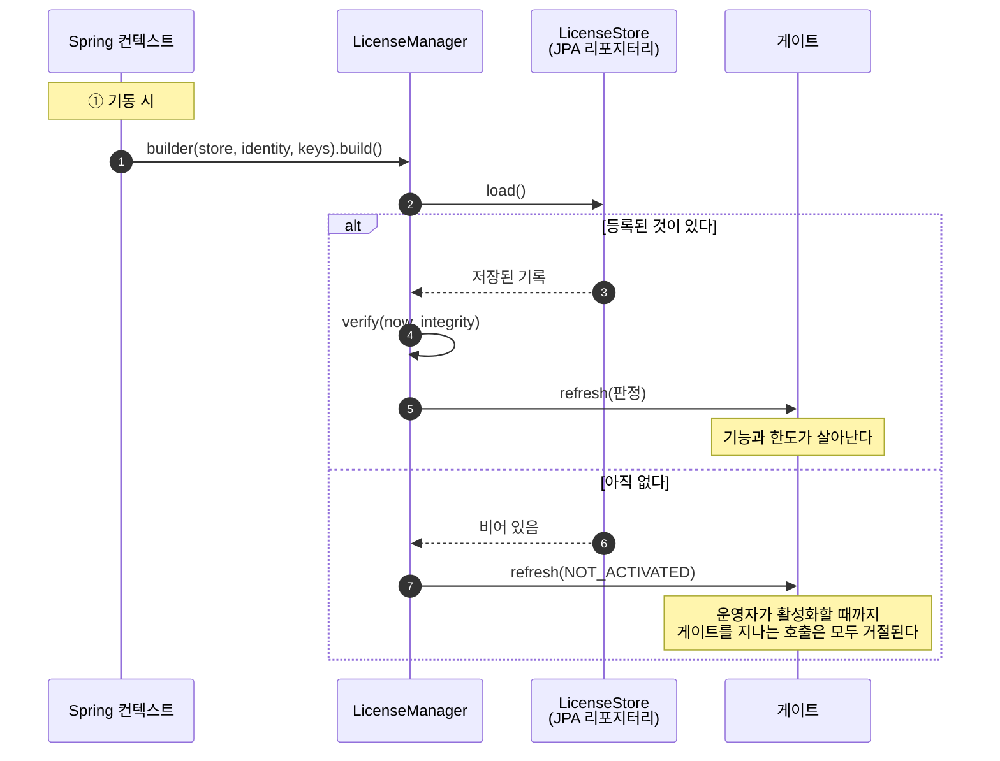
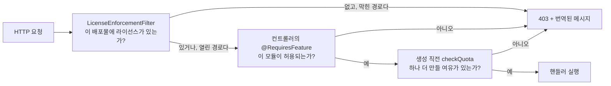

# Java

## 무엇을 만들게 되는가

순서대로 세 가지입니다. 기동 시 SDK를 조립하고, 운영자가 활성화할 자리를 만들고, 규칙이 성립해야 하는 지점에 게이트를 놓습니다.



## 가져다 쓰기

```groovy
repositories {
    maven {
        url = uri('https://maven.pkg.github.com/accesscore-dev/accesscore-license-sdk-dist')
        credentials {
            username = providers.gradleProperty('gpr.user').orElse(providers.environmentVariable('GITHUB_USERNAME')).get()
            password = providers.gradleProperty('gpr.token').orElse(providers.environmentVariable('GITHUB_TOKEN')).get()
        }
        content { includeGroup 'dev.accesscore' }
    }
}

dependencies {
    implementation 'dev.accesscore:license-sdk:1.0.0'
}
```

### 토큰

GitHub Packages 레지스트리는 공개 패키지여도 모든 사용자에게 인증을 요구합니다. `read:packages` 스코프만 가진 클래식 토큰을 <https://github.com/settings/tokens/new?scopes=read:packages&description=accesscore-license-sdk>에서 만듭니다.

빌드 파일에 넣지 않습니다. `~/.gradle/gradle.properties`에 두거나,

```properties
gpr.user=your-github-username
gpr.token=ghp_xxxxxxxxxxxxxxxxxxxx
```

환경 변수로 줍니다.

```
export GITHUB_USERNAME=your-github-username
export GITHUB_TOKEN=ghp_xxxxxxxxxxxxxxxxxxxx
```

CI에서는 워크플로우가 제공하는 `GITHUB_TOKEN`에 이미 `read:packages`가 들어 있습니다.

### Maven

```xml
<repositories>
  <repository>
    <id>accesscore</id>
    <url>https://maven.pkg.github.com/accesscore-dev/accesscore-license-sdk-dist</url>
  </repository>
</repositories>

<dependency>
  <groupId>dev.accesscore</groupId>
  <artifactId>license-sdk</artifactId>
  <version>1.0.0</version>
</dependency>
```

자격 증명은 `~/.m2/settings.xml`에 둡니다.

```xml
<servers>
  <server>
    <id>accesscore</id>
    <username>your-github-username</username>
    <password>ghp_xxxxxxxxxxxxxxxxxxxx</password>
  </server>
</servers>
```

네이티브 코어는 jar 안에 플랫폼당 한 디렉터리로 담기고, 처음 필요할 때 임시 파일로 추출됩니다. 공유 라이브러리의 출처를 자체 정책으로 고정한 배포는 `-Daclic.native.library=<경로>`로 파일을 지정합니다 — 적재할 파일을 지정할 뿐 신뢰할 키를 지정하지 않으므로 어떤 검사도 약화시키지 않습니다.

## 제품이 제공해야 하는 것

`LicenseSpi`에 모인 인터페이스 일곱 개입니다. 앞의 셋만 필수입니다.

| 인터페이스 | 답하는 것 |
| --- | --- |
| `LicenseStore` | 등록 기록 읽기와 쓰기 |
| `ProductIdentity` | 이 배포가 어떤 제품이고 어떤 릴리스인지 |
| — 검증 키 | 클래스패스 리소스에서 읽어 빌더에 전달 |
| `FeatureCatalogue` | 이 배포가 게이트하는 기능 키 |
| `QuotaCounter` | 한도 코드별 현재 수량 |
| `FeatureActivationChecker` | 운영자가 그 기능을 켰는지 |
| `AuditRecorder` | 라이선스 이벤트 기록 위치 |
| `ActivationServerDirectory` | 활성화 서버 주소 |

## 조립

```java
LicenseManager manager = LicenseManager
        .builder(store, identity, List.of(KeyMaterial.of("acps-2026-01", publicKeyPem)))
        .catalogue(catalogue)
        .counter(userCounter)
        .counter(hardwareCounter)
        .audit(auditRecorder)
        .configuredServerUrl(properties.getServerUrl())
        .instanceId(properties.getInstanceId())
        .build();

manager.verify(Instant.now(), integrityChecker.verify());
```

`verify`는 현재 시각과 무결성 검사 결과를 호출자에게서 받습니다. 코어는 시계를 읽지 않고, 무결성 검사 대상은 언어마다 다릅니다.

## 직접 만든 엔드포인트에서 활성화하기

SDK는 본문을 만들고 응답을 해석합니다. HTTP 호출은 애플리케이션의 몫이며, 타임아웃도 프록시도 애플리케이션이 정합니다.

```java
@PostMapping("/license/activate")
public ActivationView activate(@RequestBody @Validated ActivationForm form) {

    ActivationRequest request = manager.activationRequest(form.productKey());

    ActivationAnswer answer = restClient.post()
            .uri(manager.activationServerUrl() + "/api/activations")
            .contentType(MediaType.APPLICATION_JSON)
            .body(request.body())
            .retrieve()
            .body(ActivationAnswer.class);

    LicenseRecord record = manager.activationResponse(answer, request);   // 여기서 논스를 확인한다
    manager.store(record);
    manager.verify(Instant.now(), integrity.verify());                    // 게이트가 갱신된다

    return ActivationView.of(manager.gate().state());
}
```

`activationResponse`는 논스가 요청과 다르거나, 머신 지문이 이 호스트와 맞지 않거나, 페이로드가 검증되지 않는 응답을 거절합니다. 다른 배포물에서 가로챈 응답을 여기에 쓸 수 없습니다.

## 게이트 적용하기

```java
// 라이선스가 없는 동안 모든 요청을 막는다.
new LicenseEnforcementFilter(manager.gate(), List.of("/license/**", "/activations/**"), mapper)

// 기능 하나.
@RequiresFeature(PacsFeatures.ATTENDANCE)
public class AttendanceRestController { }

// 한도 하나, 추가 직전에.
manager.checkQuota(PacsQuotas.USERS);
```

라이선스가 없는 동안 어느 경로를 열어 둘지는 제품이 정합니다. 배포물은 자기 라이선스 화면에 닿아야 비로소 라이선스를 등록할 수 있고, 그 화면이 어디인지는 제품만 압니다.

각 호출이 놓이는 자리는 이렇습니다.



## 거절을 응답으로 바꾸기

`LicenseDeniedException`은 상태, 오류 코드, 메시지 키, 인자를 싣습니다. 모든 어댑터가 이것으로 같은 문서를 씁니다. 자체 응답 봉투를 쓰는 제품은 핸들러 하나로 옮깁니다.

```java
@ExceptionHandler(LicenseDeniedException.class)
public ResponseEntity<ApiResponse<Void>> handle(LicenseDeniedException denied, Locale locale) {
    String message = messageSource.getMessage(
            denied.denial().messageKey(), denied.denial().argumentArray(), locale);
    return ResponseEntity.status(denied.httpStatus())
            .body(ApiResponse.error(denied.errorCode(), message));
}
```

메시지 키와 인자 순서는 [messages.ko.md](messages.md)에 있습니다.

## 최신 상태 유지하기

하트비트가 필요한 라이선스는 주기적인 갱신이 있어야 합니다. SDK가 본문을 쓰고 응답을 읽으며, 주기와 전송은 애플리케이션이 정합니다.

```java
@Scheduled(cron = "0 17 3 * * *")
void refreshLicense() {
    if (!manager.gate().state().heartbeatRequired()) {
        return;
    }
    HeartbeatRequest request = manager.heartbeatRequest();
    HeartbeatAnswer answer = restClient.post()
            .uri(manager.activationServerUrl() + "/api/heartbeats")
            .header("X-Activation-Signature", request.signature())
            .body(request.body())
            .retrieve()
            .body(HeartbeatAnswer.class);

    manager.store(manager.heartbeatResponse(answer));
    manager.verify(Instant.now(), integrity.verify());
}
```

하트비트 실패는 배포물이 즉시 대응해야 하는 오류가 아닙니다. `heartbeatToleranceDays`가 지날 때까지 라이선스는 계속 쓸 수 있습니다. 기록만 남기고 다음 실행에 맡깁니다.

## 발급

개인키는 발급하는 쪽만 갖습니다. 배포물은 `LicenseIssuer`를 클래스패스에 두고도 쓸 일이 없습니다 — 서명에는 고객이 갖지 못하는 키가 필요합니다.

```java
LicenseIssuer issuer = new LicenseIssuer();

// 기동 시: 이 서버가 어느 키페어로 서명하는지 알린다. 배포물이 가진 키와 어긋나면
// 로그 한 줄로 드러나고, 고객의 첫 활성화가 실패한 뒤에 찾을 일이 없다.
log.info("License signing key fingerprint: {}", issuer.fingerprintOf(privateKeyPem));

SignedToken signed = issuer.sign(payload, privateKeyPem);
```

개인키는 PKCS#8로 넘기고 코어가 서명 직후 메모리에서 지웁니다. 호출자가 든 사본은 호출자가 지웁니다.

## 제품 키와 릴리스 버전

양쪽이 모두 필요로 하고 서로 답이 같아야 하므로, 모든 연산이 코어로 건너갑니다.

```java
ProductKeys keys = new ProductKeys();
String key = keys.generate("ACPS");
String shown = keys.masked("ACPS", key);

ReleaseVersions releases = new ReleaseVersions();
boolean entitled = releases.isWithinCeiling("3.2.0", "3.2");
String sortKey = releases.sortKey("3.2");   // SQL 정렬용
```

## 출시 전 점검

- [ ] 검증 키는 설정으로 바꿀 수 있는 경로가 아니라 클래스패스 리소스입니다.
- [ ] 라이선스가 없는 동안 열어두는 경로가 라이선스 화면까지만 닿습니다.
- [ ] [messages.md](messages.md)의 모든 메시지 키가 출시하는 모든 로케일에 번역돼 있습니다.
- [ ] 컨테이너가 호스트 머신 식별자를 읽기 전용으로 마운트합니다. 그렇지 않으면 활성화가 `FINGERPRINT_UNAVAILABLE`로 실패합니다.
- [ ] 하트비트 주기가 `heartbeatIntervalDays`보다 짧습니다. 한 번 걸러도 곧바로 기한을 넘기지 않습니다.
