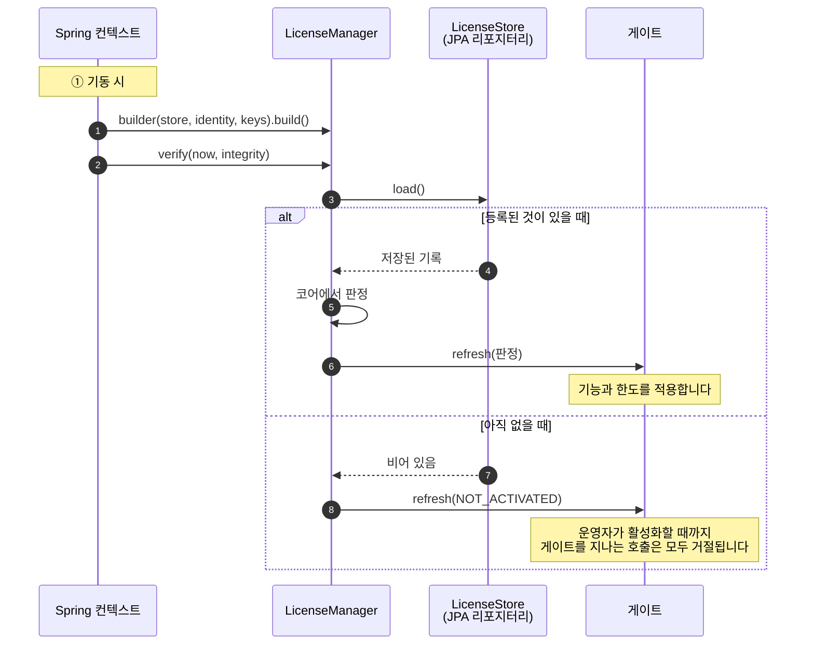
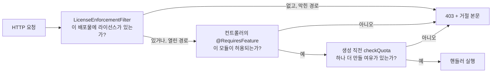

# Java

## 작업 개요

할 일은 세 가지입니다. 기동할 때 SDK를 조립하고, 운영자가 활성화할 화면을 만들고, 규칙을 적용해야 하는 지점에 게이트를 둡니다.



## 가져다 쓰기

```groovy
repositories {
    maven {
        url = uri('https://maven.pkg.github.com/accesscore-dev/accesscore-license-sdk-dist')
        credentials {
            username = providers.gradleProperty('gpr.user').orElse(providers.environmentVariable('GITHUB_USERNAME')).get()
            password = providers.gradleProperty('gpr.token').orElse(providers.environmentVariable('GITHUB_TOKEN')).get()
        }
        content { includeGroup 'dev.accesscore' }
    }
}

dependencies {
    implementation 'dev.accesscore:license-sdk:1.1.0'
}
```

### 토큰

GitHub Packages 레지스트리는 공개 패키지여도 모든 사용자에게 인증을 요구합니다. `read:packages` 스코프만 가진 클래식 토큰을 <https://github.com/settings/tokens/new?scopes=read:packages&description=accesscore-license-sdk>에서 만듭니다.

빌드 파일에 넣지 않습니다. `~/.gradle/gradle.properties`에 두거나,

```properties
gpr.user=your-github-username
gpr.token=ghp_xxxxxxxxxxxxxxxxxxxx
```

환경 변수로 줍니다.

```
export GITHUB_USERNAME=your-github-username
export GITHUB_TOKEN=ghp_xxxxxxxxxxxxxxxxxxxx
```

CI에서는 워크플로우가 제공하는 `GITHUB_TOKEN`에 이미 `read:packages`가 들어 있습니다.

### Maven

```xml
<repositories>
  <repository>
    <id>accesscore</id>
    <url>https://maven.pkg.github.com/accesscore-dev/accesscore-license-sdk-dist</url>
  </repository>
</repositories>

<dependency>
  <groupId>dev.accesscore</groupId>
  <artifactId>license-sdk</artifactId>
  <version>1.1.0</version>
</dependency>
```

자격 증명은 `~/.m2/settings.xml`에 둡니다.

```xml
<servers>
  <server>
    <id>accesscore</id>
    <username>your-github-username</username>
    <password>ghp_xxxxxxxxxxxxxxxxxxxx</password>
  </server>
</servers>
```

네이티브 코어는 jar 안에 플랫폼당 한 디렉터리로 담기고, 처음 필요할 때 임시 파일로 추출됩니다. 공유 라이브러리를 어디서 가져올지 자체 정책으로 고정한 배포물은 `-Daclic.native.library=<경로>`로 파일을 지정하면 됩니다. 이 값은 읽어 들일 파일만 가리킬 뿐 신뢰할 키를 가리키지 않으므로 어떤 검사도 느슨해지지 않습니다.

jar는 Java 17 이상에서 동작합니다. JNA와 Jackson은 의존성으로 함께 설치됩니다. Spring, Jakarta Servlet, JAX-RS, Reactor, AspectJ는 컴파일 시에만 참조합니다. 해당 어댑터는 애플리케이션의 클래스패스에 그 라이브러리가 이미 있을 때 동작하고, SDK가 대신 가져오지 않습니다.

## 제품이 구현할 인터페이스

`LicenseSpi`에 인터페이스 일곱 개가 모여 있고, 이와 별도로 검증 키가 필요합니다. 빌더는 `LicenseStore`, `ProductIdentity`, 검증 키를 반드시 받고, 나머지 다섯은 선택입니다.

| 인터페이스 | 답하는 것 | 흔한 구현 |
| --- | --- | --- |
| `LicenseStore` | 등록 기록 읽기와 쓰기 | 한 행짜리 JPA 엔티티, 또는 데이터 디렉터리의 파일 |
| `ProductIdentity` | 이 배포물이 어떤 제품이고 어떤 릴리스인지 | 상수와 빌드 버전 |
| (검증 키) | 빌더에 전달 | 클래스패스의 PEM을 기동 시 읽기 |
| `FeatureCatalogue` | 이 배포물이 게이트하는 기능 키 | 제품 기능 enum |
| `QuotaCounter` | 한도 코드별 현재 수량 | 코드별 `repository.count()` |
| `FeatureActivationChecker` | 관리자가 그 기능을 켰는지 | 설정 테이블 |
| `AuditRecorder` | 라이선스 이벤트 기록 위치 | 감사 테이블 |
| `ActivationServerDirectory` | 활성화 서버 주소 | 운영자가 입력하는 설정 행 |

이 셋이 없으면 코어는 아무것도 판정할 수 없습니다. 라이선스를 읽어 올 곳도, 대조할 제품도, 검증할 키도 없기 때문입니다.

## 조립

```java
@Configuration
@EnableAspectJAutoProxy
class LicenseConfig {

    @Bean
    LicenseManager licenseManager(LicenseStore store,
                                  ProductIdentity identity,
                                  FeatureCatalogue catalogue,
                                  List<QuotaCounter> counters,
                                  AuditRecorder audit,
                                  LicenseProperties properties) throws IOException {

        String publicKeyPem = new String(
                new ClassPathResource("license-public-key.pem").getInputStream().readAllBytes(),
                StandardCharsets.UTF_8);

        LicenseManager.Builder builder = LicenseManager
                .builder(store, identity, List.of(KeyMaterial.of("acps-2026-01", publicKeyPem)))
                .catalogue(catalogue)
                .audit(audit)
                .configuredServerUrl(properties.getServerUrl())
                .instanceId(properties.getInstanceId());

        counters.forEach(builder::counter);
        return builder.build();
    }

    @Bean
    FeatureGateAspect featureGateAspect(LicenseManager manager) {
        return new FeatureGateAspect(manager.gate());
    }

    @Bean
    ApplicationRunner licenseAtStartup(LicenseManager manager, IntegrityChecker integrity) {
        return args -> manager.verify(Instant.now(), integrity.verify());
    }
}
```

`verify`는 현재 시각과 무결성 검사 결과를 호출한 쪽에서 받습니다. 코어는 시계를 읽지 않고, 무엇을 해시해 무결성을 볼지는 언어마다 다르기 때문입니다. `LicenseProperties`와 `IntegrityChecker`는 제품이 직접 만드는 클래스입니다. SDK는 설정 프로퍼티를 읽지 않습니다.

`FeatureGateAspect`를 빈으로 등록하고 AspectJ 프록시를 켜야 `@RequiresFeature`가 동작합니다. 프록시는 `@EnableAspectJAutoProxy`나 Spring Boot의 AOP 스타터로 켭니다.

예제에서 빠진 선택 인터페이스 둘은 이렇게 연결합니다. `FeatureActivationChecker`는 빌더가 아니라 게이트에 넘깁니다.

```java
LicenseManager.builder(store, identity, keys)
        .gate(new LicenseGate(activationChecker))   // FeatureActivationChecker
        .directory(serverDirectory)                 // ActivationServerDirectory
        .build();
```

키를 교체하는 동안에는 키를 둘 이상 등록하세요. 토큰의 `kid`로 적용할 키를 고릅니다.

```java
List.of(KeyMaterial.of("acps-2026-01", currentKeyPem),
        KeyMaterial.of("acps-2027-01", incomingKeyPem))
```

## 직접 만든 엔드포인트에서 활성화하기

본문을 만들고 응답을 해석하는 일은 SDK가 합니다. HTTP 호출은 애플리케이션이 직접 하고, 타임아웃도 프록시도 애플리케이션이 정합니다.

```java
@PostMapping("/license/activate")
public ActivationView activate(@RequestBody @Validated ActivationForm form) {
    Instant now = Instant.now();
    PreparedRequest request = manager.activationRequest(form.productKey(), now);

    ActivationOutcome outcome = send(ActivationOperation.ACTIVATE, request);   // 여기서 논스를 확인한다
    if (!outcome.isSuccess()) {
        return ActivationView.refused(outcome.error(), outcome.messageKey());
    }

    ActivationSuccess issued = outcome.result();
    manager.apply(new RegistrationRecord(form.productKey(), issued.licenseToken(),
                    issued.activationId(), issued.activationSecret(), null, null, null, null),
            now, integrity.verify());                                         // 게이트가 갱신된다
    return ActivationView.of(manager.gate().state());
}

ActivationOutcome send(ActivationOperation operation, PreparedRequest request) {
    try {
        return restClient.method(HttpMethod.valueOf(request.method()))
                .uri(manager.serverUrl() + request.path())
                .headers(headers -> request.headers().forEach(headers::set))
                .body(request.body())
                .exchange((req, res) -> manager.interpret(operation,
                        res.getStatusCode().value(), res.bodyTo(String.class),
                        request.nonce(), true));
    } catch (ResourceAccessException unreachable) {
        return manager.interpret(operation, 0, "", request.nonce(), false);
    }
}
```

`PreparedRequest`에는 메서드, 서버 주소 뒤에 붙일 경로, 문자열 본문, 헤더, 논스가 들어 있습니다. 본문과 헤더는 받은 그대로 보내세요. 하트비트 서명은 그 바이트를 대상으로 계산합니다.

`interpret`는 아무것도 저장하기 전에 토큰의 서명, 논스, 이 호스트의 머신 핑거프린트를 확인합니다. 그래서 다른 배포물에서 가로챈 응답을 여기에 쓸 수 없습니다. 거절해도 예외를 던지지 않고, 실패한 `ActivationOutcome`을 돌려줍니다. 사유는 `error()`에 `INVALID_SIGNATURE`, `NONCE_MISMATCH`, `FINGERPRINT_MISMATCH`, `SEAT_EXHAUSTED`처럼 담깁니다. `PENDING_APPROVAL`은 운영자가 승인할 때까지 서버가 활성화를 보류했다는 뜻입니다. 오류가 아니라 대기 상태로 표시하고 나중에 다시 요청하세요. `APPROVAL_DENIED`는 운영자가 활성화를 거절했다는 뜻이며, 다시 요청해도 결과가 바뀌지 않습니다. 서버가 보낼 수 있는 나머지 사유는 [concepts.md](concepts.md#활성화-한-단계씩)에 있습니다.

호스트만 알 수 있는 사유는 코어가 내지 않습니다. `activate` 첫머리에서 `activationRequest`를 부르기 전에 확인하고, 그 사유의 메시지 키로 거절하세요.

```java
if (manager.serverUrl().isEmpty()) {
    return ActivationView.refused(ActivationError.NOT_CONFIGURED,
            ActivationError.NOT_CONFIGURED.messageKey());
}
if (!manager.fingerprint().isAvailable()) {
    return ActivationView.refused(ActivationError.FINGERPRINT_UNAVAILABLE,
            ActivationError.FINGERPRINT_UNAVAILABLE.messageKey());
}
```

`NOT_ACTIVATED`(갱신하거나 반납할 `hasActivationCredentials()`가 없음)와 `ALREADY_REGISTERED`도 같은 방식으로 확인합니다.

## 게이트 적용하기

```java
// 라이선스가 없는 동안 모든 요청을 막는다.
new LicenseEnforcementFilter(manager.gate(), List.of("/license/**", "/activations/**"), mapper)

// 기능 하나.
@RequiresFeature(PacsFeatures.ATTENDANCE)
public class AttendanceRestController { }

// 한도 하나, 추가 직전에.
manager.checkQuota(PacsQuotas.USERS);
```

라이선스가 없는 동안 어느 경로를 열어 둘지는 제품이 정합니다. 배포물은 자기 라이선스 화면에 접근해야 비로소 라이선스를 등록할 수 있고, 그 화면이 어디인지는 제품만 압니다.

각 호출을 두는 위치는 이렇습니다.



## 거절을 응답으로 바꾸기

`LicenseDeniedException`에는 상태, 오류 코드, 메시지 키, 인자가 담깁니다. 어느 어댑터를 쓰든 이 값으로 같은 형태의 문서를 만듭니다. 자체 응답 봉투를 쓰는 제품이라면 핸들러 하나만 두면 됩니다.

```java
@ExceptionHandler(LicenseDeniedException.class)
public ResponseEntity<ApiResponse<Void>> handle(LicenseDeniedException denied, Locale locale) {
    String message = messageSource.getMessage(
            denied.denial().messageKey(), denied.denial().argumentArray(), locale);
    return ResponseEntity.status(denied.httpStatus())
            .body(ApiResponse.error(denied.errorCode(), message));
}
```

메시지 키와 인자 순서는 [messages.md](messages.md)에 있습니다.

## 최신 상태 유지하기

하트비트를 요구하는 라이선스는 주기적으로 갱신해야 합니다. 본문을 만들고 응답을 읽는 일은 SDK가 하고, 주기와 전송 방법은 애플리케이션이 정합니다.

```java
@Scheduled(cron = "0 */30 * * * *")
void refreshLicense() {
    LicensePayload payload = manager.gate().state().payload();
    if (payload == null || !Boolean.TRUE.equals(payload.heartbeatRequired())) {
        return;
    }
    Instant now = Instant.now();
    ActivationOutcome outcome = send(ActivationOperation.HEARTBEAT, manager.heartbeatRequest(now));

    if (outcome.isSuccess()) {
        RegistrationRecord record = manager.currentRecord().orElseThrow();
        manager.apply(record.withHeartbeat(outcome.result().licenseToken(), now),
                now, integrity.verify());
    } else if (outcome.error() == ActivationError.REVOKED) {
        manager.markRevoked(now, integrity.verify());
    } else {
        log.warn("License heartbeat failed: {}", outcome.detail());
    }
}
```

`withHeartbeat`는 토큰을 바꾸고 `lastHeartbeatAt`을 기록합니다. 하트비트 기한은 이 시각부터 계산하고, 첫 하트비트 전에는 `activatedAt`부터 계산합니다. 하트비트 응답에는 활성화 비밀값이 없으므로 저장된 기록을 그대로 두고 이 두 필드만 바꾸세요. `markRevoked`는 폐기 기록을 저장하므로 재시작한 뒤에도 거절이 유지됩니다.

하트비트가 한 번 실패했다고 곧바로 대응할 필요는 없습니다. 라이선스는 하트비트 허용 시간이 지나기 전까지 계속 유효합니다. 허용 시간은 `heartbeatToleranceHours`와 `heartbeatIntervalHours` 가운데 긴 쪽이고, 라이선스에 0이 들어 있으면 각각 24시간과 1시간으로 계산합니다. 기록만 남기고 다음 실행에 맡기면 됩니다.

## 발급

개인키는 발급 서버만 갖습니다. 배포물의 클래스패스에 `LicenseIssuer`가 있어도 쓸 일은 없습니다. 서명하려면 고객이 결코 갖지 못하는 키가 있어야 하기 때문입니다.

```java
LicenseIssuer issuer = new LicenseIssuer();
byte[] privateKeyPem = Files.readAllBytes(signingKeyPath);

// 기동 시: 이 서버가 어느 키페어로 서명하는지 알린다. 배포물이 가진 키와 어긋나면
// 로그 한 줄로 드러나고, 고객의 첫 활성화가 실패한 뒤에 찾을 일이 없다.
log.info("License signing key fingerprint: {}", issuer.fingerprintOf(privateKeyPem));

// 활성화마다: 계약 내용을 요청에 담긴 머신과 논스에 묶는다.
ActivationBinding binding = objectMapper.readValue(requestBody, ActivationBinding.class);
LicensePayload payload = issuance.boundTo(binding).toPayload(
        Instant.now(), "acps-2026-01", SignatureAlgorithm.ED25519,
        AclicCore.shared().schemaVersion());
SignedToken signed = issuer.sign(payload, privateKeyPem);
```

`issuance`는 `LicenseIssuance`입니다. 라이선스 ID부터 하트비트까지 계약이 정하는 값을 담습니다. 마지막 `int` 인자 둘은 `heartbeatIntervalHours`와 `heartbeatToleranceHours`이고 단위는 시간입니다. 0을 넘기면 검증 측 기본값인 1시간과 24시간을 적용합니다. 1.1.0 이전에는 이 두 값의 단위가 일이었습니다. 일 단위 값을 넘기는 기존 호출도 그대로 컴파일되고 시간 단위로 해석되므로, 버전을 올릴 때 모든 호출을 확인하세요.

개인키는 `String`이 아니라 PKCS#8 바이트로 넘깁니다. 코어는 서명을 만든 직후 그 값을 메모리에서 지웁니다. 호출한 쪽이 보관한 사본은 호출한 쪽이 지워야 합니다.

## 제품 키와 릴리스 버전

발급 서버와 검증 측이 모두 이 값을 다루고 답이 서로 같아야 합니다. 그래서 모든 연산을 Java로 다시 구현하지 않고 코어에 맡깁니다.

```java
ProductKeys keys = new ProductKeys();
String key = keys.generate("ACPS");
String shown = keys.masked("ACPS", key);

ReleaseVersions releases = new ReleaseVersions();
boolean entitled = releases.isWithinCeiling("3.2.0", "3.2");
String sortKey = releases.sortKey("3.2");   // SQL 정렬용
```

## 출시 전 점검

- [ ] 검증 키는 설정으로 바꿀 수 있는 경로가 아니라 클래스패스 리소스입니다.
- [ ] 라이선스가 없는 동안 열어두는 경로로는 라이선스 화면에만 접근할 수 있습니다.
- [ ] [messages.md](messages.md)의 모든 메시지 키가 출시하는 모든 로케일에 번역돼 있습니다.
- [ ] 컨테이너가 호스트 머신 식별자를 읽기 전용으로 마운트합니다. 그렇지 않으면 활성화가 실패하고(직접 확인한 `FINGERPRINT_UNAVAILABLE`, 또는 `FINGERPRINT_MISMATCH`), 저장된 라이선스는 `FINGERPRINT_UNAVAILABLE`로 판정됩니다.
- [ ] 하트비트 실행 간격이 `heartbeatIntervalHours`(라이선스에 0이 들어 있으면 1시간) 이하입니다. 그래야 몇 번 실패해도 허용 시간이 지나기 전에 다시 시도합니다.
