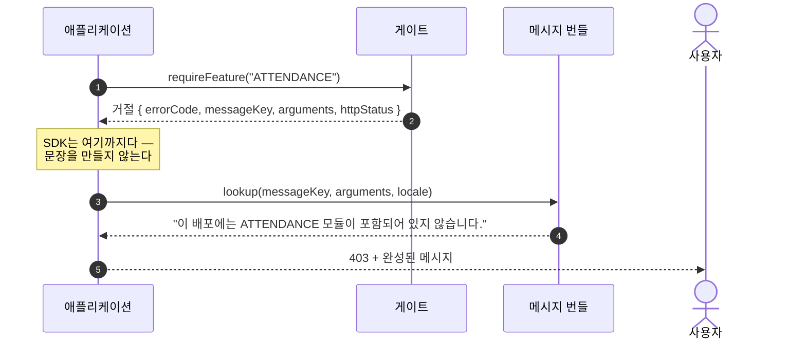

# 메시지 키

코어는 키와 인자를 돌려주고, 번역은 애플리케이션이 합니다. SDK가 얹히는 언어마다 국제화 체계가 다르기 때문입니다. 코어가 문구까지 들고 있으면 언어가 하나 늘 때마다 문구도 따라 늘어납니다.

애플리케이션은 아래 키를 자신이 지원하는 모든 로케일에 정의해야 합니다. 빠뜨린 키는 가장 나쁜 순간에 번역되지 않은 자리표시자로 드러납니다. 그 순간 운영자는 이미 막혀 있습니다.

## 메시지는 어디서 오는가



`errorCode`는 클라이언트 코드가 분기할 값이고, `messageKey`와 인자는 사람이 읽을 문장을 만들 재료입니다. 완성된 문장으로 분기하면 번역을 한 번 손보는 순간 깨집니다.

## 인자 순서도 키의 일부입니다

인자 순서는 이 문서에서만 정합니다. 두 인자를 바꿔 쓰면 숫자가 엉뚱한 자리에 들어가고, 운영자는 사실과 다른 안내를 받습니다.

## 판정이 내는 거절

| 키 | 인자 | 언제 |
| --- | --- | --- |
| `error.license.notValid` | — | 총칭 문구. 구체적인 값을 채울 수 없을 때 |
| `error.license.gracePeriodReadOnly` | — | `GRACE_PERIOD` — 만료했지만 계속 서비스 중 |
| `error.license.releaseNotEntitled` | 1. 실행 중인 릴리스<br>2. 계약 상한 | `RELEASE_NOT_ENTITLED` |
| `error.license.expired` | 1. 만료 시각 (RFC 3339) | `EXPIRED` |
| `error.license.schemaUnsupported` | 1. 라이선스의 스키마<br>2. 이 배포의 스키마 | `SCHEMA_UNSUPPORTED` |
| `error.license.heartbeatOverdue` | 1. 허용 일수 | `HEARTBEAT_OVERDUE` |
| `error.license.productMismatch` | 1. 라이선스의 제품<br>2. 이 배포의 제품 | `PRODUCT_MISMATCH` |
| `error.license.invalidSignature` | — | `INVALID_SIGNATURE` |
| `error.license.fingerprintMismatch` | — | `MACHINE_MISMATCH` |
| `error.license.fingerprintUnavailable` | — | `FINGERPRINT_UNAVAILABLE` |
| `error.license.notActivated` | — | `NOT_ACTIVATED` |
| `error.license.unreadable` | — | `NOT_LOADED` |
| `error.license.revoked` | — | `REVOKED` |
| `error.license.clockTampered` | — | `CLOCK_TAMPERED` |
| `error.license.integrityFailed` | — | `INTEGRITY_FAILED` |

숫자가 있어야 판단할 수 있는 사유에는 그 값을 함께 싣습니다. 페이로드를 읽지 못해 값을 채울 수 없을 때는 빈 자리표시자를 남기는 대신 `error.license.notValid`를 씁니다.

## 게이트가 내는 거절

| 키 | 인자 | 언제 |
| --- | --- | --- |
| `error.license.featureNotLicensed` | 1. 기능 키 | 라이선스가 그 기능을 주지 않음 |
| `error.license.featureNotActivated` | 1. 기능 키 | 라이선스는 있으나 운영자가 켜지 않음 |
| `error.license.quotaExceeded` | 1. 한도 코드<br>2. 상한 | 하나 더 늘리면 상한을 넘음 |

## 활성화 시도가 내는 사유

| 키 | 언제 |
| --- | --- |
| `error.license.activationServerNotConfigured` | 접속할 서버 주소가 없음 |
| `error.license.fingerprintUnavailable` | 머신 식별자를 하나도 읽지 못함 |
| `error.license.unknownProductKey` | 서버가 그 키를 모름 |
| `error.license.seatExhausted` | 남은 좌석 없음 — 다른 머신이 모두 차지함 |
| `error.license.contractSuspended` | 라이선스 뒤의 계약이 정지됨 |
| `error.license.productMismatch` | 키가 다른 제품을 판 것 |
| `error.license.releaseNotEntitled` | 실행 릴리스가 상한을 넘음 |
| `error.license.revoked` | 활성화가 폐기됨 |
| `error.license.serverUnreachable` | 서버에 닿지 못함 |
| `error.license.serverError` | 서버가 오류로 답함 |
| `error.license.invalidResponse` | 활성화 응답이 아닌 답 |
| `error.license.nonceMismatch` | 돌아온 토큰이 다른 nonce를 되돌려줌 |
| `error.license.fingerprintMismatch` | 돌아온 토큰이 다른 머신에 묶임 |
| `error.license.invalidSignature` | 돌아온 토큰이 다른 키로 서명됨 |
| `error.license.notActivated` | 갱신하거나 반납할 것이 없음 |
| `error.license.alreadyRegistered` | 다른 키의 사용 가능한 라이선스가 이미 등록됨 |

토큰이 도착한 뒤 거절되는 경우는 넷입니다. 잘못된 서명 키, 다른 머신에 묶인 라이선스, 다시 보내진 응답, 읽을 수 없는 응답입니다. 이 넷에 각각 이름을 붙인 것은 의도한 설계입니다. 운영자가 해야 할 일이 저마다 다른데 "검증할 수 없습니다" 하나로 묶으면 넷 다 원인을 짚을 수 없습니다.

## 오류 코드

모든 거절은 클라이언트가 분기할 코드를 함께 싣고, 그 코드는 모두 `LICENSE_`로 시작합니다. 이 접두사로 클라이언트는 메시지를 파싱하지 않고 라이선스 거절과 권한 거절을 구분합니다.

- 판정의 코드는 `LICENSE_` + 상태 이름입니다. `LICENSE_HEARTBEAT_OVERDUE`.
- 게이트의 코드는 `LICENSE_FEATURE_NOT_LICENSED`, `LICENSE_FEATURE_NOT_ACTIVATED`, `LICENSE_QUOTA_EXCEEDED` 셋입니다.

## 모든 어댑터가 쓰는 본문

```json
{
  "errorCode": "LICENSE_NOT_ACTIVATED",
  "status": "NOT_ACTIVATED",
  "messageKey": "error.license.notActivated",
  "arguments": []
}
```

어느 프레임워크를 거쳤든 형태는 하나입니다. 어댑터 계약 테스트가 바로 이 형태를 검사합니다. 그래서 새 어댑터를 얹는 비용이 낮습니다. 어댑터는 게이트가 낸 답을 응답으로 옮길 뿐 아무것도 판단하지 않기 때문입니다.
