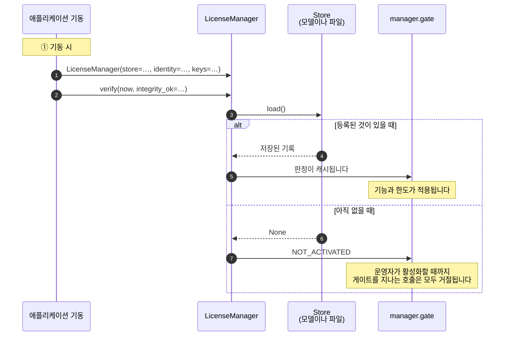
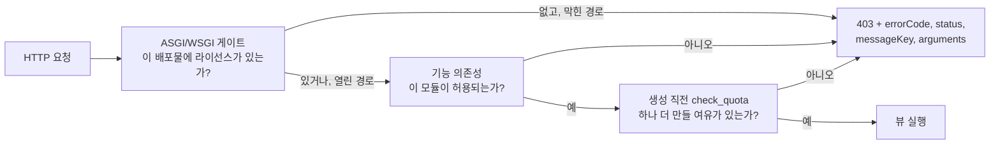

# Python

## 작업 개요

할 일은 세 가지입니다. 기동할 때 SDK를 조립하고, 운영자가 활성화할 화면을 만들고, 규칙을 적용해야 하는 코드 위치에 게이트를 둡니다.



## 가져다 쓰기

SDK는 Python 3.9 이상이 필요합니다.

```
pip install https://github.com/accesscore-dev/accesscore-license-sdk-dist/releases/download/v1.2.0/accesscore_license-1.2.0-py3-none-any.whl
```

네이티브 코어는 wheel 안에 플랫폼당 한 디렉터리로 담깁니다. 디렉터리는 `linux-x86_64`, `linux-x86_64-musl`, `linux-aarch64`, `darwin-x86_64`, `darwin-aarch64`, `windows-x86_64`입니다. Linux에서는 musl 로더가 있으면 musl 코어를 읽습니다. `ACLIC_NATIVE_LIBC=musl` 또는 `glibc`로 직접 지정할 수도 있습니다. 공유 라이브러리를 어디서 가져올지 자체 정책으로 고정한 배포물은 `ACLIC_NATIVE_LIBRARY`로 파일을 지정하면 됩니다. 이 값은 읽어 들일 파일만 가리킬 뿐 신뢰할 키를 가리키지 않습니다.

프레임워크 추가 설치(`fastapi`, `django`, `flask`)는 제품이 쓰는 프레임워크만 설치합니다. wheel은 PyPI에 없으므로 추가 설치 이름과 wheel 주소를 함께 적으세요.

```
pip install "accesscore-license[fastapi] @ https://github.com/accesscore-dev/accesscore-license-sdk-dist/releases/download/v1.2.0/accesscore_license-1.2.0-py3-none-any.whl"
```

## 제품이 구현할 클래스

`accesscore_license.host`의 추상 클래스를 구현합니다. 검증 키와 함께 앞의 둘만 필수입니다.

| 클래스 | 답하는 것 |
| --- | --- |
| `Store` | 등록 기록 읽기와 쓰기 |
| `ProductIdentity` | 이 배포가 어떤 제품이고 어떤 릴리스인지 |
| `FeatureCatalogue` | 이 배포가 게이트하는 기능 키 |
| `QuotaCounter` | 한도 코드별 현재 수량 |
| `FeatureActivationChecker` | 운영자가 그 기능을 켰는지 |
| `AuditRecorder` | 라이선스 이벤트 기록 위치 |
| `ActivationServerDirectory` | 활성화 서버 주소 |

`FeatureActivationChecker`는 매니저가 아니라 게이트에 넘깁니다. `LicenseManager(..., gate=Gate(activation_checker=checker.is_effectively_active))`처럼 씁니다. `ActivationServerDirectory`는 `directory=`로 넘기며, 넘기면 `server_url()`이 `configured_server_url`보다 이 클래스가 돌려주는 주소를 먼저 씁니다.

## 조립

```python
from datetime import datetime, timezone
from accesscore_license import LicenseManager

manager = LicenseManager(
    store=store,
    identity=identity,
    keys=[{"kid": "acps-2026-01", "publicKey": PUBLIC_KEY_PEM}],
    catalogue=catalogue,
    counters=[user_counter, hardware_counter],
    audit=audit_recorder,
    configured_server_url=settings.LICENSE_SERVER_URL,
    instance_id=settings.INSTANCE_ID,
)

manager.verify(datetime.now(timezone.utc), integrity_ok=check_integrity())
```

`verify`는 현재 시각과 무결성 검사 결과를 호출한 쪽에서 받습니다. 코어는 시계를 읽지 않고, 무엇을 해시해 무결성을 볼지는 언어마다 다르기 때문입니다.

## 직접 만든 엔드포인트에서 활성화하기

요청을 만들고 응답을 해석하는 일은 SDK가 합니다. HTTP 호출은 애플리케이션이 직접 하고, 타임아웃도 프록시도 애플리케이션이 정합니다.

```python
from datetime import datetime, timezone

import httpx
from fastapi.responses import JSONResponse

@api.post("/license/activate")
async def activate(form: ActivationForm):
    now = datetime.now(timezone.utc)
    prepared = manager.activation_request(form.product_key, now)

    try:
        async with httpx.AsyncClient(timeout=20.0) as client:
            response = await client.post(
                manager.server_url() + prepared["path"],
                content=prepared["body"],
                headers=prepared["headers"],
            )
        outcome = manager.interpret(   # 여기서 논스를 확인한다
            "ACTIVATE", response.status_code, response.text, prepared["nonce"]
        )
    except httpx.TransportError:
        outcome = manager.interpret("ACTIVATE", 0, "", prepared["nonce"], reachable=False)

    if not outcome["success"]:
        return JSONResponse(
            status_code=400,
            content={"error": outcome["error"], "messageKey": outcome["messageKey"]},
        )

    result = outcome["result"]
    manager.apply(
        {
            "licenseToken": result["licenseToken"],
            "activationId": result["activationId"],
            "activationSecret": result["activationSecret"],
            "instanceId": settings.INSTANCE_ID,
        },
        now,
        integrity_ok=check_integrity(),
    )
    return manager.gate.state()
```

`activation_request`는 `method`, `path`, `body`, `headers`, `nonce`를 돌려줍니다. `body`는 이미 JSON 문자열이고 서명이 그 바이트를 덮으므로 그대로 보내세요.

`interpret`는 거절을 예외로 던지지 않고 `success: False`와 함께 `error`, `messageKey`를 돌려줍니다. 논스가 요청과 다르면 `NONCE_MISMATCH`, 머신 핑거프린트가 이 호스트와 맞지 않으면 `FINGERPRINT_MISMATCH`, 서명이 검증되지 않으면 `INVALID_SIGNATURE`입니다. 그래서 다른 배포물에서 가로챈 응답을 여기에 쓸 수 없습니다. 서버가 보내는 거절과 `PENDING_APPROVAL`은 [concepts.md](concepts.md#활성화-한-단계씩)에 정리돼 있습니다. `apply`는 기록을 `Store`로 저장하고 판정합니다.

## 게이트 적용하기

```python
from fastapi import Depends, FastAPI
from accesscore_license.adapters import (
    asgi_license_gate, fastapi_license_dependency, fastapi_register_exception_handler,
)

api = FastAPI()

# 어디서 난 거절이든 공통 문서로 나가게.
fastapi_register_exception_handler(api)

# 기능 하나.
@api.get("/attendance", dependencies=[Depends(
    fastapi_license_dependency(manager.gate, "ATTENDANCE"))])
async def list_attendance(): ...

# 한도 하나, 추가 직전에.
@api.post("/users")
async def create_user(form: UserForm):
    manager.check_quota("USERS")
    ...

# 라이선스가 없는 동안 모든 요청을 막는다. 결과가 순수 ASGI 앱이므로 마지막에 감싼다.
app = asgi_license_gate(api, manager.gate, open_prefixes=["/license", "/activations"])
```

Django는 `django_license_middleware(gate, open_prefixes)`를 씁니다. 이 함수는 미들웨어 팩토리를 돌려주므로 모듈 수준 이름에 담고 그 이름을 `MIDDLEWARE`에 적으세요.

```python
# myproduct/license.py
license_middleware = django_license_middleware(manager.gate, ["/license"])

# settings.py
MIDDLEWARE = [..., "myproduct.license.license_middleware"]
```

Flask는 `flask_register(app, gate, open_prefixes)`를 씁니다. 이 함수는 뷰에서 던진 `LicenseDenied`도 공통 문서로 바꿉니다. WSGI 전반은 `wsgi_license_gate`를 씁니다.

라이선스가 없는 동안 어느 경로를 열어 둘지는 제품이 정합니다. 배포물이 자기 라이선스 화면에 접근할 수 있어야 라이선스를 등록할 수 있습니다.

각 호출의 위치는 다음과 같습니다.



## 거절을 응답으로 바꾸기

`LicenseDenied`에는 `status`, `error_code`, `message_key`, `arguments`, `http_status`가 담깁니다. `body()`는 어느 어댑터에서나 같은 문서를 만들며, 이 문서에는 번역하지 않은 `errorCode`, `status`, `messageKey`, `arguments`가 들어 있습니다. 자체 응답 형태를 쓰는 제품은 `fastapi_register_exception_handler` 대신 자체 핸들러를 등록하고 키를 직접 번역하면 됩니다.

```python
from fastapi.responses import JSONResponse
from accesscore_license import LicenseDenied

@api.exception_handler(LicenseDenied)
async def handle(request, denied: LicenseDenied):
    message = translate(request, denied.message_key, denied.arguments)   # 제품의 번역 함수
    return JSONResponse(
        status_code=denied.http_status,
        content={"code": denied.error_code, "message": message},
    )
```

`asgi_license_gate`, `wsgi_license_gate`, `django_license_middleware`, `flask_register`가 막은 요청은 이 핸들러를 거치지 않고 `body()`가 만든 본문을 그대로 받습니다. 이 본문에는 메시지 키와 인자만 들어 있습니다. 막은 요청에도 번역된 문장을 담으려면 FastAPI에서는 `fastapi_license_dependency`를 쓰세요. 이 의존성은 `LicenseDenied`를 던지므로 위 핸들러가 응답을 만듭니다. 다른 프레임워크에서는 `gate.require_usable()`을 호출하는 미들웨어를 직접 두고 같은 방식으로 응답을 만드세요.

메시지 키와 인자 순서는 [messages.md](messages.md)에 있습니다.

## 최신 상태 유지하기

판정은 `verify`를 호출할 때 넘긴 시각으로 내리고, 게이트는 마지막 판정을 그대로 돌려줍니다. 종료일, 유예 기간, 하트비트 기한이 지나도 다음 판정 전까지 게이트는 이전 판정으로 요청을 통과시킵니다. 그래서 주기 작업을 둘로 나눕니다.

재판정은 모든 라이선스에 둡니다. `verify(now)`를 주기적으로 호출해 지난 시간을 게이트에 반영합니다. 하트비트가 필요 없는 라이선스에도 두고, 하트비트가 계속 실패하는 동안에도 실행합니다.

하트비트는 `heartbeatRequired`가 켜진 라이선스에만 둡니다. 요청을 만들고 응답을 읽는 일은 SDK가 하고, 주기와 전송 방법은 애플리케이션이 정합니다.

```python
# 재판정: 모든 라이선스. 지난 시간을 게이트에 반영한다.
def reverify_license() -> None:
    manager.verify(datetime.now(timezone.utc), integrity_ok=check_integrity())


# 하트비트: 하트비트를 요구하는 라이선스만.
def send_heartbeat() -> None:
    payload = manager.gate.state().get("payload") or {}
    if not payload.get("heartbeatRequired"):
        return

    now = datetime.now(timezone.utc)
    prepared = manager.heartbeat_request(now)
    try:
        response = httpx.post(
            manager.server_url() + prepared["path"],
            content=prepared["body"],
            headers=prepared["headers"],   # X-Activation-Signature가 여기 들어 있다
            timeout=20.0,
        )
    except httpx.TransportError:
        return   # 하트비트 허용 시간이 지나기 전까지 라이선스는 유효하다

    outcome = manager.interpret(
        "HEARTBEAT", response.status_code, response.text, prepared["nonce"]
    )
    if outcome["success"]:
        record = dict(store.load() or {})
        record["licenseToken"] = outcome["result"]["licenseToken"]
        record["lastHeartbeatAt"] = now.isoformat().replace("+00:00", "Z")
        manager.apply(record, now, integrity_ok=check_integrity())
    elif outcome["error"] == "REVOKED":
        manager.mark_revoked(now, integrity_ok=check_integrity())
```

하트비트 응답에는 새 토큰만 있고 활성화 비밀값은 없습니다. 저장된 기록을 유지한 채 `licenseToken`만 바꾸세요. SDK는 하트비트에 성공한 시각을 직접 기록하지 않습니다. 저장하는 기록에 `lastHeartbeatAt`을 넣어야 하며, 기한은 이 시각부터 계산합니다. 첫 하트비트 전에는 `activatedAt`부터 계산합니다.

하트비트가 한 번 실패했다고 곧바로 대응할 필요는 없습니다. 하트비트 허용 시간이 지나기 전까지 라이선스는 계속 유효합니다. 허용 시간은 `heartbeatToleranceHours`와 `heartbeatIntervalHours` 가운데 긴 쪽이며, 토큰의 값이 0이면 각각 24시간과 1시간으로 계산합니다. 기록만 남기고 다음 실행에 맡기면 됩니다. 허용 시간이 지나면 재판정이 판정을 `HEARTBEAT_OVERDUE`로 바꿉니다.

재판정 주기는 기한이 지난 뒤 게이트가 거절로 바뀌기까지 허용할 최대 시간입니다. 30분 주기라면 종료일이나 하트비트 기한이 지난 뒤 최대 30분 동안 이전 판정이 유지됩니다.

## 유출된 서명 키 다루기

발급자가 서명 키를 유출로 표시하면, 고객 제품에 넣는 검증 키 목록에서 그 키에 유출 표시(`compromised: true`)가 붙습니다. 그 키를 목록에서 빼면 유출 전에 정상으로 발급된 라이선스까지 `INVALID_SIGNATURE`로 거절됩니다. 키는 그대로 등록해 두고, 그 키로 서명된 토큰이 이미 보유한 범위보다 더 많이 요구할 때만 `SIGNING_KEY_COMPROMISED`로 거절하세요.

판정은 이 비교를 하지 않습니다. 비교 기준이 애플리케이션이 보관하는 기록이기 때문입니다. 그래서 `KeyMaterial`에는 유출 표시를 넣지 않고, 유출된 키의 `kid` 목록은 애플리케이션이 따로 보관합니다. 절차는 다음과 같습니다.

1. 유출 표시가 붙은 키를 처음 등록한 뒤 첫 판정에서 그 시점에 보유한 범위를 저장합니다. 판정이 사용 가능이면 기능 목록, 한도, 만료 시각, 릴리스 상한을 저장하고, 사용 가능이 아니면 보유한 범위가 없다고 저장합니다. 이 기록은 한 번만 저장하고 이후에 바꾸지 않습니다.
2. `verify`, `apply`, `mark_revoked`가 판정을 돌려줄 때마다 페이로드의 `kid`가 유출된 키인지 확인합니다.
3. 유출된 키로 서명된 토큰이 저장한 범위를 넘으면 `SIGNING_KEY_COMPROMISED` 판정을 만들어 게이트에 넘깁니다.

토큰이 저장한 범위를 넘는 경우는 넷입니다. 저장하지 않은 기능이 있는 경우, 저장할 때 상한이 있던 한도가 더 크거나 빠진 경우(빠진 한도는 무제한입니다), 저장한 만료 시각보다 늦거나 만료 시각이 없는 경우, 저장한 릴리스 상한보다 높거나 상한이 없는 경우입니다. 보유한 범위가 없다고 저장했다면 그 키로 서명된 토큰은 모두 거절합니다. 릴리스 상한은 `ReleaseVersions().is_within_ceiling`으로 비교하세요. 문자열로 비교하면 `3.10`이 `3.9`보다 낮게 나옵니다.

```python
judged = manager.verify(now, integrity_ok=check_integrity())
payload = judged.get("payload")
if payload and payload["kid"] in compromised_key_ids and not ceiling.covers(payload):
    # 1번에서 저장한 범위를 넘었다
    manager.gate.refresh({
        "status": "SIGNING_KEY_COMPROMISED",
        "usable": False,
        "errorCode": "LICENSE_SIGNING_KEY_COMPROMISED",
        "denial": {"messageKey": "error.license.signingKeyCompromised", "arguments": []},
        "nextWatermark": judged.get("nextWatermark"),
        "availableFeatures": [],
        "limits": {},
        "graceExpiresAt": judged.get("graceExpiresAt"),
        "heartbeatDeadline": judged.get("heartbeatDeadline"),
        "payload": payload,
    })
```

이 상태를 쓰는 애플리케이션은 `error.license.signingKeyCompromised`를 번역해 두어야 합니다. 키 목록은 [messages.md](messages.md)에 있습니다.

## 등록 기록과 그 밖의 호출

`Store`는 배포물마다 dict 하나를 보관합니다. 매니저가 읽고 쓰는 키는 다음과 같습니다.

| 키 | 담는 값 | 쓰는 쪽 |
| --- | --- | --- |
| `licenseToken` | 서명된 토큰 | 활성화·하트비트 코드(`apply`) |
| `activationId`, `activationSecret` | 하트비트와 해제 요청에 서명하는 자격 증명 | 활성화 코드 |
| `instanceId` | 이 배포물의 인스턴스 식별자 | 활성화 코드 |
| `lastHeartbeatAt` | 마지막으로 성공한 하트비트 시각 | 하트비트 코드 |
| `verificationWatermark` | 판정이 받아들인 가장 늦은 시각 | 매니저(판정할 때마다) |
| `revokedAt` | 폐기 시각 | `mark_revoked` |

수명 주기를 마무리하는 호출이 세 가지 더 있습니다. `deactivation_request(now)`는 좌석을 반납하는 요청을 만들고, 그 응답은 `interpret("DEACTIVATE", …)`로 읽습니다. `mark_revoked(now)`는 폐기 시각을 저장하고 다시 판정합니다. `clear_registration(now)`는 기록을 지우고 배포물을 `NOT_ACTIVATED` 상태로 되돌립니다.

## 발급

```python
from pathlib import Path
from accesscore_license import LicenseIssuer

private_key_pem = Path("signing-key.pem").read_bytes()

issuer = LicenseIssuer()
print("License signing key fingerprint:", issuer.fingerprint_of(private_key_pem))
signed = issuer.sign(payload, private_key_pem)
```

개인키는 PKCS#8 형식(PEM 또는 DER)의 `bytes`로 넘깁니다. `str`은 거절합니다. 개인키는 발급하는 쪽만 보관합니다. 코어는 서명을 만든 직후 그 값을 메모리에서 지웁니다.

## 제품 키와 릴리스 버전

```python
from accesscore_license import ProductKeys, ReleaseVersions

keys = ProductKeys()
key = keys.generate("ACPS")
shown = keys.masked("ACPS", key)

releases = ReleaseVersions()
entitled = releases.is_within_ceiling("3.2.0", "3.2")
```

## 출시 전 점검

- [ ] 검증 키는 설정으로 바꿀 수 있는 경로가 아니라 애플리케이션과 함께 패키징됩니다.
- [ ] 라이선스가 없는 동안 열어 두는 경로로는 라이선스 화면에만 접근할 수 있습니다.
- [ ] [messages.md](messages.md)의 모든 메시지 키가 출시하는 모든 로케일에 번역돼 있습니다.
- [ ] 컨테이너가 호스트 머신 식별자를 읽기 전용으로 마운트합니다. 그렇지 않으면 활성화가 `FINGERPRINT_MISMATCH`로 실패하고, 저장된 라이선스는 `FINGERPRINT_UNAVAILABLE`로 판정됩니다.
- [ ] 하트비트 주기가 `heartbeatIntervalHours`(토큰의 값이 0이면 1시간)보다 길지 않습니다. 몇 번 실패해도 허용 시간 안에 다시 시도할 수 있습니다.
