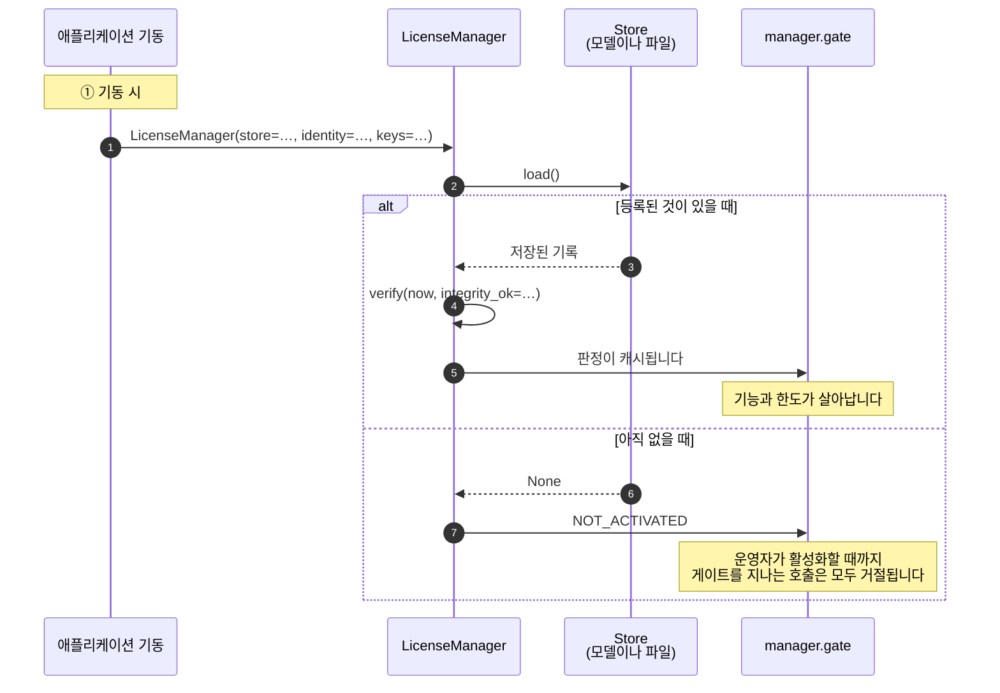
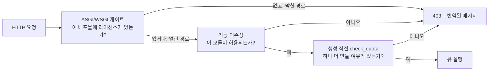

# Python

## 무엇을 만들게 되는가

할 일은 세 가지입니다. 기동할 때 SDK를 조립하고, 운영자가 활성화할 화면을 만들고, 규칙이 성립해야 하는 자리에 게이트를 놓습니다.



## 가져다 쓰기

```
pip install https://github.com/accesscore-dev/accesscore-license-sdk-dist/releases/download/v1.0.6/accesscore_license-1.0.6-py3-none-any.whl
```

네이티브 코어는 wheel 안에 플랫폼당 한 디렉터리로 담깁니다. 공유 라이브러리를 어디서 가져올지 자체 정책으로 고정한 배포물은 `ACLIC_NATIVE_LIBRARY`로 파일을 지정하면 됩니다. 이 값은 읽어 들일 파일만 가리킬 뿐 신뢰할 키를 가리키지 않습니다.

프레임워크 추가 설치는 쓰는 것만 가져옵니다. `accesscore-license[fastapi]`, `[django]`, `[flask]`.

## 제품이 제공해야 하는 것

`accesscore_license.host`의 추상 클래스를 구현합니다. 검증 키와 함께 앞의 둘만 필수입니다.

| 클래스 | 답하는 것 |
| --- | --- |
| `Store` | 등록 기록 읽기와 쓰기 |
| `ProductIdentity` | 이 배포가 어떤 제품이고 어떤 릴리스인지 |
| `FeatureCatalogue` | 이 배포가 게이트하는 기능 키 |
| `QuotaCounter` | 한도 코드별 현재 수량 |
| `FeatureActivationChecker` | 운영자가 그 기능을 켰는지 |
| `AuditRecorder` | 라이선스 이벤트 기록 위치 |
| `ActivationServerDirectory` | 활성화 서버 주소 |

## 조립

```python
from datetime import datetime, timezone
from accesscore_license import LicenseManager

manager = LicenseManager(
    store=store,
    identity=identity,
    keys=[{"kid": "acps-2026-01", "publicKey": PUBLIC_KEY_PEM}],
    catalogue=catalogue,
    counters=[user_counter, hardware_counter],
    audit=audit_recorder,
    configured_server_url=settings.LICENSE_SERVER_URL,
    instance_id=settings.INSTANCE_ID,
)

manager.verify(datetime.now(timezone.utc), integrity_ok=check_integrity())
```

`verify`는 현재 시각과 무결성 검사 결과를 호출한 쪽에서 받습니다. 코어는 시계를 읽지 않고, 무엇을 해시해 무결성을 볼지는 언어마다 다르기 때문입니다.

## 직접 만든 엔드포인트에서 활성화하기

본문을 만들고 응답을 해석하는 일은 SDK가 합니다. HTTP 호출은 애플리케이션이 직접 하고, 타임아웃도 프록시도 애플리케이션이 정합니다.

```python
@app.post("/license/activate")
async def activate(form: ActivationForm):
    request = manager.activation_request(form.product_key)

    async with httpx.AsyncClient(timeout=20.0) as client:
        response = await client.post(
            f"{manager.activation_server_url()}/api/activations", json=request.body
        )
        response.raise_for_status()
        answer = response.json()

    record = manager.activation_response(answer, request)   # 여기서 논스를 확인한다
    manager.store_record(record)
    manager.verify(datetime.now(timezone.utc), integrity_ok=check_integrity())

    return manager.gate.state()
```

`activation_response`는 논스가 요청과 다르거나, 머신 핑거프린트가 이 호스트와 맞지 않거나, 페이로드가 검증되지 않는 응답을 거절합니다. 다른 배포물에서 가로챈 응답을 여기에 쓸 수 없습니다.

## 게이트 적용하기

```python
from accesscore_license.adapters import (
    asgi_license_gate, fastapi_license_dependency, fastapi_register_exception_handler,
)

# 라이선스가 없는 동안 모든 요청을 막는다.
app = asgi_license_gate(app, manager.gate, open_prefixes=["/license", "/activations"])

# 기능 하나.
@router.get("/attendance", dependencies=[Depends(
    fastapi_license_dependency(manager.gate, "ATTENDANCE"))])
async def list_attendance(): ...

# 한도 하나, 추가 직전에.
manager.check_quota("USERS")

# 어디서 난 거절이든 공통 문서로 나가게.
fastapi_register_exception_handler(app)
```

Django는 `django_license_middleware(gate, open_prefixes)`, Flask는 `flask_register(app, gate, open_prefixes)`, WSGI 전반은 `wsgi_license_gate`를 씁니다.

라이선스가 없는 동안 어느 경로를 열어 둘지는 제품이 정합니다. 배포물은 자기 라이선스 화면에 닿아야 비로소 라이선스를 등록할 수 있습니다.

각 호출이 놓이는 자리는 이렇습니다.



## 거절을 응답으로 바꾸기

`LicenseDenied`에는 `status`, `error_code`, `message_key`, `arguments`, `http_status`가 담기고, `body()`가 어느 어댑터에서나 같은 형태의 문서를 만듭니다. 자체 응답 형태를 쓰는 제품은 키를 직접 번역하면 됩니다.

```python
from django.utils.translation import gettext

@app.exception_handler(LicenseDenied)
async def handle(request, denied):
    message = gettext(denied.message_key) % tuple(denied.arguments)
    return JSONResponse(
        status_code=denied.http_status,
        content={"code": denied.error_code, "message": message},
    )
```

메시지 키와 인자 순서는 [messages.md](messages.md)에 있습니다.

## 최신 상태 유지하기

하트비트를 요구하는 라이선스는 주기적으로 갱신해야 합니다. 본문을 만들고 응답을 읽는 일은 SDK가 하고, 주기와 전송 방법은 애플리케이션이 정합니다.

```python
def refresh_license() -> None:
    if not manager.gate.state().heartbeat_required:
        return

    request = manager.heartbeat_request()
    response = httpx.post(
        f"{manager.activation_server_url()}/api/heartbeats",
        json=request.body,
        headers={"X-Activation-Signature": request.signature},
        timeout=20.0,
    )
    response.raise_for_status()

    manager.store_record(manager.heartbeat_response(response.json()))
    manager.verify(datetime.now(timezone.utc), integrity_ok=check_integrity())
```

하트비트가 한 번 실패했다고 곧바로 대응할 필요는 없습니다. `heartbeatToleranceDays`가 지나기 전까지 라이선스는 계속 유효합니다. 기록만 남기고 다음 실행에 맡기면 됩니다.

## 발급

```python
from accesscore_license import LicenseIssuer

issuer = LicenseIssuer()
print("License signing key fingerprint:", issuer.fingerprint_of(private_key_pem))
signed = issuer.sign(payload, private_key_pem)
```

개인키는 발급하는 쪽만 갖습니다. 코어는 서명을 만든 직후 그 값을 메모리에서 지웁니다.

## 제품 키와 릴리스 버전

```python
from accesscore_license import ProductKeys, ReleaseVersions

keys = ProductKeys()
key = keys.generate("ACPS")
shown = keys.masked("ACPS", key)

releases = ReleaseVersions()
entitled = releases.is_within_ceiling("3.2.0", "3.2")
```

## 출시 전 점검

- [ ] 검증 키는 설정으로 바꿀 수 있는 경로가 아니라 애플리케이션과 함께 패키징됩니다.
- [ ] 라이선스가 없는 동안 열어두는 경로가 라이선스 화면까지만 닿습니다.
- [ ] [messages.md](messages.md)의 모든 메시지 키가 출시하는 모든 로케일에 번역돼 있습니다.
- [ ] 컨테이너가 호스트 머신 식별자를 읽기 전용으로 마운트합니다. 그렇지 않으면 활성화가 `FINGERPRINT_UNAVAILABLE`로 실패합니다.
- [ ] 하트비트 주기가 `heartbeatIntervalDays`보다 짧습니다. 한 번 걸러도 곧바로 기한을 넘기지 않습니다.
